# APTISPREP — Tài liệu nghiệp vụ và ERD hiện trạng

Cập nhật V039: xác thực phiên nghe 90% phía server, mở rộng CHECK đáp án Lesson A–F và hành trình dừng C1. Hai ERD bên dưới phản ánh schema V039: 39 bảng, 414 cột, 62 quan hệ FK. V039 không thêm bảng hoặc FK; lesson_engagement thêm 10 cột playback/verification. Chi tiết tại [LESSON_WORK_AND_MEDIA.md](LESSON_WORK_AND_MEDIA.md). Goal mới đến C1 vẫn cần Thông cập nhật phần tài khoản; dữ liệu C2 cũ được giữ.

Phiên bản tài liệu: 1.1 — ngày 23/10/2026. Phạm vi: schema trong source đến migration V039.

Đây là bản viết lại để đọc nghiệp vụ và mô hình dữ liệu hiện tại ở một nơi. Tài liệu gốc [SPEC_V2.md](SPEC_V2.md) vẫn được giữ làm baseline; tài liệu này không tự thay đổi yêu cầu V2 hoặc cam kết mọi chức năng đã nghiệm thu thực tế.

Nguồn đối chiếu: SPEC_V2, [PROJECT_DECISIONS.md](../PROJECT_DECISIONS.md), migration V001–V039, entity và các service AccountAccess/AccountProfile, LearningPath/LessonTeaching/FlashcardSet, Catalog, ExamAttempt, ScoringPolicy/ScoringAdmin, AiAssessment/AttemptFinalization. ERD dưới đây phản ánh schema được khai báo trong source, không khẳng định database ứng dụng trên máy đã nâng V039.

## Mục lục

1. [Mục tiêu và phạm vi](#1-mục-tiêu-và-phạm-vi)
2. [Vai trò và thuật ngữ](#2-vai-trò-và-thuật-ngữ)
3. [Danh sách nghiệp vụ](#3-danh-sách-nghiệp-vụ)
4. [Luồng nghiệp vụ chi tiết](#4-luồng-nghiệp-vụ-chi-tiết)
5. [Quy tắc nghiệp vụ](#5-quy-tắc-nghiệp-vụ)
6. [Nguồn dữ liệu và ranh giới AI](#6-nguồn-dữ-liệu-và-ranh-giới-ai)
7. [Phân nhóm dữ liệu và khác biệt V2](#7-phân-nhóm-dữ-liệu-và-khác-biệt-v2)
8. [ERD không thuộc tính](#8-erd-không-thuộc-tính)
9. [ERD có thuộc tính](#9-erd-có-thuộc-tính)
10. [Khóa, ràng buộc và tham chiếu ứng dụng](#10-khóa-ràng-buộc-và-tham-chiếu-ứng-dụng)
11. [Giới hạn và nghiệm thu](#11-giới-hạn-và-nghiệm-thu)

## 1. Mục tiêu và phạm vi

APTISPREP hỗ trợ người học luyện tiếng Anh theo từng kỹ năng, thiết lập mục tiêu, đánh giá đầu vào, học theo chặng, ôn từ vựng và làm các bài đánh giá. Hệ thống lưu tiến độ thật, bài làm, kết quả và bằng chứng cập nhật trình độ.

Trục nghiệp vụ: tài khoản → Goal/Placement tùy chọn → Skill Profile → Learning Path → Lesson/Flashcard/Practice → Checkpoint → cập nhật Profile/chặng tiếp theo. Full Mock là luồng đánh giá tổng hợp, không thay thế Checkpoint.

### 1.1 Phần V2 gốc

Tài khoản và phân quyền; mục tiêu theo kỹ năng; Placement; hồ sơ kỹ năng; lộ trình; Lesson; Flashcard; Practice; Checkpoint; Full Mock; nộp/chấm/xem kết quả; quản trị chứng chỉ, bộ chấm, band CEFR, câu hỏi, media, đề, bài học và thẻ.

### 1.2 Phần mở rộng đang được giữ

- Bộ Flashcard và bộ cá nhân: đã được bổ sung vào bản SPEC_V2 hiện có trong repository.
- Quản lý học viên, khóa/mở khóa tài khoản.
- Knowledge check, bài nộp và lịch sử nội dung Lesson; chính sách mở transcript/bài mẫu.
- Chấm AI tùy chọn; job/result/retry và phân biệt nguồn Lesson/Exam.
- Section theo kỹ năng, giới hạn nghe, snapshot bài thi, outbox phục hồi xử lý.
- Quy tắc raw→scale cấu hình theo scheme/skill; lịch ôn SRS và chống tính trùng lượt ôn.

Các phần trên có lý do nghiệp vụ/kỹ thuật, nhưng không phải tất cả đều nằm trong ERD V2 đầu tiên. Không coi số bảng tăng là bằng chứng mọi bảng đều dư.

### 1.3 Ngoài phạm vi hiện tại

Không cấp chứng chỉ chính thức; không khẳng định điểm/CEFR tương đương Aptis chính thức; không có nghiệp vụ giáo viên chấm tay hoàn chỉnh được đặc tả tại đây; không triển khai thanh toán. Speaking qua transcript không được quảng bá là đánh giá chính xác phát âm/ngữ điệu.

## 2. Vai trò và thuật ngữ

| Vai trò | Trách nhiệm |
|---|---|
| Student | Quản lý hồ sơ/mục tiêu; học; ôn thẻ; làm và xem các bài thi của mình |
| Admin | Quản lý nội dung/chấm điểm; xem kết quả và tiến độ; khóa/mở khóa học viên |
| System | Kiểm quyền, lưu/khóa bài, chấm, tổng hợp, cập nhật Profile/Path theo điều kiện |
| Dịch vụ AI ngoài hệ thống | Nhận nội dung được backend gửi để hỗ trợ nhận xét/chấm; không quyết định trực tiếp quyền hay CEFR trong Profile |

| Thuật ngữ | Ý nghĩa |
|---|---|
| Skill | GRAMMAR_VOCABULARY, READING, LISTENING, WRITING, SPEAKING |
| CEFR | A1, A2, B1, B2, C1, C2; thiếu bằng chứng thì chưa xác định, không tự gán |
| Goal | Mục tiêu do người học chọn; khác với level của chặng đang học |
| Skill Profile | Trình độ hiện tại có căn cứ Placement/Checkpoint theo từng skill |
| Learning Path | Một chặng được cá nhân hóa, gồm bài học và điều kiện Checkpoint |
| Scheme/version | Phiên bản cấu hình quy đổi điểm và band, gắn chứng chỉ |
| Raw / scale | Điểm nguồn / điểm quy đổi nội bộ; không đồng nghĩa phần trăm đúng |
| Snapshot | Bản nội dung/policy/ngữ cảnh được giữ cho lượt làm hoặc bài nộp |
| Idempotency | Gửi lại cùng thao tác không tạo lượt thi, lượt ôn hoặc cập nhật Profile trùng |
| AI Lesson / AI Exam | Hai nguồn nghiệp vụ khác nhau cùng dùng dịch vụ AI |

## 3. Danh sách nghiệp vụ

### 3.1 Student — giữ mã V2

| Mã | Nghiệp vụ | Đầu vào, điều kiện và kết quả chính |
|---|---|---|
| S01 | Đăng ký | Thông tin hợp lệ, email chưa tồn tại; tạo tài khoản Student |
| S02 | Đăng nhập | Đúng thông tin và trạng thái cho phép; thiết lập phiên theo role |
| S03 | Đăng xuất | Kết thúc phiên, không xóa lịch sử/tiến độ |
| S04 | Quản lý Goal | Có thể bỏ qua; khi lưu chọn ít nhất một skill/CEFR; score/ngày/chứng chỉ tùy chọn |
| S05 | Placement | Đề công bố; tạo/resume lượt theo skill; kết quả hợp lệ cập nhật Profile |
| S06 | Xem Profile | Chỉ hiển thị mức đã có căn cứ; skill chưa đánh giá giữ chưa xác định |
| S07 | Xem Learning Path | Tạo/đồng bộ từ Goal và Profile; thiếu dữ liệu vẫn có định hướng khi có nội dung |
| S08 | Học Lesson | Nội dung công bố; lưu mở bài, bài làm/kiểm tra và hoàn thành khi đủ điều kiện |
| S09 | Ôn Flashcard | Bộ công khai hợp lệ hoặc bộ thuộc mình; lưu lượt ôn, trạng thái và lịch ôn |
| S10 | Practice | Làm/nộp/xem kết quả luyện tập; không nâng Profile |
| S11 | Checkpoint | Từ chặng hiện tại, đủ bài bắt buộc và có policy CEFR; đạt mới xác nhận level |
| S12 | Full Mock | Đề mới có đủ 5 skill; tổng hợp kết quả, không tự nâng Profile |
| S13 | Nộp bài thi | Khóa đáp án theo phiên bản; chấm khách quan/AI, giữ bài nếu chấm lỗi |
| S14 | Xem kết quả/lịch sử | Đúng chủ sở hữu; xem raw/scale/CEFR, trạng thái chấm và retry được phép |

Bộ Flashcard cá nhân và yêu cầu AI cho bài Lesson là mở rộng của S09/S08; không tạo thêm một Exam Attempt giả.

### 3.2 Admin

| Mã | Nghiệp vụ | Quy tắc chính |
|---|---|---|
| A01–A02 | Đăng nhập/đăng xuất | Chung cơ chế tài khoản; chỉ Admin vào khu quản trị |
| A03 | Chứng chỉ | Quản lý mã/tên/trạng thái; mã không trùng; ưu tiên vô hiệu hóa thay xóa lịch sử |
| A04 | Scoring Scheme | Quản lý theo chứng chỉ/version; thay cấu hình đã dùng qua version mới |
| A05 | Score Band và raw→scale | Cấu hình riêng từng skill; khoảng hợp lệ, không chồng lấn, band nằm trong scale |
| A06 | Ngân hàng câu hỏi | Kiểm skill/type/item/option/thứ tự; chỉ câu đã công bố được đưa vào đề |
| A07 | Media câu hỏi | Lưu metadata và file hợp lệ; bảo vệ file đang được snapshot/lịch sử tham chiếu |
| A08 | Đề thi | Chọn câu, thứ tự, loại, thời gian, chứng chỉ và scheme/section phù hợp; kiểm trước công bố |
| A09 | Lesson | Quản lý nội dung, media, kiểm tra kiến thức và trạng thái công bố |
| A10 | Flashcard | Quản lý bộ/thẻ thư viện, liên kết Lesson; không ghi đè tiến độ học viên |
| A11–A14 — mở rộng | Quản lý học viên | Danh sách/tìm/lọc, chi tiết/tiến độ, khóa/mở khóa; không tạo/xóa học viên hay sửa điểm |

## 4. Luồng nghiệp vụ chi tiết

### 4.1 Đăng nhập, Goal và hành trình ban đầu

1. Student đăng ký/đăng nhập.
2. Student có thể thiết lập Goal cho một hoặc nhiều skill, hoặc bỏ qua.
3. Student có thể làm Placement hoặc học theo định hướng trước.
4. Hệ thống đọc Goal hiện hành và Profile từng skill, chọn level nội dung và đồng bộ chặng.
5. Không có Goal thì giao diện báo “Chưa đặt mục tiêu”, không hiển thị C2 như mục tiêu của người học.
6. Level nội dung khởi đầu như A1 không có nghĩa Student đã được xác nhận Profile A1. Target của chặng cũng không đồng nghĩa Goal cuối cùng.
7. Thay Goal tạo phiên bản Goal hiện hành mới, lưu Goal cũ dạng archived; đồng bộ lộ trình nhưng không xóa tiến độ học đã lưu.

### 4.2 Placement và cập nhật Profile

1. Chọn đề Placement đã công bố theo skill.
2. Nếu đã có lượt chưa kết thúc/chưa chấm xong của skill thì resume hoặc chờ/retry, không tạo lượt song song.
3. Làm, lưu và nộp qua Exam Engine chung.
4. Khi có scale/CEFR hợp lệ, hệ thống áp dụng kết quả cho đúng user/skill một lần.
5. Dùng Placement hợp lệ gần nhất theo thời gian nộp và ID khi đồng thời, không mặc định lấy điểm cao nhất.
6. Profile hiệu lực không thấp hơn level đã xác nhận qua Checkpoint; không reset tiến độ Lesson/Flashcard.
7. Placement chỉ có raw, chưa có CEFR hoặc lỗi chấm không được tạo Profile giả.

### 4.3 Lesson và điều kiện hoàn thành

1. Mở Lesson công bố; lưu trạng thái đang học và lần truy cập.
2. Học nội dung/media; hiển thị transcript/bài mẫu theo chính sách của bài.
3. Nếu có knowledge check, làm và lưu lịch sử; cần có ít nhất một lượt đạt 60%.
4. Với Writing, nộp bài viết đáp ứng yêu cầu; với Speaking, cần có bản ghi được nộp trong lịch sử.
5. Với Listening có audio, cần server xác nhận coverage ít nhất 90% bằng phiên/token, thứ tự heartbeat, thời gian server và thời lượng đọc từ file. Tua/gửi lại không cộng tiến độ; các đoạn nghe được hợp nhất không trùng nhau. Đây không phải bộ đếm hai lượt của bài thi, cũng không chứng minh người dùng chú ý/nghe bằng tai.
6. Khi đủ các điều kiện áp dụng, đánh dấu Lesson Progress và các Path Item liên quan hoàn thành nhất quán.
7. Học xong Lesson hoặc được AI nhận xét tốt không tự nâng CEFR trong Profile.

Ngưỡng knowledge check 60% là chính sách Lesson mở rộng của nhóm, không phải ngưỡng đỗ Checkpoint.

### 4.4 Flashcard

1. Student mở bộ được phép xem; bộ thư viện có thể gắn một Lesson, bộ cá nhân thuộc người tạo.
2. Xem hai mặt thẻ, chọn LEARNING hoặc MASTERED.
3. Mỗi action mới có reviewKey; lưu log lượt ôn và cập nhật progress trong một transaction.
4. Ôn lại cùng trạng thái bằng action mới vẫn tăng review_count. Gửi lại cùng key không tăng thêm; dùng lại key cho trạng thái khác bị từ chối.
5. Cập nhật mastery, last_reviewed_at và lịch ôn. Chính sách nội bộ hiện tại: LEARNING hẹn lại 10 phút; MASTERED bắt đầu 1 ngày, các lần sau tăng theo ease factor, tối đa 365 ngày.
6. SRS chỉ là hỗ trợ ôn tập, không xác nhận CEFR.

### 4.5 Practice, Checkpoint và Full Mock

| Loại | Nội dung | Ảnh hưởng Profile |
|---|---|---|
| PRACTICE | Một skill, luyện tập theo đề công bố; có thể chỉ chấm raw | Không cập nhật |
| CHECKPOINT | Một skill/target của chặng; cần hoàn thành bài bắt buộc và có scheme đủ cấu hình | Đạt mới xác nhận level; trượt giữ mức cũ |
| FULL_MOCK | Đề mới đủ cả 5 skill; có thể phân thời gian bằng section | Không cập nhật |
| PLACEMENT | Đánh giá đầu vào/làm lại theo skill | Cập nhật theo kết quả hợp lệ gần nhất, có checkpoint floor |

Checkpoint đạt khi đã chấm xong, CEFR ước lượng đạt target và điểm dương. Không có ngưỡng chung cố định 30/50; không xác nhận vượt level của đề Checkpoint. Áp dụng kết quả/chuyển chặng không được thực hiện hai lần từ cùng attempt.

### 4.6 Làm, lưu và nộp bài thi

1. Backend kiểm tài khoản, quyền với đề/lượt thi và request key.
2. Tạo attempt, snapshot nội dung/ngữ cảnh chấm và answer ban đầu. Chỉ nội dung đã công bố được dùng để bắt đầu lượt mới.
3. Trong thời gian làm, lưu các item/ghi âm đúng attempt thuộc Student; Listening bị kiểm giới hạn nghe phía backend.
4. Nộp hoặc xử lý hết giờ: khóa bài và phiên bản đáp án; lưu trước khi gọi AI.
5. Câu khách quan chấm từ snapshot; câu Writing/Speaking chuyển đến AI khi được cấu hình.
6. Chờ chấm/lỗi chấm không được thay bằng điểm 0 giả; bài làm và file vẫn được giữ để retry.
7. Đủ kết quả hợp lệ thì tổng hợp theo skill/toàn bài. Lượt hết giờ có thể giữ trạng thái EXPIRED dù phần chấm đã xong; cần đọc cả status và grading_status.
8. Chỉ Placement/Checkpoint đủ điều kiện mới đi vào luồng cập nhật Profile/Path.

### 4.7 Quản trị nội dung và policy

1. Admin tạo chứng chỉ, scheme/version, raw→scale và band theo skill.
2. Admin tạo câu hỏi đúng loại, item và đáp án; bổ sung media nếu cần; kiểm rồi công bố.
3. Admin tạo đề với loại, thời gian và danh sách câu không trùng; section và scheme áp dụng theo nhu cầu.
4. Trước dùng scheme, phải có raw-scale rule và band cho skill tương ứng.
5. Scheme đã được đề hoặc attempt sử dụng không được sửa nội dung/band/rule tại chỗ; tạo version mới, sao chép cấu hình rồi chỉnh phiên bản mới trước khi gán cho đề khác.
6. Vô hiệu hóa nội dung/policy không được làm biến mất dữ liệu chấm lịch sử. Bộ đọc lịch sử phải đọc được phiên bản cũ.
7. Admin xem tiến độ/kết quả học viên nhưng không sửa trực tiếp điểm của người học.

## 5. Quy tắc nghiệp vụ

### 5.1 Câu hỏi và bài làm

| Dạng | Skill | Cấu trúc và chấm |
|---|---|---|
| SINGLE_CHOICE | Grammar & Vocabulary, Reading, Listening | Item có option; chọn một đáp án; đúng/sai từ snapshot |
| MATCHING | Ba skill khách quan | Từ 2 item; option/đáp án theo item; tuân thủ cấu hình tái sử dụng option |
| ORDERING | Ba skill khách quan | Từ 2 item; correct_position là hoán vị duy nhất 1..N; không bắt tạo option dư |
| WRITING_TEXT | Writing | Nội dung văn bản, giới hạn từ nếu có; không chấm bằng is_correct |
| SPEAKING_AUDIO | Speaking | Bản ghi âm và transcript khi có; không chấm bằng is_correct |

SINGLE_CHOICE là loại nghiệp vụ đang dùng. QuestionType làm nguồn loại và quy tắc Java; chuỗi lưu DB giữ tên tương ứng. Không được xóa loại chỉ vì một số biên dữ liệu vẫn dùng chuỗi.

### 5.2 Quyền, dữ liệu và chấm điểm

- Mọi ghi/xem dữ liệu cá nhân phải kiểm đúng user ở backend; ID trên URL không đủ làm bằng chứng quyền.
- Tài khoản bị khóa phải bị chặn cả đăng nhập và yêu cầu tiếp theo của session đang hoạt động.
- Một câu không xuất hiện hai lần trong cùng đề; position duy nhất toàn đề. Nếu có section, section phải thuộc đúng đề.
- Đề một skill có thể không lưu section. Scheme có thể bỏ trống nếu chỉ cần raw; Checkpoint cần scheme để xác nhận CEFR.
- Bài có scheme dùng policy riêng theo skill/version; không có rule thì báo thiếu cấu hình, không tự dùng công thức mẫu.
- Kết quả chưa chấm giữ NULL. Điểm 0 chỉ dùng khi đó thực sự là kết quả chấm.
- Scale theo skill nằm trong 0–50. Band trong cùng scheme/skill không chồng lấn, kể cả chung biên.
- Tổng hợp hiện tại: final_scale_score là trung bình các skill đã đủ điều kiện; CEFR tổng hợp lấy mức thấp nhất trong các skill. Đây là quy tắc nội bộ, không phải tổng điểm 200 hoặc bảng Aptis chính thức; constraint DB cũ cho phép 0–200 rộng hơn khoảng mà phép trung bình tạo ra.
- Goal target_score tùy chọn trong 0–50, cần target CEFR của cùng skill; không dùng Goal để tự gán Profile.
- Listening trong Exam giới hạn tối đa 2 lượt cho mỗi media/attempt, kiểm và tăng đếm ở backend.
- Chỉ dùng số liệu DB thật cho dashboard/history. DB rỗng hiển thị rỗng; không fallback sang ID/điểm mẫu.
- Không sửa checksum migration cũ, reset DB, xóa file hoặc xóa lịch sử để vượt lỗi tích hợp.

## 6. Nguồn dữ liệu và ranh giới AI

### 6.1 Bài thi Writing/Speaking

| Dữ liệu | Nơi lưu và vai trò |
|---|---|
| Văn bản Writing cấp câu trả lời | user_answers.text_answer — bản tổng hợp dùng để khóa/chấm |
| Âm thanh Speaking cấp câu trả lời | user_answers.audio_url và audio_manifest — đường dẫn đầu tiên/danh sách bản ghi của các item |
| Chi tiết từng item | user_answer_details — chọn option, thứ tự và phần tự luận theo item để sửa/khôi phục/tương thích |
| Phiên bản bài làm | answer_version và snapshot/policy/rubric tương ứng |
| Điểm theo skill | exam_skill_results; không suy ra đã chấm chỉ vì answer tồn tại |

Khi lưu item Writing/Speaking, backend đồng bộ bản tổng hợp cấp user_answers trong cùng transaction. Khi khóa/chấm, đọc bản cấp answer trước; fallback detail chỉ để hỗ trợ dữ liệu cũ còn thiếu bản tổng hợp. Không xóa detail/file và không ghi đè text cũ có sẵn trong migration V038.

### 6.2 AI có hai nguồn riêng biệt

| Thuộc tính | Bài thi | Bài Lesson |
|---|---|---|
| source_type | EXAM_ANSWER | LESSON_SUBMISSION |
| source_id | user_answers.id | lesson_work_submissions.id |
| attempt_id / answer_id của job mới | ID thật của Exam Attempt / User Answer | NULL |
| Ngữ cảnh | Đề, snapshot, rubric và scoring policy | Bản nộp Lesson, prompt và nội dung đã lưu |
| Kết quả | Đi vào finalization bài thi | Phản hồi bài học; không hoàn tất Exam |
| Cập nhật Profile | Chỉ thông qua Placement/Checkpoint đủ điều kiện | Không |
| Tái sử dụng dịch vụ | AiAssessmentService và provider dùng chung | AiAssessmentService và provider dùng chung |

AI không phải hai hệ thống độc lập. Tách nguồn là để kết quả Lesson không bị coi là kết quả thi chỉ vì số ID tình cờ trùng nhau.

V038 gắn nguồn cho job Lesson cũ theo assessment_key; các ID Exam giả trước đây vẫn được giữ để truy vết nhưng không dùng để finalization. Mỗi job tham chiếu nguồn qua cặp source_type/source_id do ứng dụng kiểm soát, không có một FK SQL chung trỏ đồng thời hai bảng.

### 6.3 Bài học hiện tại và lịch sử

lesson_responses giữ bản làm hiện tại của user/lesson; lesson_work_submissions giữ các lần nộp Writing/Speaking và snapshot phục vụ xem/AI. Knowledge check dùng lesson_checks và lesson_check_attempts riêng, không tạo exam_attempts. Các snapshot và file cũ phải tiếp tục đọc được sau khi nội dung gốc thay đổi.

## 7. Phân nhóm dữ liệu và khác biệt V2

### 7.1 Danh mục 39 bảng hiện trạng

| Nhóm | Bảng |
|---|---|
| Tài khoản, mục tiêu, Profile — 5 | users, user_goals, user_goal_skills, user_skill_profiles, user_profile_applications |
| Chứng chỉ và quy đổi — 4 | certificates, scoring_schemes, score_bands, scoring_scale_rules |
| Ngân hàng câu và đề — 7 | questions, question_items, question_options, question_media, mock_exams, mock_exam_sections, mock_exam_questions |
| Làm bài và kết quả — 7 | exam_attempts, user_answers, user_answer_details, exam_skill_results, user_media_activities, exam_attempt_snapshots, attempt_outbox |
| Học theo chặng/Lesson — 10 | learning_paths, learning_path_items, lessons, lesson_progress, lesson_checks, lesson_responses, lesson_check_attempts, lesson_engagement, lesson_work_submissions, lesson_block_listens |
| Flashcard — 4 | flashcard_sets, flashcards, user_flashcard_progress, flashcard_reviews |
| AI — 2 | ai_assessment_jobs, ai_assessments |

Không tính flyway_schema_history là bảng nghiệp vụ. LessonMaterial là Embedded trong lessons; LessonContextSnapshot là cấu trúc snapshot, không phải hai bảng độc lập.

### 7.2 Baseline, mở rộng và legacy

- V2 đầu tiên: 23 entity. SPEC_V2 sau bổ sung Flashcard Set: 24 entity cốt lõi. Schema hiện trạng: 39 bảng, tức 15 bảng mở rộng so với SPEC đã bổ sung Set.
- 15 bảng mở rộng: mock_exam_sections, user_media_activities, user_profile_applications, exam_attempt_snapshots, attempt_outbox, ai_assessment_jobs, ai_assessments, scoring_scale_rules, lesson_checks, lesson_check_attempts, lesson_responses, lesson_engagement, lesson_work_submissions, lesson_block_listens, flashcard_reviews.
- lesson_block_listens là bảng legacy chưa tìm thấy consumer hiện tại; vẫn vẽ để không che phần đang tồn tại trong schema. content_blocks_json và block_key là dấu vết hướng block; không coi là tính năng đang được dùng đầy đủ.
- Giữ dữ liệu legacy không có nghĩa tiếp tục dùng luồng legacy làm nguồn chuẩn. Không xóa bảng/cột chỉ để ERD trông giống V2 đầu tiên.
- Flashcard hiện đi qua Lesson → Flashcard Set → Flashcard. Cột lesson_id trực tiếp trên flashcards đã được bỏ ở V021 sau chuyển dữ liệu; ERD không vẽ lại quan hệ cũ này.

## 8. ERD không thuộc tính

[Mở bản SVG để phóng to sơ đồ không thuộc tính](diagrams/erd-current-1.svg).

Sơ đồ toàn bộ 39 bảng sau V039, chỉ có bảng và quan hệ FK thật. Tên ở hộp là tên bảng SQL. Không thêm quan hệ giả đến Exam cho AI Lesson. V039 không thay đổi các quan hệ nên sơ đồ không thuộc tính giữ nguyên cấu trúc.

Ký hiệu: || = đúng 1; |o hoặc o| = 0 hoặc 1; o{ = 0 đến nhiều. Dấu .. là quan hệ không định danh: bảng con có PK riêng, FK không cấu thành PK. Cardinality thể hiện ràng buộc lưu trữ, nên đề nháp có thể chưa có câu, attempt đang tạo có thể chưa có result. Điều kiện “đủ câu/đủ skill trước công bố” nằm ở quy tắc nghiệp vụ, không được suy diễn thành mọi parent luôn phải có child.

Các quan hệ tham chiếu do ứng dụng kiểm soát được giải thích riêng ở mục 10.2, không giả lập thành FK vật lý trên hình.

```mermaid
erDiagram
    direction TB

    users["users"]
    certificates["certificates"]
    scoringSchemes["scoring_schemes"]
    scoreBands["score_bands"]
    questions["questions"]
    questionItems["question_items"]
    questionOptions["question_options"]
    questionMedia["question_media"]
    mockExams["mock_exams"]
    mockExamSections["mock_exam_sections"]
    mockExamQuestions["mock_exam_questions"]
    examAttempts["exam_attempts"]
    userAnswers["user_answers"]
    userAnswerDetails["user_answer_details"]
    userMediaActivities["user_media_activities"]
    examSkillResults["exam_skill_results"]
    userSkillProfiles["user_skill_profiles"]
    userGoals["user_goals"]
    userGoalSkills["user_goal_skills"]
    lessons["lessons"]
    lessonProgress["lesson_progress"]
    flashcards["flashcards"]
    userFlashcardProgress["user_flashcard_progress"]
    learningPaths["learning_paths"]
    learningPathItems["learning_path_items"]
    userProfileApplications["user_profile_applications"]
    aiAssessmentJobs["ai_assessment_jobs"]
    aiAssessments["ai_assessments"]
    flashcardSets["flashcard_sets"]
    lessonChecks["lesson_checks"]
    lessonResponses["lesson_responses"]
    lessonCheckAttempts["lesson_check_attempts"]
    lessonEngagement["lesson_engagement"]
    examAttemptSnapshots["exam_attempt_snapshots"]
    attemptOutbox["attempt_outbox"]
    lessonWorkSubmissions["lesson_work_submissions"]
    lessonBlockListens["lesson_block_listens"]
    scoringScaleRules["scoring_scale_rules"]
    flashcardReviews["flashcard_reviews"]

    users |o..o{ certificates : "created_by"
    certificates ||..o{ scoringSchemes : "certificate_id"
    scoringSchemes ||..o{ scoreBands : "scoring_scheme_id"
    questions ||..o{ questionItems : "question_id"
    questionItems ||..o{ questionOptions : "question_item_id"
    questions ||..o{ questionMedia : "question_id"
    certificates ||..o{ mockExams : "certificate_id"
    scoringSchemes |o..o{ mockExams : "scoring_scheme_id"
    mockExams ||..o{ mockExamSections : "mock_exam_id"
    mockExamSections |o..o{ mockExamQuestions : "mock_exam_section_id"
    questions ||..o{ mockExamQuestions : "question_id"
    mockExams ||..o{ mockExamQuestions : "mock_exam_id"
    mockExamSections |o..o{ mockExamQuestions : "mock_exam_section_id + mock_exam_id"
    users ||..o{ examAttempts : "user_id"
    mockExams ||..o{ examAttempts : "mock_exam_id"
    examAttempts ||..o{ userAnswers : "exam_attempt_id"
    questions ||..o{ userAnswers : "question_id"
    userAnswers ||..o{ userAnswerDetails : "user_answer_id"
    questionItems ||..o{ userAnswerDetails : "question_item_id"
    questionOptions |o..o{ userAnswerDetails : "selected_option_id + question_item_id"
    examAttempts ||..o{ userMediaActivities : "exam_attempt_id"
    questionMedia ||..o{ userMediaActivities : "question_media_id"
    examAttempts ||..o{ examSkillResults : "exam_attempt_id"
    users ||..o{ userSkillProfiles : "user_id"
    examAttempts |o..o{ userSkillProfiles : "source_attempt_id"
    examAttempts |o..o{ userSkillProfiles : "checkpoint_source_attempt_id"
    examAttempts |o..o{ userSkillProfiles : "checkpoint_last_attempt_id"
    users ||..o{ userGoals : "user_id"
    certificates |o..o{ userGoals : "certificate_id"
    userGoals ||..o{ userGoalSkills : "user_goal_id"
    users ||..o{ lessonProgress : "user_id"
    lessons ||..o{ lessonProgress : "lesson_id"
    flashcardSets ||..o{ flashcards : "set_id"
    users ||..o{ userFlashcardProgress : "user_id"
    flashcards ||..o{ userFlashcardProgress : "flashcard_id"
    users ||..o{ learningPaths : "user_id"
    userGoalSkills |o..o{ learningPaths : "goal_skill_id"
    examAttempts |o..o{ learningPaths : "source_attempt_id"
    mockExams |o..o{ learningPaths : "checkpoint_exam_id"
    learningPaths ||..o{ learningPathItems : "learning_path_id"
    lessons ||..o{ learningPathItems : "lesson_id"
    users ||..o{ userProfileApplications : "user_id"
    examAttempts ||..o{ userProfileApplications : "attempt_id"
    users ||..o{ aiAssessmentJobs : "user_id"
    aiAssessmentJobs ||..o{ aiAssessments : "job_id"
    users |o..o{ flashcardSets : "owner_user_id"
    lessons |o..o| flashcardSets : "lesson_id"
    lessons ||..o{ lessonChecks : "lesson_id"
    users ||..o{ lessonResponses : "user_id"
    lessons ||..o{ lessonResponses : "lesson_id"
    users ||..o{ lessonCheckAttempts : "user_id"
    lessons ||..o{ lessonCheckAttempts : "lesson_id"
    users ||..o{ lessonEngagement : "user_id"
    lessons ||..o{ lessonEngagement : "lesson_id"
    examAttempts ||..o| examAttemptSnapshots : "exam_attempt_id"
    users ||..o{ lessonWorkSubmissions : "user_id"
    lessons ||..o{ lessonWorkSubmissions : "lesson_id"
    users ||..o{ lessonBlockListens : "user_id"
    lessons ||..o{ lessonBlockListens : "lesson_id"
    scoringSchemes ||..o{ scoringScaleRules : "scoring_scheme_id"
    users ||..o{ flashcardReviews : "user_id"
    flashcards ||..o{ flashcardReviews : "flashcard_id"
```



## 9. ERD có thuộc tính

[Mở bản SVG để phóng to sơ đồ có thuộc tính](diagrams/erd-current-2.svg).

Cùng 39 bảng, 414 cột được đối chiếu từ DDL V001–V039. Có cả cột legacy/audit để phản ánh đúng schema, không chỉ các field JPA đang sử dụng. CHECK của lesson_checks.correct_option là 0–5; validation ở service vẫn yêu cầu đáp án nằm trong số lựa chọn thực tế và không bỏ trống lựa chọn ở giữa.

Kiểu Mermaid được rút gọn cho dễ đọc; phần ghi chú trong mỗi thuộc tính giữ kiểu SQL, kích thước và NULL/NOT NULL. PK = khóa chính; FK = thuộc một FK thật; UK = unique một cột, không bao gồm unique ghép. Các unique ghép/filtered index ở mục 10.1; APP_REF trong ghi chú không phải FK SQL.

Sơ đồ lớn, nên mở toàn màn hình hoặc dùng bản SVG đính kèm nếu trình xem hỗ trợ. Không bỏ bảng hỗ trợ/legacy để làm hình nhỏ hơn mà không thông báo.

```mermaid
erDiagram
    direction TB

    users["users"] {
        int id PK "INT; NOT NULL"
        string full_name "NVARCHAR(255); NOT NULL"
        string email UK "VARCHAR(255); NOT NULL"
        string password_hash "VARCHAR(255); NOT NULL"
        string role "VARCHAR(30); NOT NULL"
        string status "VARCHAR(30); NOT NULL"
        datetime created_at "DATETIME2; NOT NULL"
        datetime updated_at "DATETIME2; NOT NULL"
    }
    certificates["certificates"] {
        int id PK "INT; NOT NULL"
        string name "NVARCHAR(255); NOT NULL"
        string code UK "VARCHAR(50); NOT NULL"
        text description "NVARCHAR(MAX); NULL"
        string status "VARCHAR(30); NOT NULL"
        int created_by FK "INT; NULL"
        datetime created_at "DATETIME2; NOT NULL"
        datetime updated_at "DATETIME2; NOT NULL"
    }
    scoringSchemes["scoring_schemes"] {
        int id PK "INT; NOT NULL"
        int certificate_id FK "INT; NOT NULL"
        string name "NVARCHAR(255); NOT NULL"
        string version "VARCHAR(30); NOT NULL"
        string status "VARCHAR(30); NOT NULL"
        datetime effective_from "DATETIME2; NULL"
        datetime created_at "DATETIME2; NOT NULL"
    }
    scoreBands["score_bands"] {
        int id PK "INT; NOT NULL"
        int scoring_scheme_id FK "INT; NOT NULL"
        string skill "VARCHAR(30); NOT NULL"
        string cefr_level "VARCHAR(10); NOT NULL"
        decimal min_score "DECIMAL(5,2); NOT NULL"
        decimal max_score "DECIMAL(5,2); NOT NULL"
    }
    questions["questions"] {
        int id PK "INT; NOT NULL"
        text content "NVARCHAR(MAX); NOT NULL"
        text instruction "NVARCHAR(MAX); NULL"
        string question_type "VARCHAR(30); NOT NULL"
        string skill "VARCHAR(30); NOT NULL"
        int part_no "INT; NULL"
        string cefr_level "VARCHAR(10); NULL"
        string difficulty "VARCHAR(30); NULL"
        boolean allow_option_reuse "BIT; NOT NULL"
        int preparation_seconds "INT; NULL"
        string status "VARCHAR(30); NOT NULL"
        datetime created_at "DATETIME2; NOT NULL"
        datetime updated_at "DATETIME2; NOT NULL"
        text reading_passage "NVARCHAR(MAX); NULL"
    }
    questionItems["question_items"] {
        int id PK "INT; NOT NULL"
        int question_id FK "INT; NOT NULL"
        text content "NVARCHAR(MAX); NOT NULL"
        int correct_position "INT; NULL"
        int position "INT; NOT NULL"
        int min_word_count "INT; NULL"
        int max_word_count "INT; NULL"
        int response_seconds "INT; NULL"
    }
    questionOptions["question_options"] {
        int id PK "INT; NOT NULL"
        int question_item_id FK "INT; NOT NULL"
        text content "NVARCHAR(MAX); NOT NULL"
        string option_code "VARCHAR(50); NULL"
        boolean is_correct "BIT; NULL"
        int position "INT; NOT NULL"
    }
    questionMedia["question_media"] {
        int id PK "INT; NOT NULL"
        int question_id FK "INT; NOT NULL"
        string media_type "VARCHAR(20); NOT NULL"
        string media_url "NVARCHAR(500); NOT NULL"
        string original_filename "NVARCHAR(255); NULL"
        string content_type "VARCHAR(100); NULL"
        bigint file_size "BIGINT; NULL"
        int max_play_count "INT; NULL"
        int position "INT; NOT NULL"
        string alt_text "NVARCHAR(500); NULL"
        text transcript "NVARCHAR(MAX); NULL"
        datetime created_at "DATETIME2; NOT NULL"
    }
    mockExams["mock_exams"] {
        int id PK "INT; NOT NULL"
        int certificate_id FK "INT; NOT NULL"
        int scoring_scheme_id FK "INT; NULL"
        string title "NVARCHAR(255); NOT NULL"
        text description "NVARCHAR(MAX); NULL"
        string exam_type "VARCHAR(30); NOT NULL"
        string target_level "VARCHAR(10); NULL"
        string status "VARCHAR(30); NOT NULL"
        datetime created_at "DATETIME2; NOT NULL"
        datetime updated_at "DATETIME2; NOT NULL"
        string skill "VARCHAR(30); NULL"
        int duration_minutes "INT; NULL"
    }
    mockExamSections["mock_exam_sections"] {
        int id PK "INT; NOT NULL"
        int mock_exam_id FK "INT; NOT NULL"
        string skill "VARCHAR(30); NOT NULL"
        int display_order "INT; NOT NULL"
        int duration_minutes "INT; NOT NULL"
        string status "VARCHAR(30); NOT NULL"
    }
    mockExamQuestions["mock_exam_questions"] {
        int id PK "INT; NOT NULL"
        int mock_exam_section_id FK "INT; NULL"
        int question_id FK "INT; NOT NULL"
        int position "INT; NOT NULL"
        int mock_exam_id FK "INT; NOT NULL"
    }
    examAttempts["exam_attempts"] {
        int id PK "INT; NOT NULL"
        int user_id FK "INT; NOT NULL"
        int mock_exam_id FK "INT; NOT NULL"
        string status "VARCHAR(30); NOT NULL"
        string grading_status "VARCHAR(30); NULL"
        datetime started_at "DATETIME2; NOT NULL"
        datetime submitted_at "DATETIME2; NULL"
        datetime completed_at "DATETIME2; NULL"
        decimal final_scale_score "DECIMAL(6,2); NULL"
        string estimated_overall_cefr "VARCHAR(10); NULL"
        datetime created_at "DATETIME2; NOT NULL"
        string request_key "VARCHAR(255); NULL"
        int answer_version "INT; NOT NULL"
        int scoring_scheme_id "INT; NULL; APP_REF scheme"
        string policy_version "VARCHAR(100); NULL"
        string rubric_version "VARCHAR(100); NULL"
        string grading_request_key "VARCHAR(255); NULL"
    }
    userAnswers["user_answers"] {
        int id PK "INT; NOT NULL"
        int exam_attempt_id FK "INT; NOT NULL"
        int question_id FK "INT; NOT NULL"
        string status "VARCHAR(30); NOT NULL"
        datetime started_at "DATETIME2; NULL"
        datetime completed_at "DATETIME2; NULL"
        datetime created_at "DATETIME2; NOT NULL"
        datetime updated_at "DATETIME2; NOT NULL"
        text text_answer "NVARCHAR(MAX); NULL"
        string audio_url "NVARCHAR(500); NULL"
        decimal ai_score "DECIMAL(5,2); NULL"
        text ai_feedback "NVARCHAR(MAX); NULL"
        datetime graded_at "DATETIME2; NULL"
        text transcript "NVARCHAR(MAX); NULL"
        string ai_provider "VARCHAR(30); NULL"
        string ai_model "VARCHAR(100); NULL"
        int answer_version "INT; NOT NULL"
        text audio_manifest "NVARCHAR(MAX); NULL"
    }
    userAnswerDetails["user_answer_details"] {
        int id PK "INT; NOT NULL"
        int user_answer_id FK "INT; NOT NULL"
        int question_item_id FK "INT; NOT NULL"
        int selected_option_id FK "INT; NULL"
        int user_position "INT; NULL"
        text answer_text "NVARCHAR(MAX); NULL"
        string audio_path "NVARCHAR(500); NULL"
        text transcript "NVARCHAR(MAX); NULL"
        int recording_duration_seconds "INT; NULL"
        decimal auto_score "DECIMAL(5,2); NULL"
        text feedback "NVARCHAR(MAX); NULL"
        string grading_status "VARCHAR(30); NULL"
        datetime graded_at "DATETIME2; NULL"
        datetime created_at "DATETIME2; NOT NULL"
        datetime updated_at "DATETIME2; NOT NULL"
    }
    userMediaActivities["user_media_activities"] {
        int id PK "INT; NOT NULL"
        int exam_attempt_id FK "INT; NOT NULL"
        int question_media_id FK "INT; NOT NULL"
        int play_count "INT; NOT NULL"
        datetime last_played_at "DATETIME2; NULL"
        string play_token_hash "VARCHAR(64); NULL"
        datetime play_token_expires_at "DATETIME2; NULL"
    }
    examSkillResults["exam_skill_results"] {
        int id PK "INT; NOT NULL"
        int exam_attempt_id FK "INT; NOT NULL"
        string skill "VARCHAR(30); NOT NULL"
        int correct_count "INT; NULL"
        int total_items "INT; NULL"
        decimal raw_score "DECIMAL(6,2); NULL"
        decimal scale_score "DECIMAL(5,2); NULL"
        string cefr_level "VARCHAR(10); NULL"
        string grading_method "VARCHAR(30); NULL"
        datetime created_at "DATETIME2; NOT NULL"
        string grading_status "VARCHAR(30); NULL"
        decimal objective_raw_score "DECIMAL(6,2); NULL"
        decimal subjective_raw_score "DECIMAL(6,2); NULL"
    }
    userSkillProfiles["user_skill_profiles"] {
        int id PK "INT; NOT NULL"
        int user_id FK "INT; NOT NULL"
        string skill "VARCHAR(30); NOT NULL"
        string current_level "VARCHAR(10); NOT NULL"
        int source_attempt_id FK "INT; NULL"
        datetime updated_at "DATETIME2; NOT NULL"
        string checkpoint_floor_level "VARCHAR(10); NULL"
        int checkpoint_source_attempt_id FK "INT; NULL"
        int checkpoint_last_attempt_id FK "INT; NULL"
        datetime checkpoint_last_submitted_at "DATETIME2; NULL"
        string placement_level "VARCHAR(10); NULL"
        datetime placement_submitted_at "DATETIME2; NULL"
    }
    userGoals["user_goals"] {
        int id PK "INT; NOT NULL"
        int user_id FK "INT; NOT NULL"
        int certificate_id FK "INT; NULL"
        date target_date "DATE; NULL"
        string status "VARCHAR(30); NOT NULL"
        datetime created_at "DATETIME2; NOT NULL"
    }
    userGoalSkills["user_goal_skills"] {
        int id PK "INT; NOT NULL"
        int user_goal_id FK "INT; NOT NULL"
        string skill "VARCHAR(30); NOT NULL"
        string target_level "VARCHAR(10); NOT NULL"
        decimal target_score "DECIMAL(5,2); NULL"
    }
    lessons["lessons"] {
        int id PK "INT; NOT NULL"
        string title "NVARCHAR(255); NOT NULL"
        text description "NVARCHAR(MAX); NULL"
        string skill "VARCHAR(30); NOT NULL"
        string cefr_level "VARCHAR(10); NOT NULL"
        string video_path "NVARCHAR(500); NULL"
        int display_order "INT; NOT NULL"
        string status "VARCHAR(30); NOT NULL"
        datetime created_at "DATETIME2; NOT NULL"
        datetime updated_at "DATETIME2; NOT NULL"
        string topic "NVARCHAR(160); NULL"
        string task_type "NVARCHAR(160); NULL"
        text objectives "NVARCHAR(MAX); NULL"
        text strategy "NVARCHAR(MAX); NULL"
        text example_text "NVARCHAR(MAX); NULL"
        text analysis "NVARCHAR(MAX); NULL"
        text common_mistakes "NVARCHAR(MAX); NULL"
        text practice_prompt "NVARCHAR(MAX); NULL"
        text sample_response "NVARCHAR(MAX); NULL"
        text checklist "NVARCHAR(MAX); NULL"
        string video_url "NVARCHAR(500); NULL"
        string source_url "NVARCHAR(500); NULL"
        string source_name "NVARCHAR(255); NULL"
        string audio_path "NVARCHAR(500); NULL"
        string audio_name "NVARCHAR(255); NULL"
        text transcript "NVARCHAR(MAX); NULL"
        int min_word_count "INT; NULL"
        int max_word_count "INT; NULL"
        string image_path "VARCHAR(500); NULL"
        string image_name "NVARCHAR(255); NULL"
        text content_blocks_json "NVARCHAR(MAX); NULL; legacy content"
        string transcript_visibility "VARCHAR(30); NULL"
        string sample_visibility "VARCHAR(30); NULL"
    }
    lessonProgress["lesson_progress"] {
        int id PK "INT; NOT NULL"
        int user_id FK "INT; NOT NULL"
        int lesson_id FK "INT; NOT NULL"
        string status "VARCHAR(30); NOT NULL"
        datetime last_accessed_at "DATETIME2; NULL"
        datetime completed_at "DATETIME2; NULL"
    }
    flashcards["flashcards"] {
        int id PK "INT; NOT NULL"
        text front_content "NVARCHAR(MAX); NOT NULL"
        text back_content "NVARCHAR(MAX); NOT NULL"
        string cefr_level "VARCHAR(10); NULL"
        int display_order "INT; NOT NULL"
        datetime created_at "DATETIME2; NOT NULL"
        datetime updated_at "DATETIME2; NOT NULL"
        int set_id FK "INT; NOT NULL"
        string status "VARCHAR(30); NOT NULL"
    }
    userFlashcardProgress["user_flashcard_progress"] {
        int id PK "INT; NOT NULL"
        int user_id FK "INT; NOT NULL"
        int flashcard_id FK "INT; NOT NULL"
        string status "VARCHAR(30); NOT NULL"
        int mastery_level "INT; NULL"
        int review_count "INT; NOT NULL"
        datetime last_reviewed_at "DATETIME2; NULL"
        datetime next_review_at "DATETIME2; NULL"
        int interval_days "INT; NOT NULL"
        decimal ease_factor "DECIMAL(4,2); NOT NULL"
    }
    learningPaths["learning_paths"] {
        int id PK "INT; NOT NULL"
        int user_id FK "INT; NOT NULL"
        int goal_skill_id FK "INT; NULL"
        int source_attempt_id FK "INT; NULL"
        string skill "VARCHAR(30); NOT NULL"
        string from_level "VARCHAR(10); NULL"
        string target_level "VARCHAR(10); NULL"
        string path_source "VARCHAR(30); NOT NULL"
        int checkpoint_exam_id FK "INT; NULL"
        string status "VARCHAR(30); NOT NULL"
        datetime created_at "DATETIME2; NOT NULL"
        datetime completed_at "DATETIME2; NULL"
    }
    learningPathItems["learning_path_items"] {
        int id PK "INT; NOT NULL"
        int learning_path_id FK "INT; NOT NULL"
        int lesson_id FK "INT; NOT NULL"
        int position "INT; NOT NULL"
        boolean is_required "BIT; NOT NULL"
        string status "VARCHAR(30); NOT NULL"
        datetime completed_at "DATETIME2; NULL"
    }
    userProfileApplications["user_profile_applications"] {
        int id PK "INT; NOT NULL"
        int user_id FK "INT; NOT NULL"
        int attempt_id FK "INT; NOT NULL"
        string skill "VARCHAR(30); NOT NULL"
        datetime applied_at "DATETIME2; NOT NULL"
    }
    aiAssessmentJobs["ai_assessment_jobs"] {
        int id PK "INT; NOT NULL"
        string assessment_key UK "VARCHAR(255); NOT NULL"
        int user_id FK "INT; NOT NULL"
        int attempt_id "INT; NULL; APP_REF exam only; legacy IDs retained"
        int answer_id "INT; NULL; APP_REF exam only; legacy IDs retained"
        int answer_version "INT; NOT NULL"
        string skill "VARCHAR(30); NOT NULL"
        string task_type "VARCHAR(30); NOT NULL"
        text task_content "NVARCHAR(MAX); NOT NULL"
        text locked_content "NVARCHAR(MAX); NOT NULL"
        string rubric_version "VARCHAR(100); NOT NULL"
        string policy_version "VARCHAR(100); NOT NULL"
        decimal max_score "DECIMAL(5,2); NOT NULL"
        text transcript "NVARCHAR(MAX); NULL"
        string state "VARCHAR(30); NOT NULL"
        int retry_count "INT; NOT NULL"
        string last_error "NVARCHAR(1000); NULL"
        datetime created_at "DATETIME2; NOT NULL"
        datetime updated_at "DATETIME2; NOT NULL"
        datetime next_retry_at "DATETIME2; NULL"
        string source_type "VARCHAR(30); NOT NULL"
        int source_id "INT; NULL; APP_REF depends on source_type"
    }
    aiAssessments["ai_assessments"] {
        int id PK "INT; NOT NULL"
        int job_id FK "INT; NOT NULL"
        string assessment_key "VARCHAR(255); NOT NULL"
        int answer_id "INT; NULL; APP_REF exam only; legacy IDs retained"
        int answer_version "INT; NOT NULL"
        string state "VARCHAR(30); NOT NULL"
        decimal score "DECIMAL(5,2); NULL"
        string estimated_cefr "VARCHAR(10); NULL"
        text feedback "NVARCHAR(MAX); NULL"
        text transcript "NVARCHAR(MAX); NULL"
        string rubric_version "VARCHAR(100); NOT NULL"
        string policy_version "VARCHAR(100); NOT NULL"
        string provider "VARCHAR(50); NULL"
        string model "VARCHAR(100); NULL"
        string error_message "NVARCHAR(1000); NULL"
        datetime created_at "DATETIME2; NOT NULL"
        datetime completed_at "DATETIME2; NULL"
    }
    flashcardSets["flashcard_sets"] {
        int id PK "INT; NOT NULL"
        string title "NVARCHAR(255); NOT NULL"
        string description "NVARCHAR(2000); NULL"
        string cefr_level "VARCHAR(10); NOT NULL"
        string status "VARCHAR(30); NOT NULL"
        int owner_user_id FK "INT; NULL"
        string visibility "VARCHAR(20); NOT NULL"
        int lesson_id FK, UK "INT; NULL"
    }
    lessonChecks["lesson_checks"] {
        int id PK "INT; NOT NULL"
        int lesson_id FK "INT; NOT NULL"
        int position "INT; NOT NULL"
        string prompt "NVARCHAR(2000); NOT NULL"
        string option_a "NVARCHAR(1000); NOT NULL"
        string option_b "NVARCHAR(1000); NOT NULL"
        string option_c "NVARCHAR(1000); NULL"
        int correct_option "INT; NOT NULL"
        string explanation "NVARCHAR(4000); NOT NULL"
        string option_d "NVARCHAR(1000); NULL"
        string option_e "NVARCHAR(1000); NULL"
        string option_f "NVARCHAR(1000); NULL"
        string block_key "VARCHAR(80); NULL; legacy block metadata"
    }
    lessonResponses["lesson_responses"] {
        int id PK "INT; NOT NULL"
        int user_id FK "INT; NOT NULL"
        int lesson_id FK "INT; NOT NULL"
        text response_text "NVARCHAR(MAX); NULL"
        datetime updated_at "DATETIME2; NOT NULL"
        string audio_path "NVARCHAR(500); NULL"
        string audio_name "NVARCHAR(255); NULL"
        int response_version "INT; NOT NULL"
        string assessment_key "VARCHAR(255); NULL; legacy trace key, no FK"
    }
    lessonCheckAttempts["lesson_check_attempts"] {
        int id PK "INT; NOT NULL"
        int user_id FK "INT; NOT NULL"
        int lesson_id FK "INT; NOT NULL"
        int score "INT; NOT NULL"
        int total "INT; NOT NULL"
        text answers_json "NVARCHAR(MAX); NOT NULL"
        datetime submitted_at "DATETIME2; NOT NULL"
        text review_json "NVARCHAR(MAX); NULL"
        text content_snapshot "NVARCHAR(MAX); NULL"
    }
    lessonEngagement["lesson_engagement"] {
        int id PK "INT; NOT NULL"
        int user_id FK "INT; NOT NULL"
        int lesson_id FK "INT; NOT NULL"
        datetime audio_played_at "DATETIME2; NULL"
        string last_section "VARCHAR(40); NULL"
        datetime updated_at "DATETIME2; NOT NULL"
        string playback_token_hash "VARCHAR(64); NULL"
        string playback_audio_path "NVARCHAR(500); NULL"
        float playback_duration_seconds "FLOAT; NULL"
        float playback_position_seconds "FLOAT; NULL"
        datetime playback_last_ping_at "DATETIME2; NULL"
        datetime playback_expires_at "DATETIME2; NULL"
        text playback_ranges_json "NVARCHAR(MAX); NULL"
        int playback_sequence "INT; NOT NULL; DEFAULT 0"
        boolean playback_running "BIT; NOT NULL; DEFAULT 0"
        string verified_audio_path "NVARCHAR(500); NULL"
    }
    examAttemptSnapshots["exam_attempt_snapshots"] {
        int id PK "INT; NOT NULL"
        int exam_attempt_id FK, UK "INT; NOT NULL"
        int mock_exam_id "INT; NOT NULL; snapshot metadata, no FK"
        int certificate_id "INT; NOT NULL; snapshot metadata, no FK"
        int scoring_scheme_id "INT; NULL; snapshot metadata, no FK"
        string exam_type "VARCHAR(30); NOT NULL"
        string skill "VARCHAR(30); NULL"
        string target_level "VARCHAR(10); NULL"
        string title "NVARCHAR(255); NOT NULL"
        int duration_minutes "INT; NULL"
        int answer_version "INT; NOT NULL"
        string policy_version "VARCHAR(100); NOT NULL"
        text grading_context "NVARCHAR(MAX); NOT NULL"
        text locked_question_snapshot "NVARCHAR(MAX); NOT NULL"
        datetime created_at "DATETIME2; NOT NULL"
    }
    attemptOutbox["attempt_outbox"] {
        bigint id PK "BIGINT; NOT NULL"
        string event_key UK "VARCHAR(255); NOT NULL"
        string event_type "VARCHAR(80); NOT NULL"
        int aggregate_id "INT; NOT NULL; APP_REF exam_attempts"
        text payload "NVARCHAR(MAX); NOT NULL"
        string status "VARCHAR(30); NOT NULL"
        int attempts "INT; NOT NULL"
        datetime next_attempt_at "DATETIME2; NOT NULL"
        string last_error "NVARCHAR(1000); NULL"
        datetime created_at "DATETIME2; NOT NULL"
        datetime processed_at "DATETIME2; NULL"
    }
    lessonWorkSubmissions["lesson_work_submissions"] {
        int id PK "INT; NOT NULL"
        int user_id FK "INT; NOT NULL"
        int lesson_id FK "INT; NOT NULL"
        string skill "VARCHAR(30); NOT NULL"
        text prompt_snapshot "NVARCHAR(MAX); NULL"
        text response_text "NVARCHAR(MAX); NULL"
        string audio_path "VARCHAR(500); NULL"
        datetime submitted_at "DATETIME2; NOT NULL"
        text content_snapshot "NVARCHAR(MAX); NULL"
    }
    lessonBlockListens["lesson_block_listens"] {
        int id PK "INT; NOT NULL"
        int user_id FK "INT; NOT NULL"
        int lesson_id FK "INT; NOT NULL"
        string block_key "VARCHAR(80); NOT NULL"
        string media_path "VARCHAR(500); NOT NULL"
        datetime played_at "DATETIME2; NOT NULL"
    }
    scoringScaleRules["scoring_scale_rules"] {
        int id PK "INT; NOT NULL"
        int scoring_scheme_id FK "INT; NOT NULL"
        string skill "VARCHAR(30); NOT NULL"
        decimal raw_min "DECIMAL(6,2); NOT NULL"
        decimal raw_max "DECIMAL(6,2); NOT NULL"
        decimal scale_min "DECIMAL(5,2); NOT NULL"
        decimal scale_max "DECIMAL(5,2); NOT NULL"
    }
    flashcardReviews["flashcard_reviews"] {
        string id PK "VARCHAR(160); NOT NULL"
        int user_id FK "INT; NOT NULL"
        int flashcard_id FK "INT; NOT NULL"
        string state "VARCHAR(30); NOT NULL"
        datetime reviewed_at "DATETIME2; NOT NULL"
    }

    users |o..o{ certificates : "created_by"
    certificates ||..o{ scoringSchemes : "certificate_id"
    scoringSchemes ||..o{ scoreBands : "scoring_scheme_id"
    questions ||..o{ questionItems : "question_id"
    questionItems ||..o{ questionOptions : "question_item_id"
    questions ||..o{ questionMedia : "question_id"
    certificates ||..o{ mockExams : "certificate_id"
    scoringSchemes |o..o{ mockExams : "scoring_scheme_id"
    mockExams ||..o{ mockExamSections : "mock_exam_id"
    mockExamSections |o..o{ mockExamQuestions : "mock_exam_section_id"
    questions ||..o{ mockExamQuestions : "question_id"
    mockExams ||..o{ mockExamQuestions : "mock_exam_id"
    mockExamSections |o..o{ mockExamQuestions : "mock_exam_section_id + mock_exam_id"
    users ||..o{ examAttempts : "user_id"
    mockExams ||..o{ examAttempts : "mock_exam_id"
    examAttempts ||..o{ userAnswers : "exam_attempt_id"
    questions ||..o{ userAnswers : "question_id"
    userAnswers ||..o{ userAnswerDetails : "user_answer_id"
    questionItems ||..o{ userAnswerDetails : "question_item_id"
    questionOptions |o..o{ userAnswerDetails : "selected_option_id + question_item_id"
    examAttempts ||..o{ userMediaActivities : "exam_attempt_id"
    questionMedia ||..o{ userMediaActivities : "question_media_id"
    examAttempts ||..o{ examSkillResults : "exam_attempt_id"
    users ||..o{ userSkillProfiles : "user_id"
    examAttempts |o..o{ userSkillProfiles : "source_attempt_id"
    examAttempts |o..o{ userSkillProfiles : "checkpoint_source_attempt_id"
    examAttempts |o..o{ userSkillProfiles : "checkpoint_last_attempt_id"
    users ||..o{ userGoals : "user_id"
    certificates |o..o{ userGoals : "certificate_id"
    userGoals ||..o{ userGoalSkills : "user_goal_id"
    users ||..o{ lessonProgress : "user_id"
    lessons ||..o{ lessonProgress : "lesson_id"
    flashcardSets ||..o{ flashcards : "set_id"
    users ||..o{ userFlashcardProgress : "user_id"
    flashcards ||..o{ userFlashcardProgress : "flashcard_id"
    users ||..o{ learningPaths : "user_id"
    userGoalSkills |o..o{ learningPaths : "goal_skill_id"
    examAttempts |o..o{ learningPaths : "source_attempt_id"
    mockExams |o..o{ learningPaths : "checkpoint_exam_id"
    learningPaths ||..o{ learningPathItems : "learning_path_id"
    lessons ||..o{ learningPathItems : "lesson_id"
    users ||..o{ userProfileApplications : "user_id"
    examAttempts ||..o{ userProfileApplications : "attempt_id"
    users ||..o{ aiAssessmentJobs : "user_id"
    aiAssessmentJobs ||..o{ aiAssessments : "job_id"
    users |o..o{ flashcardSets : "owner_user_id"
    lessons |o..o| flashcardSets : "lesson_id"
    lessons ||..o{ lessonChecks : "lesson_id"
    users ||..o{ lessonResponses : "user_id"
    lessons ||..o{ lessonResponses : "lesson_id"
    users ||..o{ lessonCheckAttempts : "user_id"
    lessons ||..o{ lessonCheckAttempts : "lesson_id"
    users ||..o{ lessonEngagement : "user_id"
    lessons ||..o{ lessonEngagement : "lesson_id"
    examAttempts ||..o| examAttemptSnapshots : "exam_attempt_id"
    users ||..o{ lessonWorkSubmissions : "user_id"
    lessons ||..o{ lessonWorkSubmissions : "lesson_id"
    users ||..o{ lessonBlockListens : "user_id"
    lessons ||..o{ lessonBlockListens : "lesson_id"
    scoringSchemes ||..o{ scoringScaleRules : "scoring_scheme_id"
    users ||..o{ flashcardReviews : "user_id"
    flashcards ||..o{ flashcardReviews : "flashcard_id"
```

## 10. Khóa, ràng buộc và tham chiếu ứng dụng

### 10.1 Unique ghép và unique có điều kiện

Không gắn UK riêng lên từng cột của unique ghép vì như vậy sẽ diễn đạt sai: một user có thể có nhiều skill, một scheme có thể có nhiều band.

| Bảng | Tổ hợp duy nhất | Phạm vi |
|---|---|---|
| scoring_schemes | (certificate_id, version) | Toàn bảng |
| score_bands | (scoring_scheme_id, skill, cefr_level) | Toàn bảng |
| question_items | (question_id, position) | Toàn bảng |
| question_options | (question_item_id, position) | Toàn bảng |
| question_options | (id, question_item_id) | Toàn bảng |
| question_media | (question_id, position) | Toàn bảng |
| mock_exam_sections | (mock_exam_id, skill) | Toàn bảng |
| mock_exam_sections | (mock_exam_id, display_order) | Toàn bảng |
| mock_exam_sections | (id, mock_exam_id) | Toàn bảng |
| mock_exam_questions | (mock_exam_id, question_id) | Toàn bảng |
| mock_exam_questions | (mock_exam_id, position) | Toàn bảng |
| exam_attempts | (user_id, request_key) | WHERE request_key IS NOT NULL |
| user_answers | (exam_attempt_id, question_id) | Toàn bảng |
| user_answer_details | (user_answer_id, question_item_id) | Toàn bảng |
| user_media_activities | (exam_attempt_id, question_media_id) | Toàn bảng |
| exam_skill_results | (exam_attempt_id, skill) | Toàn bảng |
| user_skill_profiles | (user_id, skill) | Toàn bảng |
| user_goal_skills | (user_goal_id, skill) | Toàn bảng |
| lessons | (skill, cefr_level, display_order) | Toàn bảng |
| lesson_progress | (user_id, lesson_id) | Toàn bảng |
| user_flashcard_progress | (user_id, flashcard_id) | Toàn bảng |
| learning_paths | (user_id, skill) | WHERE status = 'ACTIVE' |
| learning_path_items | (learning_path_id, position) | Toàn bảng |
| learning_path_items | (learning_path_id, lesson_id) | Toàn bảng |
| user_profile_applications | (user_id, attempt_id, skill) | Toàn bảng |
| ai_assessments | (job_id, answer_version) | Toàn bảng |
| lesson_checks | (lesson_id, position) | Toàn bảng |
| lesson_responses | (user_id, lesson_id) | Toàn bảng |
| lesson_engagement | (user_id, lesson_id) | Toàn bảng |
| lesson_block_listens | (user_id, lesson_id, block_key) | Toàn bảng |
| scoring_scale_rules | (scoring_scheme_id, skill) | Toàn bảng |

Ngoài bảng trên, flashcard_sets.lesson_id unique khi khác NULL: một Lesson tối đa một Set đang liên kết trong DB; một Set có thể không gắn Lesson. exam_attempt_snapshots.exam_attempt_id unique: mỗi Attempt tối đa một snapshot row. Email, mã chứng chỉ, assessment_key của job và event_key của outbox unique riêng.

Ở mock_exam_questions, FK ghép (mock_exam_section_id, mock_exam_id) buộc section thuộc đúng đề. Ở user_answer_details, FK ghép (selected_option_id, question_item_id) buộc đáp án chọn thuộc đúng item. Trường hợp cột tùy chọn NULL không tạo quan hệ bắt buộc đến section/option.

Một Goal ACTIVE/user và một Placement chưa kết thúc/user/skill là quy tắc service được bảo vệ khi giao dịch; không tự vẽ thành unique user_id toàn bảng. Path ACTIVE có filtered unique (user_id, skill), vẫn giữ nhiều chặng archived/completed.

### 10.2 Các ID không có FK SQL

| Cột | Tham chiếu/ý nghĩa | Vì sao không vẽ như FK thật |
|---|---|---|
| exam_attempts.scoring_scheme_id | Phiên bản scheme khóa cho lượt làm | V020 thêm cột nhưng không khai báo FK |
| exam_attempt_snapshots.mock_exam_id, certificate_id, scoring_scheme_id | Metadata được chụp tại lúc tạo lượt | Chỉ exam_attempt_id có FK; metadata phải được đọc như snapshot |
| ai_assessment_jobs.source_type + source_id | EXAM_ANSWER → user_answers; LESSON_SUBMISSION → lesson_work_submissions | Tham chiếu đa nguồn do service kiểm, không phải FK SQL đa bảng |
| ai_assessment_jobs.attempt_id, answer_id | ID Exam thật ở job mới nguồn Exam; NULL ở Lesson mới | Không có FK; có ID giả Lesson cũ giữ cho audit |
| ai_assessments.answer_id | Metadata bài thi/legacy đi kèm assessment | FK của result là job_id, không phải answer_id |
| lesson_responses.assessment_key | Trường truy vết tương thích lịch sử | Không có FK; nguồn Lesson mới xác định từ submission của job |
| attempt_outbox.aggregate_id | Attempt liên quan sự kiện | Không có FK; payload/event_key phục vụ phục hồi xử lý |

### 10.3 JSON, file và các trường đặc biệt

- audio_manifest là danh sách đường dẫn ghi âm, không phải một bảng Audio riêng. File nằm trong storage local; DB giữ đường dẫn/metadata.
- locked_question_snapshot, grading_context, content_snapshot, answers_json và review_json giữ nội dung/snapshot cần thiết; không coi mỗi khóa JSON là entity.
- content_blocks_json / block_key / lesson_block_listens là legacy được giữ, không phải sơ đồ phân rã Lesson thành Block đang chạy đầy đủ.
- Schema có 39 bảng nhưng không có 39 use case độc lập; bảng nối, log, snapshot và outbox hỗ trợ các use case chính.

## 11. Giới hạn và nghiệm thu

### 11.1 Giới hạn cần hiểu đúng

1. Tài liệu mô tả source hiện tại đến V039, không tự chạy migration hoặc thay dữ liệu ứng dụng.
2. Mermaid vẽ FK từ DDL, còn quy tắc CEFR/skill/type/ownership/trạng thái nằm ở service; ERD không thay thế kiểm nghiệp vụ.
3. AI thật cần cấu hình/key/quota; test mock không chứng minh chất lượng chấm thật. Thiếu/lỗi AI phải báo trạng thái, không dựng điểm mẫu.
4. Rule raw→scale hiện là ước lượng tuyến tính cấu hình, tổng hợp nội bộ; chưa tái tạo thang chấm chính thức.
5. Một số trường/bảng legacy vẫn còn để bảo toàn dữ liệu. Việc xóa về sau cần kiểm dữ liệu và migration mới, không xóa lẻ entity.
6. Ngưỡng 60% Lesson, dấu nghe 90%, lịch SRS, giới hạn nghe Exam và Full Mock đủ 5 skill là những chính sách cụ thể của bản triển khai; không khẳng định mọi chi tiết đều có nguyên văn trong V2 đầu tiên.

### 11.2 Checklist nghiệm thu nghiệp vụ

- Bỏ Goal/Placement vẫn học được; không xuất hiện Goal hoặc Profile giả.
- Tài khoản A không xem/sửa bài làm, ghi âm, Goal hoặc progress của B.
- Placement làm lại không tạo lượt song song và không hạ dưới checkpoint floor.
- Lesson hoàn thành đúng điều kiện; progress và path item nhất quán; không tự nâng CEFR.
- Ôn cùng trạng thái bằng action mới tăng lượt; retry action cũ không tăng thêm.
- SINGLE_CHOICE/MATCHING/ORDERING và Writing/Speaking được validate đúng skill.
- Full Mock mới không công bố thiếu skill/câu; section không thuộc đề bị chặn.
- Bài không scheme có raw nhưng không tự tạo scale/CEFR.
- Scheme đã dùng không bị sửa band/rule; version mới có đủ cấu hình.
- Writing nhiều item và Speaking nhiều bản ghi không làm mất phần đã lưu.
- Lesson AI không đi vào finalization Exam, kể cả ID trùng.
- AI lỗi giữ bài/NULL; retry không tính trùng, không áp Profile hai lần.
- Nâng migration mới không sửa checksum cũ hoặc xóa dữ liệu đã có.

### 11.3 Đọc và cập nhật tài liệu

Các block mermaid được đặt trực tiếp trong Markdown, không cần plugin Figma. Có thể xem ở GitHub hoặc Markdown preview có hỗ trợ Mermaid; trình xem không hỗ trợ sẽ chỉ hiện code. Tên cột/quan hệ kỹ thuật phải được cập nhật theo migration mới; không sửa ERD bằng suy đoán từ tên class.

Kiểm chứng code đợt V2 trước khi viết lại tài liệu: [V2_CLEANUP_VERIFICATION_2026-10-23.md](V2_CLEANUP_VERIFICATION_2026-10-23.md). Báo cáo vấn đề trước sửa: [V2_SCOPE_AND_CODE_REVIEW_2026-10-23.md](V2_SCOPE_AND_CODE_REVIEW_2026-10-23.md). Trạng thái triển khai tóm tắt: [V2_IMPLEMENTATION.md](V2_IMPLEMENTATION.md).
