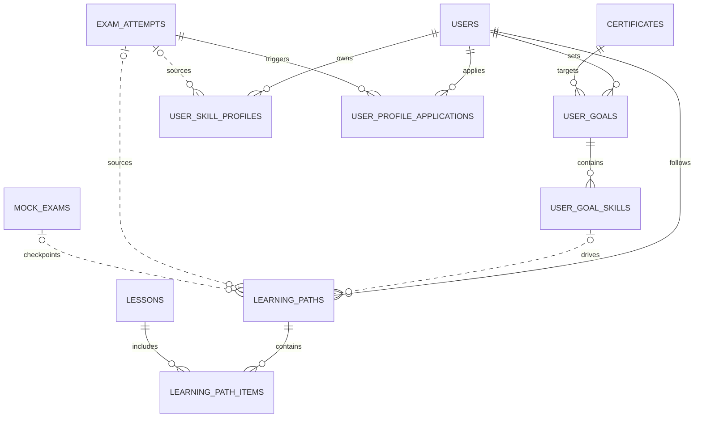
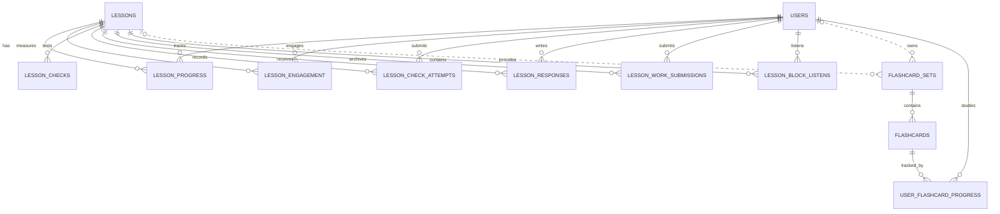
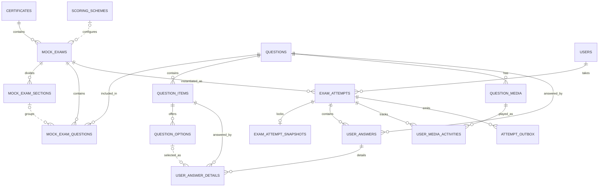
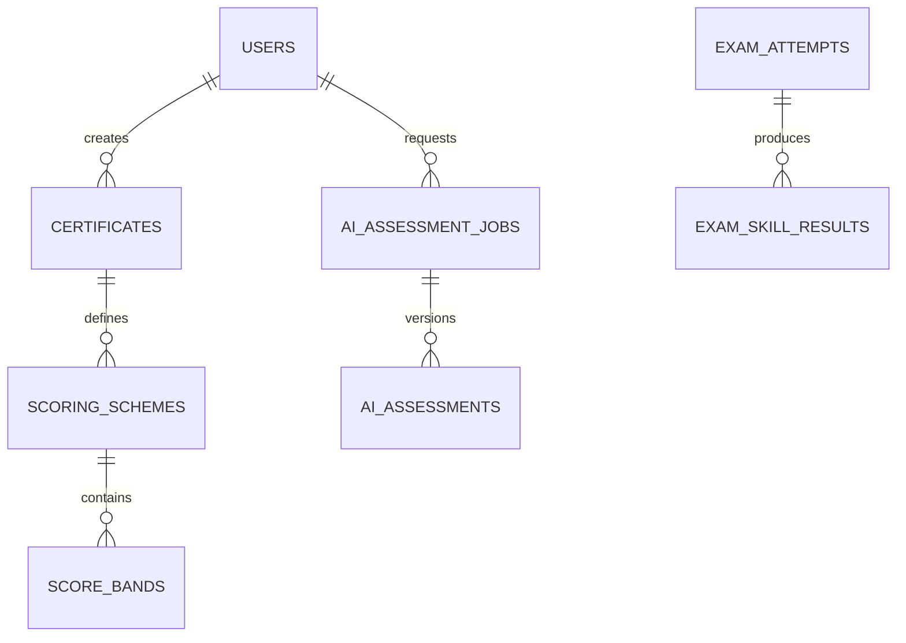

# Rà soát nghiệp vụ, ERD as-built và độ lệch so với SPEC V2

Ngày rà soát: 22/10/2026
Phạm vi: source Java, Flyway `V001`–`V031`, metadata SQL Server `aptisprep_db`, `SPEC_V2.md`, `PROJECT_DECISIONS.md` và các contract bàn giao.

## 1. Kết luận điều hành

- Nghiệp vụ hiện tại vẫn đi đúng trục chính của SPEC V2: tài khoản → mục tiêu/profile → lộ trình/bài học → đề thi/attempt → chấm điểm/kết quả.
- DB thực tế có **37 bảng nghiệp vụ**, trong khi catalog entity gốc của SPEC V2 mô tả **24 bảng**. Có **13 bảng mở rộng**. Phần lớn là mở rộng hợp lý để đáp ứng snapshot, idempotency, AI grading và hoạt động bài học.
- Mô hình không “giống hoàn toàn” ERD ban đầu, nhưng không phải là một DB khác. Đây là ERD V2 đã được tiến hóa qua migration. Các quan hệ cốt lõi vẫn còn.
- Hai điểm cần ưu tiên sửa thiết kế là: tài liệu ERD gốc chưa theo kịp schema; và một số event/exception đang có semantics chưa chuẩn (đặc biệt `AiGradingException` bị ánh xạ thành HTTP 400, cùng cơ chế đánh dấu outbox delivered).
- Có code demo/adapter và method chuyển tiếp không còn cần thiết trong luồng production. Chỉ nên xóa sau khi bổ sung test characterization để tránh làm hỏng demo hoặc contract cũ.

## 2. Toàn bộ nghiệp vụ đang có

### 2.1 Tài khoản và phân quyền

- Đăng ký Student, mã hóa mật khẩu, chặn email trùng.
- Đăng nhập/đăng xuất bằng Spring Security.
- Phân vai `STUDENT` và `ADMIN`; trạng thái tài khoản `ACTIVE`, `LOCKED`, `INACTIVE`.
- Mọi nghiệp vụ Student lấy danh tính từ `Principal`, sau đó service kiểm tra lại trạng thái và ownership.
- Admin xem danh sách học viên, tìm/lọc, xem chi tiết tiến độ và khóa/mở khóa tài khoản; không được tự khóa chính mình.

### 2.2 Mục tiêu, hồ sơ kỹ năng và Placement

- Student tạo/cập nhật mục tiêu theo chứng chỉ, ngày mục tiêu và từng kỹ năng.
- Mỗi user có tối đa một profile cho mỗi skill qua unique `(user_id, skill)`.
- Placement dùng chung exam engine; không có engine riêng.
- Khi attempt Placement hoàn tất, kết quả đủ điều kiện được áp vào `user_skill_profiles` theo khóa idempotent trong `user_profile_applications`.
- Sau khi goal/profile thay đổi, hệ thống bảo đảm hoặc làm mới learning path.
- Checkpoint chỉ được phép nâng profile khi đúng attempt, đúng skill, đúng policy và không áp lặp.

### 2.3 Learning Path

- Tạo path theo user/skill/target level; liên kết tùy chọn với goal skill, source attempt và checkpoint exam.
- Một thời điểm chỉ nên có path ACTIVE phù hợp cho một nhánh học; path cũ được archive khi mục tiêu/context thay đổi.
- Path gồm các lesson có thứ tự và trạng thái riêng.
- Hoàn thành lesson phải đồng bộ `learning_path_items.status/completed_at` và `lesson_progress` trong cùng transaction.
- Khi hoàn thành các bài bắt buộc, Student được mở checkpoint từ path; route generic không được bypass điều kiện này.

### 2.4 Lesson và hoạt động học

- Admin tạo, sửa, nhân bản, sắp xếp, publish và archive lesson theo skill + CEFR.
- Lesson hỗ trợ nội dung có cấu trúc, blocks JSON, mục tiêu, chiến lược, ví dụ, phân tích, bài thực hành, bài mẫu, nguồn tham khảo, audio/image/video và quy tắc mở transcript/sample.
- Student chỉ mở lesson PUBLISHED.
- Hệ thống ghi lần mở, section cuối, trạng thái hoàn thành và engagement nghe.
- Listening yêu cầu nghe đủ điều kiện trước khi hoàn thành; Writing/Speaking yêu cầu lưu/nộp bài; knowledge check yêu cầu đạt ngưỡng.
- Knowledge check hỗ trợ 2–6 lựa chọn, lưu attempt, snapshot nội dung và review/feedback.
- Writing/Speaking lesson lưu lịch sử submission; Speaking lưu file audio; có thể yêu cầu AI assessment nếu provider bật.

### 2.5 Flashcard

- Flashcard bắt buộc thuộc một `flashcard_set`.
- Bộ thư viện có thể gắn 0..1 lesson và không có owner; bộ cá nhân có owner và không gắn lesson.
- Admin quản lý bộ thư viện; Student quản lý bộ cá nhân.
- Student học thẻ và hệ thống lưu mastery, review count, lần ôn gần nhất/kế tiếp.

### 2.6 Question Bank và media

- Admin CRUD câu hỏi ở trạng thái Draft/Published/Archived.
- Câu hỏi hỗ trợ `SINGLE_CHOICE`, `MATCHING`, `ORDERING`, `WRITING_TEXT`, `SPEAKING_AUDIO` và năm skill.
- Cấu trúc chuẩn: Question → Item → Option; Reading có passage riêng.
- Media ảnh/audio/video gắn Question; validate MIME, chữ ký file, dung lượng, alt text, transcript và thứ tự.
- Listening giới hạn số lượt phát; đáp án đúng không được trả về giao diện Student.
- Câu hỏi đã đi vào lịch sử attempt không được sửa phá vỡ lịch sử; phải archive và tạo version mới.

### 2.7 Quản lý đề thi

- Admin tạo/sửa/publish đề `PLACEMENT`, `PRACTICE`, `CHECKPOINT`, `FULL_MOCK`.
- Đề liên kết Certificate và Scoring Scheme, có skill/target level/duration.
- Section là mở rộng tùy chọn; Full Mock dùng nhiều section/skill.
- `mock_exam_questions` giữ vị trí toàn đề và section tùy chọn; không cho lặp câu hoặc vị trí.
- Chỉ câu hỏi PUBLISHED, đúng skill section mới được đưa vào đề PUBLISHED.
- Student catalog chỉ hiển thị đề PUBLISHED; Admin thấy cả Draft.

### 2.8 Exam attempt engine

- Start có request key để chống tạo trùng; attempt đang chạy được resume, attempt terminal tuân theo retake policy.
- Khi start, hệ thống khóa nội dung và grading context trong `exam_attempt_snapshots`.
- Hỗ trợ save, autosave, nhiều item, objective answer, Writing text và Speaking audio.
- Mọi question/item/option/media phải thuộc snapshot của attempt và đúng owner.
- Deadline được kiểm tra phía server ở page/save/media/submit; hết giờ chuyển `EXPIRED`.
- Listening dùng `user_media_activities` để đếm lượt bền vững và cấp token ngắn hạn.
- Submit khóa answer/version, tạo `LockedAttempt`, chấm objective và phát yêu cầu chấm subjective.

### 2.9 Chấm điểm, AI và kết quả

- Objective grading tính correct/total/raw theo snapshot.
- Scoring policy quy đổi raw → scale → CEFR theo certificate/scheme/band và version đã khóa.
- Writing/Speaking tạo AI job có assessment key và answer version; provider chạy ngoài transaction dài.
- AI assessment lưu trạng thái, raw response đã kiểm soát, score, CEFR, feedback và lỗi an toàn.
- `exam_skill_results` lưu riêng objective/subjective/grading state; chưa chấm giữ NULL, không biến thành 0.
- Finalization chỉ hoàn tất attempt khi đủ skill result hợp lệ và đúng answer/policy version.
- Student chỉ xem kết quả của mình; Admin xem lịch sử toàn hệ thống với lọc và phân trang.
- Có retry grading cho phần lỗi; không được ghi đè bài đã khóa.

### 2.10 Certificate và scoring administration

- Admin quản lý Certificate, Scoring Scheme theo version và Score Band theo skill/CEFR.
- Scheme đã được đề/attempt sử dụng không được sửa phá lịch sử; tạo version mới.
- Band không được chồng khoảng, min ≤ max và scale nằm trong giới hạn.

### 2.11 Lưu trữ và độ bền xử lý

- File upload được lưu qua `StorageService`, không public trực tiếp `/uploads/**`.
- Attempt snapshot bảo vệ lịch sử khỏi thay đổi catalog.
- Attempt outbox lưu sự kiện submitted/completed để có thể recover sau gián đoạn.
- Các unique key (`request_key`, `assessment_key`, event key, application key) bảo vệ idempotency ở DB thay vì chỉ dùng RAM.

## 3. ERD as-built của DB hiện tại

Schema có 37 bảng, nên ERD được chia theo miền. Đây là nguồn Mermaid tương ứng với các hình FigJam.

### 3.1 Tài khoản, mục tiêu, profile và lộ trình

### 3.2 Lesson, Flashcard và hoạt động học

### 3.3 Question, Exam, Attempt và Answer

Lưu ý: DB có FK ghép từ `user_answer_details(selected_option_id, question_item_id)` sang `question_options(id, question_item_id)`. Đây là bảo vệ tốt vì nó ngăn chọn option thuộc item khác. Metadata SQL Server hiển thị FK ghép thành hai dòng.

### 3.4 Scoring và AI

`ai_assessment_jobs` giữ các id attempt/answer dưới dạng cột có index/unique nghiệp vụ nhưng hiện DB chỉ khai báo FK tới `users`; không có FK vật lý tới attempt/answer. Đây là lựa chọn giảm coupling khi retry, nhưng làm giảm referential integrity.

## 4. So sánh với ERD ban đầu

### 4.1 Phần giống

- Giữ nguyên 24 entity cốt lõi của SPEC V2.
- Các cardinality chính User–Attempt, Exam–Question, Attempt–Answer, Goal–Skill, Path–Item, Lesson–Progress và Scheme–Band vẫn đúng ý định ban đầu.
- Chuẩn hóa Question → Item → Option và Answer → Detail vẫn được giữ.
- Flashcard hiện đã quay về đúng hướng thiết kế mong muốn: Set → Card; bộ thư viện gắn Lesson, bộ cá nhân có owner.
- Section vẫn chỉ là metadata mở rộng; quan hệ chuẩn của câu trong đề là `mock_exam_questions.mock_exam_id`.

### 4.2 Phần mở rộng hợp lý

13 bảng ngoài catalog 24 entity của SPEC:

| Bảng mở rộng | Đánh giá |
|---|---|
| `mock_exam_sections` | Hợp lý, đã được nhắc như extension trong quyết định dự án |
| `user_media_activities` | Cần thiết để giới hạn Listening bền vững |
| `exam_attempt_snapshots` | Cần thiết để khóa đề/đáp án/policy tại thời điểm start |
| `attempt_outbox` | Cần thiết cho retry sự kiện grading/finalization |
| `user_profile_applications` | Cần thiết cho idempotency khi áp Placement/Checkpoint |
| `ai_assessment_jobs`, `ai_assessments` | Cần thiết khi AI chạy async, retry và giữ audit/version |
| `lesson_checks`, `lesson_check_attempts` | Hợp lý cho kiểm tra kiến thức trong lesson |
| `lesson_responses`, `lesson_work_submissions` | Hợp lý; response là bản hiện tại, submission là lịch sử bất biến |
| `lesson_engagement`, `lesson_block_listens` | Hợp lý cho điều kiện nghe và resume theo block |

### 4.3 Phần lệch/cần quyết định lại

1. `SPEC_V2.md` không còn là ERD as-built. Cần đổi nhãn phần hiện tại thành “baseline” và liên kết tài liệu này làm “as-built”.
2. `ai_assessment_jobs.attempt_id/answer_id` và `ai_assessments` thiếu một số FK vật lý. Nếu không có yêu cầu giữ job khi xóa dữ liệu cha, nên thêm FK `NO ACTION`; nếu cố ý không thêm phải ghi ADR.
3. `attempt_outbox` không có FK vật lý tới attempt dù có `aggregate_id`. Nếu giữ mô hình generic thì hợp lý, nhưng tên bảng hiện chỉ phục vụ attempt; cần chọn hoặc generic hóa thật, hoặc thêm FK.
4. `lesson_check_attempts`, `lesson_work_submissions`, `lesson_block_listens` dùng scalar IDs thay vì JPA relationships. DB có FK nên dữ liệu vẫn an toàn, nhưng mapping/domain style không đồng nhất.
5. `user_answer_details` vẫn giữ các cột tự luận legacy trong khi nguồn chuẩn đã chuyển lên `user_answers`. Không xóa ngay; cần migration kiểm dữ liệu và deprecation plan.
6. Trạng thái và loại nghiệp vụ phần lớn là `VARCHAR`/String. Check constraint không đồng đều qua các bảng; enum Java và DB có nguy cơ trôi nhau.

## 5. Rà soát exception

| Exception | Hiện trạng | Kết luận |
|---|---|---|
| `ResourceNotFoundException` | Ánh xạ 404, dùng cho entity/tài nguyên không tồn tại hoặc không được phép lộ | **Giữ** |
| `BusinessRuleException` | Ánh xạ 400, dùng cho validation/state transition | **Giữ**, nhưng thu hẹp phạm vi |
| `AccessDeniedException` | Ánh xạ 403, kiểm ownership/status | **Giữ hoặc thay bằng exception Spring**, nên đổi tên để tránh nhầm với `org.springframework.security.access.AccessDeniedException` |
| `AiGradingException` | Kế thừa `BusinessRuleException`, vì vậy thành HTTP 400 | **Cần sửa semantics**; provider lỗi không phải lỗi request của user. Với xử lý async nên ghi job ERROR và thông báo retry; nếu đi qua HTTP nên map 502/503 |

Các chỗ đang dùng `BusinessRuleException` nhưng nên phân loại lại:

- File/resource không tồn tại trong storage nên là 404, không phải 400.
- Lỗi đọc/ghi storage hoặc provider nên là exception hạ tầng nội bộ, log correlation id và trả thông báo an toàn; không quy lỗi cho client.
- Conflict do version/concurrency/idempotency có thể dùng exception riêng ánh xạ 409.
- `GlobalExceptionHandler` hiện chỉ có 400/403/404. Nên bổ sung handler an toàn cho 409 và lỗi hạ tầng; không trả stack trace/provider body.

## 6. Rà soát event

| Event | Có cần không? | Nhận xét |
|---|---|---|
| `GoalChangedEvent` | Có điều kiện | Tách Account khỏi Learning Path và chạy AFTER_COMMIT là hợp lý. Nhưng listener dùng `ObjectProvider` rồi bỏ qua im lặng nếu bean vắng; nếu tạo path là hậu điều kiện bắt buộc, nên gọi contract rõ ràng hoặc có outbox/retry |
| `AttemptSubmittedEvent` | Có | Cần tách khóa bài khỏi grading. Payload `LockedAttempt` giúp consumer không đọc dữ liệu mutable. Nên giữ cùng outbox |
| `AiAssessmentCompletedEvent` | Có | Hợp lý để nối async assessment với finalization. Độ bền chủ yếu nằm ở AI job table; cần test recovery khi publish/listener thất bại |
| `AttemptCompletedEvent` | Có | Cần để áp Placement/Profile/Path sau finalization và tránh vòng bean. Nên giữ cùng outbox |

Rủi ro event cần sửa:

1. `AttemptOutboxService.markDelivered` đánh dấu delivered khi event được phát AFTER_COMMIT, không chứng minh mọi consumer đã xử lý nghiệp vụ thành công. Khi AI bị disable, consumer `onSubmitted` return nhưng outbox vẫn có thể bị đánh dấu delivered; bật AI lại sẽ không recovery bản ghi đó.
2. `GoalChangedEvent` không có outbox. Nếu listener lỗi sau commit, Goal đã lưu nhưng Path có thể chưa đồng bộ.
3. Event constructors cho payload thiếu version/context tạo khả năng publish event “rỗng”. Production hiện dùng payload đầy đủ; nên loại constructor legacy sau khi test không còn phụ thuộc.
4. Nên định nghĩa rõ delivered = “đã dispatch” hay “đã xử lý thành công”. Nếu cần at-least-once, consumer phải ACK theo event key sau khi hoàn tất, không để một listener chung tự ACK.

## 7. Hàm/lớp có thể bỏ hoặc rút gọn

Đây là danh sách ứng viên, chưa phải lệnh xóa ngay:

| Ứng viên | Bằng chứng | Đề xuất |
|---|---|---|
| `ExamAttemptService.ownsAttempt` | Chỉ thấy khai báo, không thấy call site | Xóa sau test compile/search |
| `ExamAttemptService.applyAiAssessment` | Chỉ forward sang `AttemptFinalizationService`; listener gọi finalization trực tiếp | Xóa method chuyển tiếp |
| Constructor 4 tham số của `AttemptSubmittedEvent` | Production dùng constructor có `LockedAttempt` | Xóa nếu test/compatibility không cần |
| Constructor 4 và 6 tham số của `AiAssessmentCompletedEvent` | Production publish bản có `answerVersion` | Xóa overload cũ để bắt buộc version |
| `AdminCatalogPreviewService` fixtures | Chỉ phục vụ `app.demo.catalog-fallback`; DB production đã có dữ liệu thật | Tách sang profile `demo` hoặc xóa toàn bộ fallback |
| `StudentContentPreviewService.fallbackExams` | Cùng lý do; còn làm tên service gây hiểu nhầm | Xóa fallback, đổi tên thành `StudentExamCatalogService` |
| `AdminCatalogPreviewController.isReal` | Route đã giới hạn `questions|exams`, nên luôn true | Bỏ method và các nhánh unreachable sau khi bỏ fallback |
| `hasRealEntry` | Gọi `catalogService.entry` rồi bắt exception, sau đó controller gọi `entry` lần nữa | Gọi một lần và dùng kết quả |
| Các overload `LessonService.save` | Đang phục vụ test và các caller cũ | Không xóa ngay; gom vào command object sau khi controller/test chuyển hết |

Các dấu hiệu chất lượng nên dọn nhưng không phải dead code:

- `StudentContentPreviewService` import `org.springframework.stereotype.Service` hai lần.
- Tên `PreviewController/PreviewService` không còn phản ánh thực tế vì đang đọc DB thật.
- Một số service viết dồn nhiều statement trên một dòng, làm review transaction/validation khó và dễ bỏ sót precedence bug.
- `ObjectProvider` đang được dùng để né vòng dependency ở vài luồng. Event/contract là đúng hướng, nhưng optional dependency không nên làm mất hậu điều kiện bắt buộc mà không log/retry.

## 8. Thứ tự chỉnh sửa đề xuất

1. Chốt tài liệu này làm ERD as-built; cập nhật `SPEC_V2.md` để phân biệt baseline và hiện trạng.
2. Sửa semantics outbox/ACK và test crash/retry trước khi dọn event.
3. Tách exception 400/403/404/409/502-503; đặc biệt bỏ `AiGradingException extends BusinessRuleException`.
4. Bỏ production fallback/fixture, đổi tên các lớp `Preview*` đang chạy thật.
5. Xóa hai method ExamAttempt không dùng và các event constructor legacy sau characterization tests.
6. Quyết định FK cho AI/outbox và ghi ADR trước khi thêm migration.
7. Lập migration riêng để xử lý cột answer legacy; không sửa migration đã chạy.

## 9. Cách kiểm chứng

- Metadata DB được đọc trực tiếp từ `sys.tables`, `sys.columns`, `sys.foreign_key_columns` của `aptisprep_db`.
- Flyway hiện đã chạy đến `V031` thành công.
- So sánh baseline lấy từ 24 mục entity trong `docs/SPEC_V2.md`.
- Đánh giá hàm không dùng dựa trên call-site search toàn `src/main/java` và `src/test/java`; vẫn cần Maven compile/test sau khi thực sự xóa.
