**HSF302 – APTIS LEARNING SYSTEM**

Bản nghiệp vụ hiện trạng và hai ERD theo source đến V038: [BUSINESS_SPEC_CURRENT.md](BUSINESS_SPEC_CURRENT.md). Giữ các sơ đồ/yêu cầu bên dưới làm baseline V2 để đối chiếu, không coi chúng là ERD vật lý đầy đủ của bản triển khai hiện tại.

Ghi chú đối chiếu 23/10/2026: tài liệu này giữ vai trò đặc tả nghiệp vụ; không phải ERD toàn bộ database triển khai. Phần mở rộng, quyết định tương thích dữ liệu và trạng thái code được tách tại [V2_IMPLEMENTATION.md](V2_IMPLEMENTATION.md) và [V2_CLEANUP_VERIFICATION_2026-10-23.md](V2_CLEANUP_VERIFICATION_2026-10-23.md), không thay các use case gốc để khớp lỗi code.

**TÀI LIỆU PHÂN TÍCH HỆ THỐNG  
ERD – USE CASE – FLOWCHART – SWIMLANE**

*Bản Markdown hoàn chỉnh với **code Mermaid nằm trực tiếp tại từng vị trí sơ đồ**. Nếu trình xem Markdown hỗ trợ Mermaid, sơ đồ sẽ render tự động; nếu không, bạn vẫn nhìn thấy và copy được code Mermaid.*

# MỤC LỤC NỘI DUNG

1\. Mục tiêu và phạm vi hệ thống

2\. Role và trách nhiệm

3\. Mô hình dữ liệu và ERD

4\. Use Case tổng thể

5\. Đặc tả chi tiết Use Case

6\. Flowchart nghiệp vụ

7\. Swimlane nghiệp vụ

8\. Business Rules và ràng buộc

9\. Ghi chú triển khai

Phụ lục A. Danh sách sơ đồ

# 1. MỤC TIÊU VÀ PHẠM VI HỆ THỐNG

APTIS Learning System là hệ thống hỗ trợ người học đánh giá trình độ,
đặt mục tiêu, học theo lộ trình cá nhân hóa, luyện tập và thực hiện các
bài thi mô phỏng. Hệ thống đồng thời cung cấp khu vực quản trị để xây
dựng nội dung học, ngân hàng câu hỏi, đề thi và quy tắc chấm điểm.

Luồng nghiệp vụ tổng quát:

- Student đăng ký/đăng nhập và có thể thiết lập mục tiêu theo từng kỹ
  năng.

- Student có thể thực hiện Placement Test để xác định trình độ hiện tại.

- Hệ thống lưu trạng thái kỹ năng hiện tại trong USER_SKILL_PROFILE.

- Từ trình độ hiện tại và mục tiêu, hệ thống tạo hoặc lựa chọn Learning
  Path phù hợp.

- Student học Lesson, Flashcard, làm Practice và theo dõi tiến độ.

- Checkpoint được dùng để xác nhận việc đạt một CEFR level mới.

- Full Mock Exam được dùng để mô phỏng bài thi đầy đủ và đánh giá tổng
  thể.

- Admin quản lý Certificate, Question Bank, Question Media, Mock Exam,
  Lesson, Flashcard và Scoring.

Bốn loại đề trong hệ thống:

- PLACEMENT: xác định trình độ ban đầu theo từng skill.

- PRACTICE: luyện tập, không tự động nâng current level.

- CHECKPOINT: xác nhận Student đã đạt target level của một chặng học.

- FULL_MOCK: mô phỏng bài thi đầy đủ.

Kỹ năng và dạng câu hỏi (bổ sung):

- Kỹ năng (cột `skill`): GRAMMAR_VOCABULARY, READING, LISTENING, WRITING,
  SPEAKING.

- Câu khách quan (hệ thống tự chấm): SINGLE_CHOICE, MATCHING, ORDERING —
  dùng cho GRAMMAR_VOCABULARY, READING, LISTENING.

- Câu tự luận/nói: WRITING_TEXT (Student nhập văn bản) và SPEAKING_AUDIO
  (Student ghi âm, upload file). Bài làm được lưu trong USER_ANSWER
  (`text_answer`, `audio_url`).

- Writing/Speaking không tự chấm bằng đáp án đúng/sai. Nếu không bật chấm
  AI/giáo viên (xem 9.4), hệ thống chỉ lưu bài làm; EXAM_SKILL_RESULT của
  skill đó để NULL và đánh dấu chưa chấm.

# 2. ROLE VÀ TRÁCH NHIỆM

## 2.1 Student

Student là người học và là actor chính của luồng học tập.

- Đăng ký, đăng nhập và đăng xuất.

- Thiết lập/cập nhật mục tiêu học tập theo Certificate, target date và
  từng skill.

- Làm Placement Test.

- Xem Skill Profile hiện tại.

- Xem Learning Path theo từng skill.

- Học Lesson và theo dõi Lesson Progress.

- Học Flashcard và theo dõi Flashcard Progress.

- Làm Practice Exam.

- Làm Checkpoint Exam.

- Làm Full Mock Exam.

- Trả lời câu hỏi, submit bài thi và xem kết quả.

## 2.2 Admin

Admin quản trị nội dung, cấu hình đề và quy tắc chấm điểm.

- Đăng nhập và đăng xuất.

- Quản lý Certificate/chương trình thi.

- Quản lý Question Bank: Question, Question Item, Question Option.

- Quản lý Question Media: upload hình ảnh hoặc âm thanh và lưu đường dẫn
  file.

- Quản lý Mock Exam và danh sách Question trong từng đề.

- Quản lý Lesson.

- Quản lý Flashcard.

- Quản lý Scoring Scheme.

- Quản lý Score Band.

## 2.3 System

System không phải role đăng nhập. Đây là phần xử lý tự động của backend
và được thể hiện trong Flowchart/Swimlane để làm rõ trách nhiệm của hệ
thống.

- Xác thực user và phân quyền.

- Tạo Exam Attempt, lưu User Answer và User Answer Detail (kèm bài
  Writing/Speaking nếu có).

- Tính raw score.

- Quy đổi scale score theo scoring logic/scoring scheme.

- Xác định CEFR level theo Score Band.

- Tạo Exam Skill Result.

- Khởi tạo/cập nhật User Skill Profile khi nghiệp vụ cho phép.

- Tạo/cập nhật Learning Path.

- Cập nhật Lesson Progress và Flashcard Progress.

# 3. MÔ HÌNH DỮ LIỆU VÀ ERD

Để tránh sơ đồ quá dày đặc, ERD được chia thành nhiều module nhỏ. Mỗi sơ đồ dưới đây chỉ chứa các entity liên quan trực tiếp để chữ và quan hệ dễ đọc.

## 3.1 ERD không thuộc tính

ERD không thuộc tính dùng để trình bày quan hệ tổng quan giữa các
entity.

**ERD không thuộc tính – Question Bank**

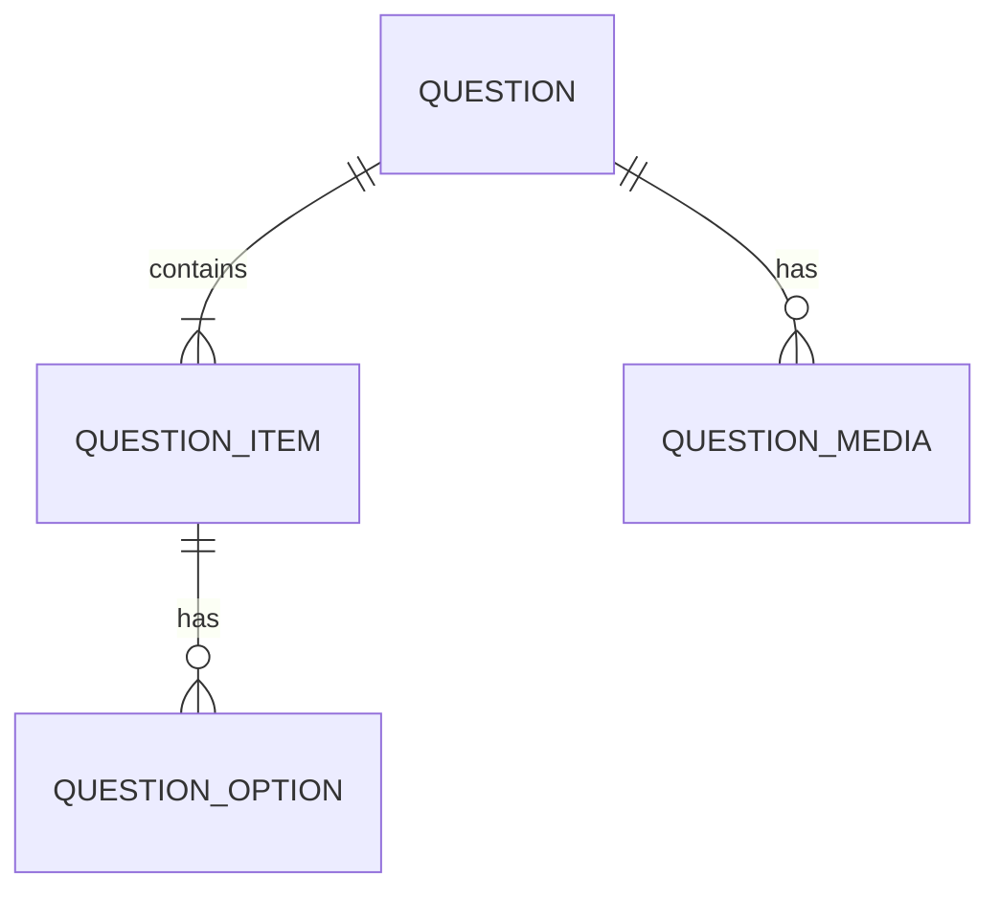

*Question Bank*

**ERD không thuộc tính – Exam Structure**

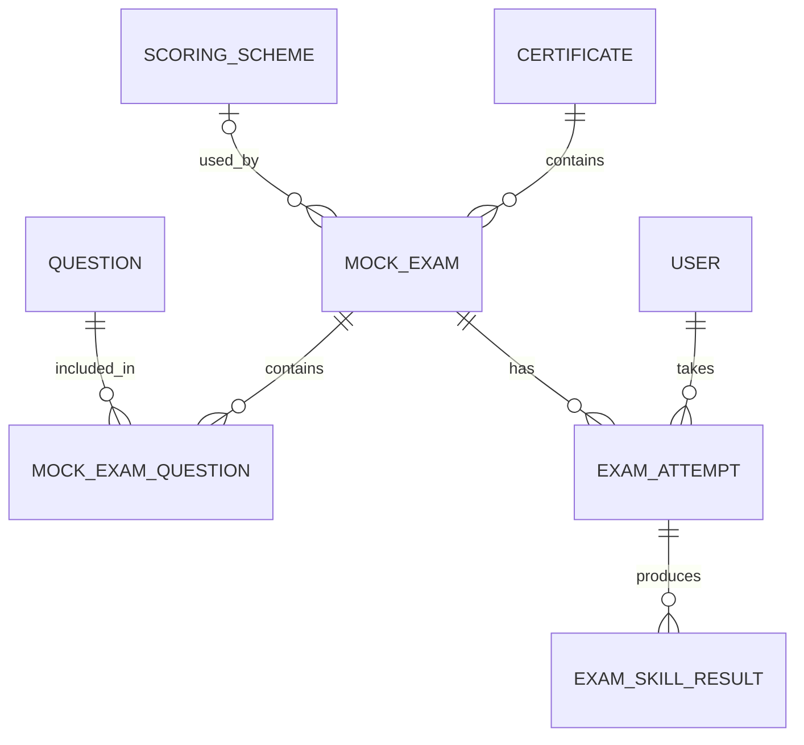

*Exam Structure*

**ERD không thuộc tính – Answer Structure**

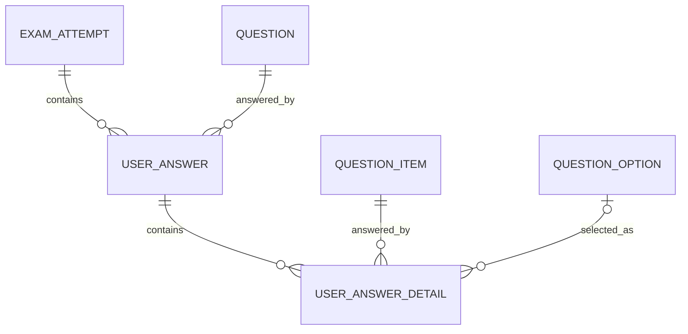

*Answer Structure*

**ERD không thuộc tính – Goal & Skill Profile**

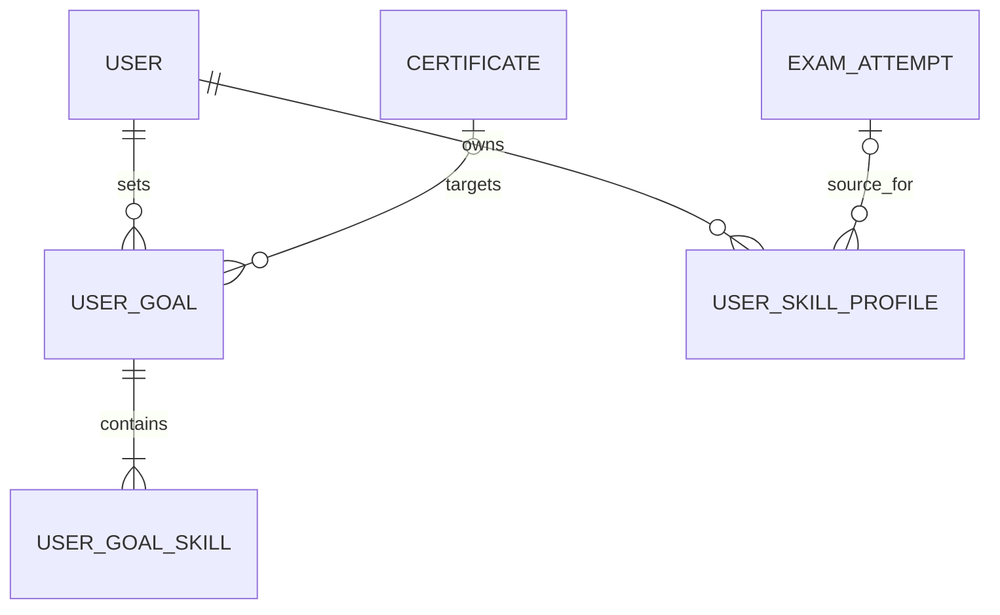

*Goal & Skill Profile*

**ERD không thuộc tính – Learning Path**

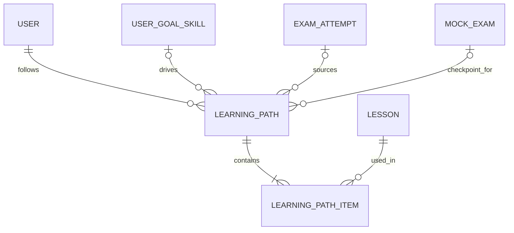

*Learning Path*

**ERD không thuộc tính – Lesson / Flashcard / Progress**

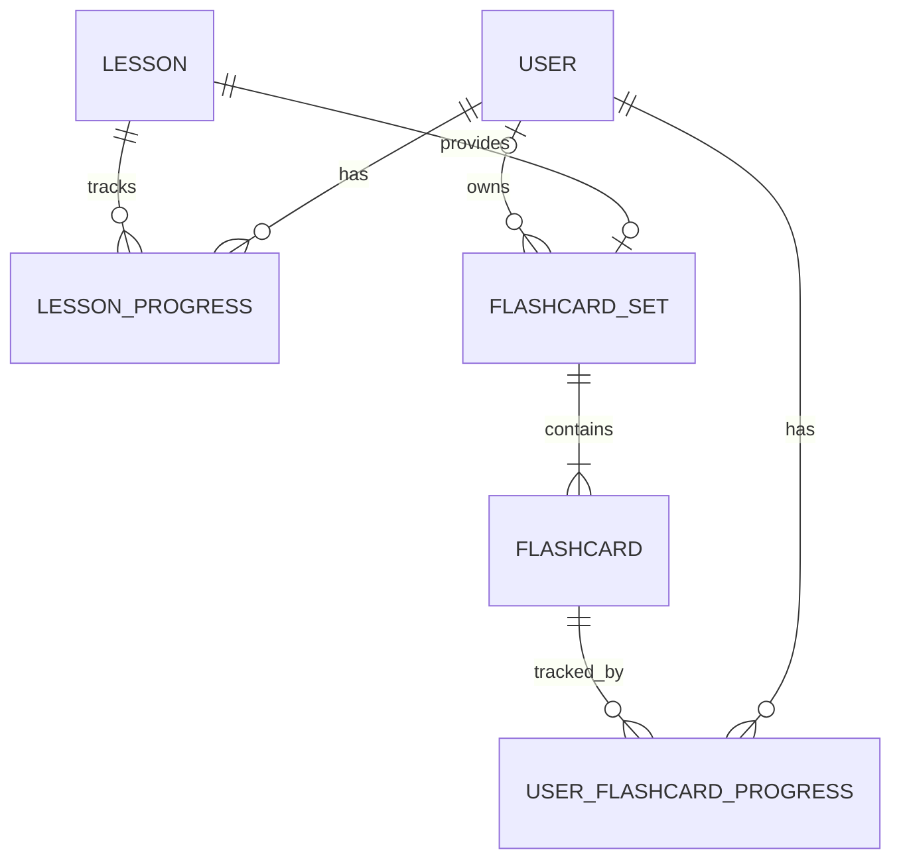

*ERD không thuộc tính – Lesson / Flashcard / Progress*

**ERD không thuộc tính – Certificate / Scoring**

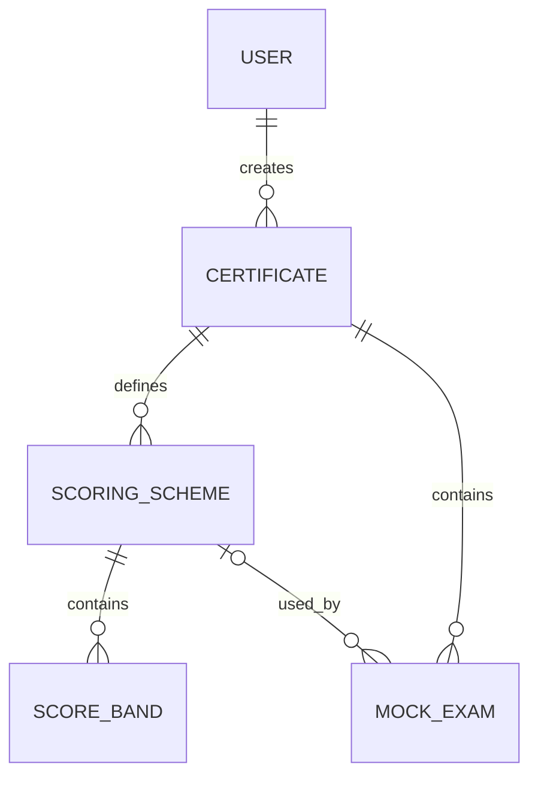

*ERD không thuộc tính – Certificate / Scoring*

## 3.2 ERD có đầy đủ thuộc tính

ERD đầy đủ thuộc tính nên chia theo module để có thể đọc được tên field,
PK và FK. Không nên cố ép toàn bộ hơn 20 entity vào một ảnh duy nhất.

**ERD đầy đủ thuộc tính – Question Bank & Media**

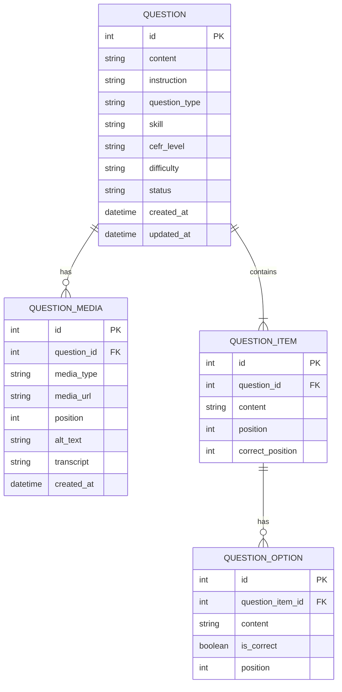

*ERD đầy đủ thuộc tính – Question Bank & Media*

**ERD đầy đủ thuộc tính – Exam Structure**

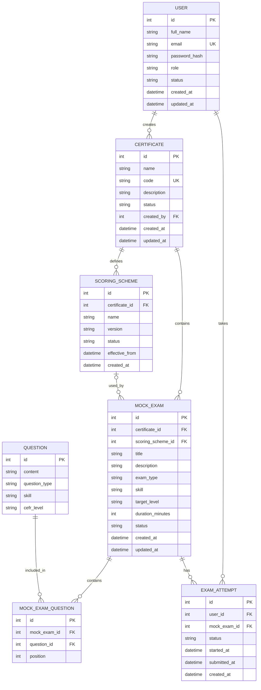

*Exam Structure*

**ERD đầy đủ thuộc tính – Answer Structure**

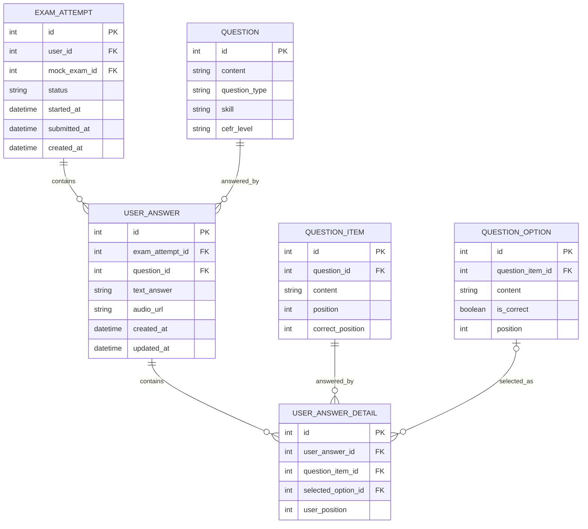

*Answer Structure*

**ERD đầy đủ thuộc tính – Scoring & Result**

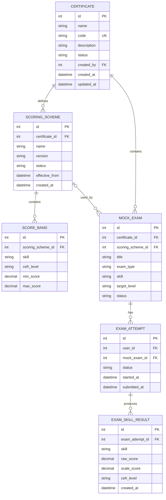

*ERD đầy đủ thuộc tính – Scoring & Result*

**ERD đầy đủ thuộc tính – Goal & Skill Profile**

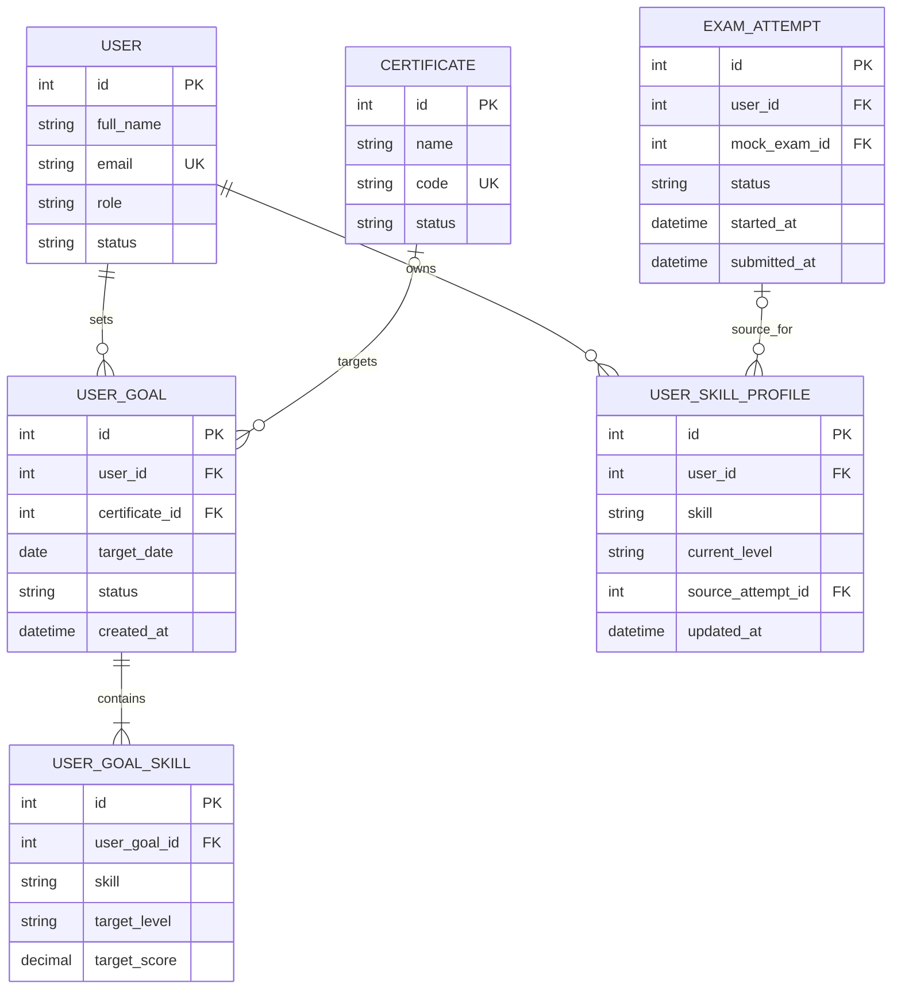

*Goal & Skill Profile*

**ERD đầy đủ thuộc tính – Learning Path**

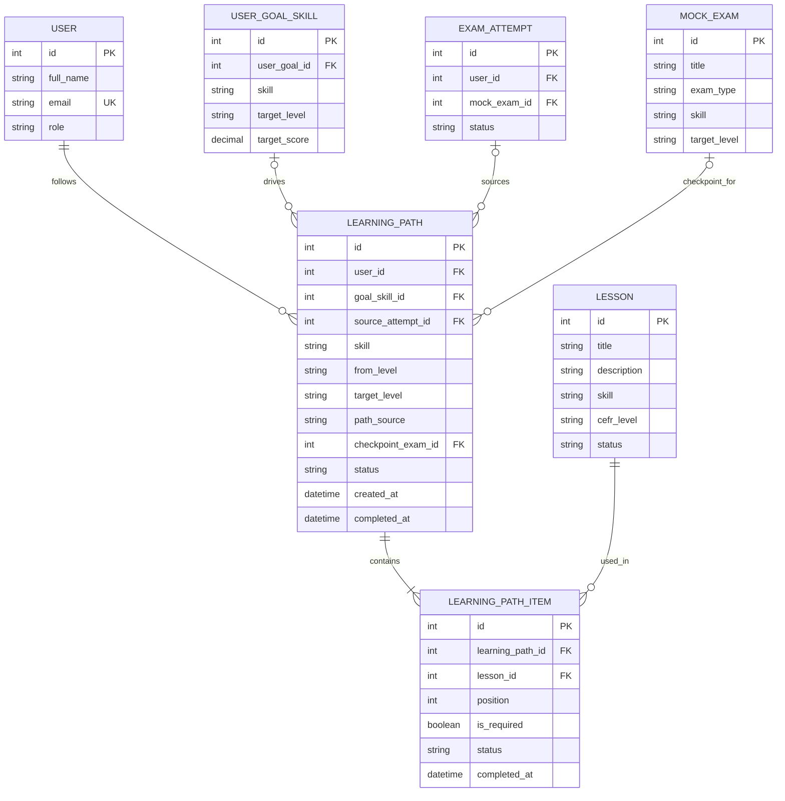

*Learning Path*

**ERD đầy đủ thuộc tính – Lesson / Flashcard / Progress**

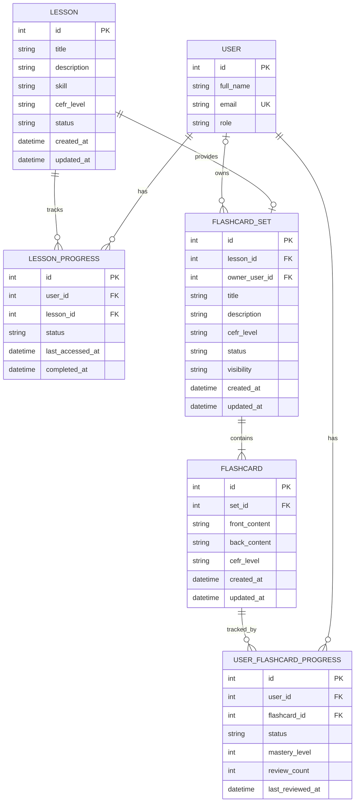

*ERD đầy đủ thuộc tính – Lesson / Flashcard / Progress*

## 3.3 Danh sách entity và thuộc tính

### USER

- id INT PK

- full_name NVARCHAR(255)

- email VARCHAR(255) UNIQUE

- password_hash NVARCHAR(255)

- role VARCHAR(30)

- status VARCHAR(30)

- created_at DATETIME2

- updated_at DATETIME2

### CERTIFICATE

- id INT PK

- name NVARCHAR(255)

- code VARCHAR(50) UNIQUE

- description NVARCHAR(MAX)

- status VARCHAR(30)

- created_by INT FK → USER.id

- created_at DATETIME2

- updated_at DATETIME2

### SCORING_SCHEME

- id INT PK

- certificate_id INT FK → CERTIFICATE.id

- name NVARCHAR(255)

- version VARCHAR(30)

- status VARCHAR(30)

- effective_from DATETIME2 NULL

- created_at DATETIME2

### SCORE_BAND

- id INT PK

- scoring_scheme_id INT FK → SCORING_SCHEME.id

- skill VARCHAR(30)

- cefr_level VARCHAR(10)

- min_score DECIMAL(5,2)

- max_score DECIMAL(5,2)

### MOCK_EXAM

- id INT PK

- certificate_id INT FK → CERTIFICATE.id

- scoring_scheme_id INT FK NULL → SCORING_SCHEME.id

- title NVARCHAR(255)

- description NVARCHAR(MAX)

- exam_type VARCHAR(30)

- skill VARCHAR(30) NULL

- target_level VARCHAR(10) NULL

- duration_minutes INT NULL

- status VARCHAR(30)

- created_at DATETIME2

- updated_at DATETIME2

### MOCK_EXAM_QUESTION

- id INT PK

- mock_exam_id INT FK → MOCK_EXAM.id

- question_id INT FK → QUESTION.id

- position INT

### QUESTION

- id INT PK

- content NVARCHAR(MAX)

- instruction NVARCHAR(MAX) NULL

- question_type VARCHAR(30)

- skill VARCHAR(30)

- cefr_level VARCHAR(10)

- difficulty VARCHAR(30) NULL

- status VARCHAR(30)

- created_at DATETIME2

- updated_at DATETIME2

### QUESTION_MEDIA

- id INT PK

- question_id INT FK → QUESTION.id

- media_type VARCHAR(20)

- media_url NVARCHAR(500)

- position INT

- alt_text NVARCHAR(500) NULL

- transcript NVARCHAR(MAX) NULL

- created_at DATETIME2

### QUESTION_ITEM

- id INT PK

- question_id INT FK → QUESTION.id

- content NVARCHAR(MAX)

- position INT

- correct_position INT NULL

### QUESTION_OPTION

- id INT PK

- question_item_id INT FK → QUESTION_ITEM.id

- content NVARCHAR(MAX)

- is_correct BIT

- position INT

### EXAM_ATTEMPT

- id INT PK

- user_id INT FK → USER.id

- mock_exam_id INT FK → MOCK_EXAM.id

- status VARCHAR(30)

- started_at DATETIME2

- submitted_at DATETIME2 NULL

- created_at DATETIME2

### USER_ANSWER

- id INT PK

- exam_attempt_id INT FK → EXAM_ATTEMPT.id

- question_id INT FK → QUESTION.id

- text_answer NVARCHAR(MAX) NULL — bài Writing

- audio_url NVARCHAR(500) NULL — file ghi âm Speaking

- created_at DATETIME2

- updated_at DATETIME2

### USER_ANSWER_DETAIL

- id INT PK

- user_answer_id INT FK → USER_ANSWER.id

- question_item_id INT FK → QUESTION_ITEM.id

- selected_option_id INT FK NULL → QUESTION_OPTION.id

- user_position INT NULL

### EXAM_SKILL_RESULT

- id INT PK

- exam_attempt_id INT FK → EXAM_ATTEMPT.id

- skill VARCHAR(30)

- raw_score DECIMAL(6,2) NULL

- scale_score DECIMAL(5,2) NULL

- cefr_level VARCHAR(10) NULL

- created_at DATETIME2

### USER_SKILL_PROFILE

- id INT PK

- user_id INT FK → USER.id

- skill VARCHAR(30)

- current_level VARCHAR(10)

- source_attempt_id INT FK NULL → EXAM_ATTEMPT.id

- updated_at DATETIME2

### USER_GOAL

- id INT PK

- user_id INT FK → USER.id

- certificate_id INT FK NULL → CERTIFICATE.id

- target_date DATE NULL

- status VARCHAR(30)

- created_at DATETIME2

### USER_GOAL_SKILL

- id INT PK

- user_goal_id INT FK → USER_GOAL.id

- skill VARCHAR(30)

- target_level VARCHAR(10)

- target_score DECIMAL(5,2) NULL

### LEARNING_PATH

- id INT PK

- user_id INT FK → USER.id

- goal_skill_id INT FK NULL → USER_GOAL_SKILL.id

- source_attempt_id INT FK NULL → EXAM_ATTEMPT.id

- skill VARCHAR(30)

- from_level VARCHAR(10) NULL

- target_level VARCHAR(10) NULL

- path_source VARCHAR(30)

- checkpoint_exam_id INT FK NULL → MOCK_EXAM.id

- status VARCHAR(30)

- created_at DATETIME2

- completed_at DATETIME2 NULL

### LEARNING_PATH_ITEM

- id INT PK

- learning_path_id INT FK → LEARNING_PATH.id

- lesson_id INT FK → LESSON.id

- position INT

- is_required BIT

- status VARCHAR(30)

- completed_at DATETIME2 NULL

### LESSON

- id INT PK

- title NVARCHAR(255)

- description NVARCHAR(MAX)

- skill VARCHAR(30)

- cefr_level VARCHAR(10)

- status VARCHAR(30)

- created_at DATETIME2

- updated_at DATETIME2

### LESSON_PROGRESS

- id INT PK

- user_id INT FK → USER.id

- lesson_id INT FK → LESSON.id

- status VARCHAR(30)

- last_accessed_at DATETIME2 NULL

- completed_at DATETIME2 NULL

### FLASHCARD_SET

- id INT PK

- lesson_id INT FK → LESSON.id NULL

- owner_user_id INT FK → USER.id NULL

- title NVARCHAR(255)

- description NVARCHAR(MAX) NULL

- cefr_level VARCHAR(10)

- status VARCHAR(30)

- visibility VARCHAR(20)

- created_at DATETIME2

- updated_at DATETIME2

### FLASHCARD

- id INT PK

- set_id INT FK → FLASHCARD_SET.id

- front_content NVARCHAR(MAX)

- back_content NVARCHAR(MAX)

- cefr_level VARCHAR(10)

- created_at DATETIME2

- updated_at DATETIME2

### USER_FLASHCARD_PROGRESS

- id INT PK

- user_id INT FK → USER.id

- flashcard_id INT FK → FLASHCARD.id

- status VARCHAR(30)

- mastery_level INT NULL

- review_count INT

- last_reviewed_at DATETIME2 NULL

## 3.4 Quan hệ và cardinality chính

- USER 1 — N CERTIFICATE (created_by).

- CERTIFICATE 1 — N SCORING_SCHEME.

- CERTIFICATE 1 — N MOCK_EXAM.

- SCORING_SCHEME 1 — N SCORE_BAND.

- Mỗi MOCK_EXAM dùng 0..1 SCORING_SCHEME; một SCORING_SCHEME có thể được
  nhiều MOCK_EXAM sử dụng.

- MOCK_EXAM 1 — N MOCK_EXAM_QUESTION; QUESTION 1 — N MOCK_EXAM_QUESTION.

- QUESTION 1 — N QUESTION_ITEM.

- QUESTION 1 — 0..N QUESTION_MEDIA.

- QUESTION_ITEM 1 — 0..N QUESTION_OPTION.

- USER 1 — N EXAM_ATTEMPT; MOCK_EXAM 1 — N EXAM_ATTEMPT.

- EXAM_ATTEMPT 1 — 0..N USER_ANSWER; QUESTION 1 — 0..N USER_ANSWER.

- USER_ANSWER 1 — 0..N USER_ANSWER_DETAIL.

- QUESTION_ITEM 1 — 0..N USER_ANSWER_DETAIL.

- QUESTION_OPTION có thể được nhiều USER_ANSWER_DETAIL tham chiếu thông
  qua selected_option_id.

- EXAM_ATTEMPT 1 — N EXAM_SKILL_RESULT.

- USER 1 — N USER_SKILL_PROFILE, với UNIQUE(user_id, skill).

- USER 1 — N USER_GOAL; USER_GOAL 1 — N USER_GOAL_SKILL.

- USER 1 — N LEARNING_PATH.

- USER_GOAL_SKILL 1 — 0..N LEARNING_PATH nhưng goal_skill_id ở
  LEARNING_PATH có thể NULL.

- EXAM_ATTEMPT 1 — 0..N LEARNING_PATH nhưng source_attempt_id ở
  LEARNING_PATH có thể NULL.

- LEARNING_PATH 1 — N LEARNING_PATH_ITEM; LESSON 1 — N
  LEARNING_PATH_ITEM.

- USER 1 — N LESSON_PROGRESS; LESSON 1 — N LESSON_PROGRESS.

- LESSON 1 — 0..1 FLASHCARD_SET dùng chung. Bộ thẻ này không có owner và
  được học từ trang chi tiết bài học.

- USER 1 — N FLASHCARD_SET riêng tư. Bộ thẻ riêng có owner, không gắn
  lesson và chỉ người tạo được truy cập.

- FLASHCARD_SET 1 — N FLASHCARD; mỗi FLASHCARD bắt buộc thuộc đúng một
  FLASHCARD_SET.

- USER 1 — N USER_FLASHCARD_PROGRESS; FLASHCARD 1 — N
  USER_FLASHCARD_PROGRESS.

## 3.5 Ghi chú QUESTION_MEDIA

QUESTION_MEDIA được dùng để lưu đường dẫn tới file hình ảnh hoặc âm
thanh. Hệ thống hiện tại không cần tích hợp TTS/Image API. Admin chỉ cần
upload file; backend lưu file vào thư mục/storage và lưu media_url trong
database.

- media_type: IMAGE hoặc AUDIO.

- media_url: đường dẫn file.

- position: thứ tự media nếu một Question có nhiều file.

- alt_text: mô tả ảnh, có thể NULL.

- transcript: transcript của audio, có thể NULL.

- Không cần QUESTION_AUDIO và QUESTION_IMAGE riêng.

# 4. USE CASE TỔNG THỂ

## 4.1 Use Case Diagram – Student

**Use Case Student – Account / Goal / Profile**

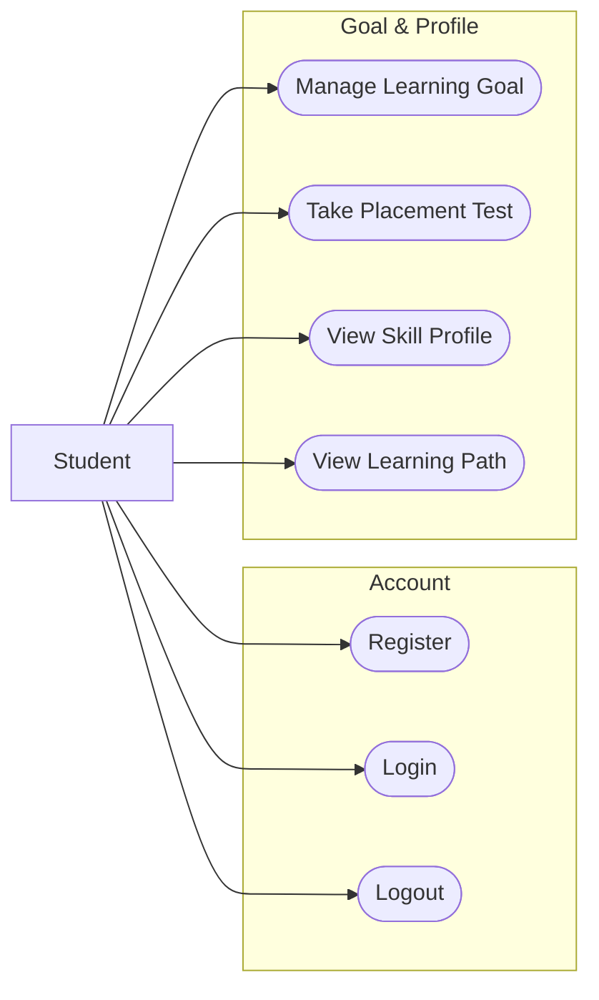

*Student – Account / Goal / Profile*

**Use Case Student – Learning**

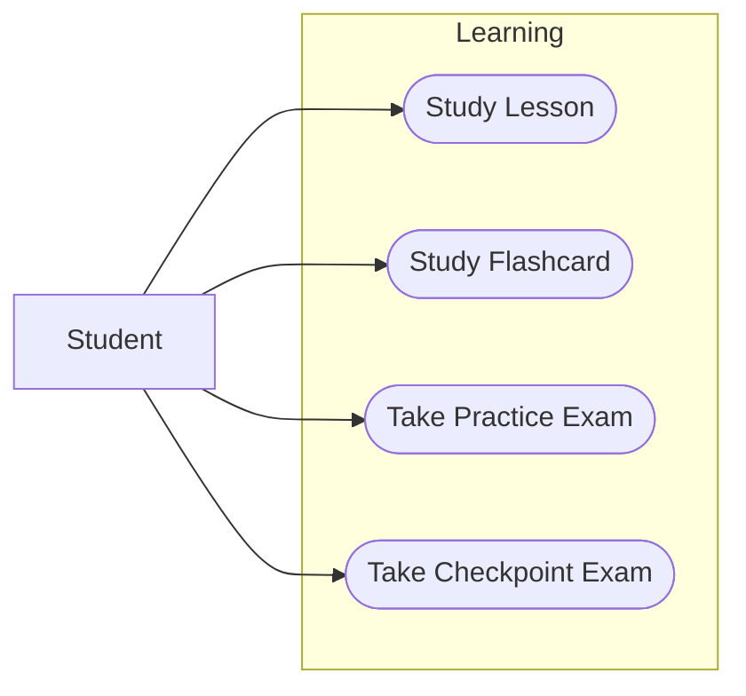

*Student – Learning*

**Use Case Student – Examination**

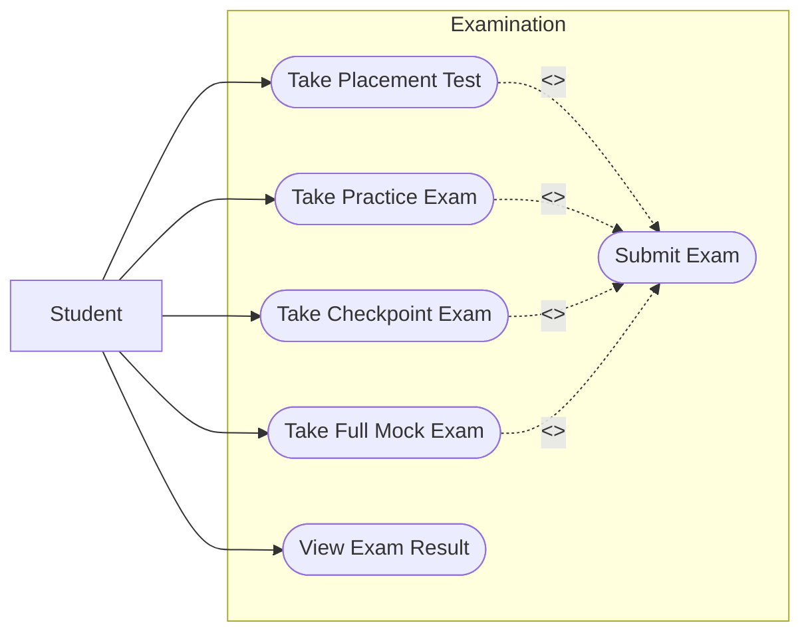

*Student – Examination*

## 4.2 Use Case Diagram – Admin

**Use Case Admin – Account**

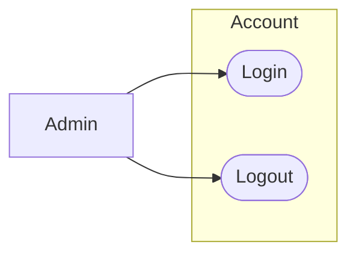

*Admin – Account*

**Use Case Admin – Content Management**

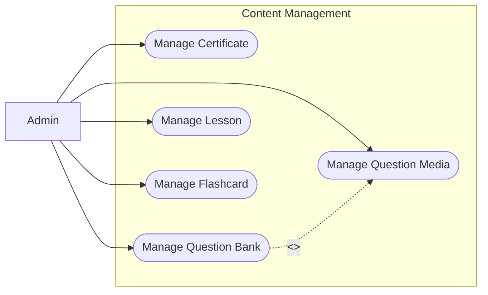

*Admin – Content Management*

**Use Case Admin – Exam & Scoring**

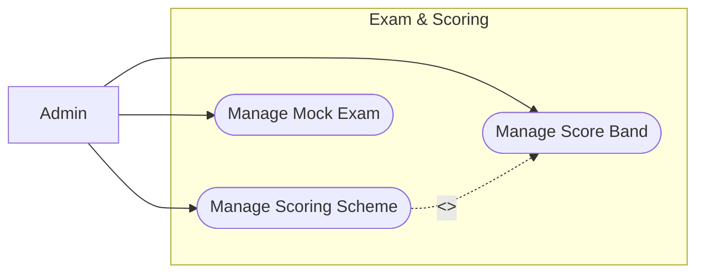

*Admin – Exam & Scoring*

## 4.3 Danh sách Use Case

| **Mã UC** | **Tên Use Case**      | **Actor** |
|-----------|-----------------------|-----------|
| UC-S01    | Register              | Student   |
| UC-S02    | Login                 | Student   |
| UC-S03    | Logout                | Student   |
| UC-S04    | Manage Learning Goal  | Student   |
| UC-S05    | Take Placement Test   | Student   |
| UC-S06    | View Skill Profile    | Student   |
| UC-S07    | View Learning Path    | Student   |
| UC-S08    | Study Lesson          | Student   |
| UC-S09    | Study Flashcard       | Student   |
| UC-S10    | Take Practice Exam    | Student   |
| UC-S11    | Take Checkpoint Exam  | Student   |
| UC-S12    | Take Full Mock Exam   | Student   |
| UC-S13    | Submit Exam           | Student   |
| UC-S14    | View Exam Result      | Student   |
| UC-A01    | Login                 | Admin     |
| UC-A02    | Logout                | Admin     |
| UC-A03    | Manage Certificate    | Admin     |
| UC-A04    | Manage Scoring Scheme | Admin     |
| UC-A05    | Manage Score Band     | Admin     |
| UC-A06    | Manage Question Bank  | Admin     |
| UC-A07    | Manage Question Media | Admin     |
| UC-A08    | Manage Mock Exam      | Admin     |
| UC-A09    | Manage Lesson         | Admin     |
| UC-A10    | Manage Flashcard      | Admin     |

# 5. ĐẶC TẢ CHI TIẾT USE CASE

## UC-S01 – Register

| **Mục**        | **Mô tả**                                          |
|----------------|----------------------------------------------------|
| Mã UC          | UC-S01                                             |
| Tên Use Case   | Register                                           |
| Actor          | Student                                            |
| Mục tiêu       | Tạo tài khoản Student mới.                         |
| Tiền điều kiện | Email chưa được sử dụng; Student chưa đăng nhập.   |
| Trigger        | Student chọn chức năng Register.                   |
| Hậu điều kiện  | Một USER mới với role=STUDENT được tạo thành công. |

### Main Flow

1\. Student mở trang Register.

2\. Student nhập họ tên, email, password và các thông tin bắt buộc.

3\. System validate dữ liệu.

4\. System kiểm tra email chưa tồn tại.

5\. System mã hóa password và tạo USER với role STUDENT.

6\. System thông báo đăng ký thành công và chuyển Student tới Login.

### Alternative / Exception Flow

- Email đã tồn tại → System báo lỗi và yêu cầu dùng email khác.

- Dữ liệu không hợp lệ → System hiển thị lỗi validation.

- Lỗi lưu database → System thông báo không thể tạo tài khoản.

## UC-S02 – Login

| **Mục**        | **Mô tả**                                            |
|----------------|------------------------------------------------------|
| Mã UC          | UC-S02                                               |
| Tên Use Case   | Login                                                |
| Actor          | Student                                              |
| Mục tiêu       | Đăng nhập vào hệ thống bằng tài khoản Student.       |
| Tiền điều kiện | Student đã có tài khoản hợp lệ.                      |
| Trigger        | Student nhập thông tin đăng nhập và chọn Login.      |
| Hậu điều kiện  | Student được xác thực và truy cập Student Dashboard. |

### Main Flow

1\. Student nhập email và password.

2\. System tìm USER theo email.

3\. System kiểm tra password.

4\. System kiểm tra role và status.

5\. System tạo session.

6\. System chuyển tới Student Dashboard.

### Alternative / Exception Flow

- Sai email/password → báo lỗi.

- Tài khoản inactive/disabled → từ chối đăng nhập.

## UC-S03 – Logout

| **Mục**        | **Mô tả**                                                               |
|----------------|-------------------------------------------------------------------------|
| Mã UC          | UC-S03                                                                  |
| Tên Use Case   | Logout                                                                  |
| Actor          | Student                                                                 |
| Mục tiêu       | Kết thúc phiên đăng nhập.                                               |
| Tiền điều kiện | Student đang đăng nhập.                                                 |
| Trigger        | Student chọn Logout.                                                    |
| Hậu điều kiện  | Session không còn được sử dụng và Student quay về màn hình Login. |

### Main Flow

1\. Student chọn Logout.

2\. System hủy session.

3\. System chuyển Student về Login.

## UC-S04 – Manage Learning Goal

| **Mục**        | **Mô tả**                                                                    |
|----------------|------------------------------------------------------------------------------|
| Mã UC          | UC-S04                                                                       |
| Tên Use Case   | Manage Learning Goal                                                         |
| Actor          | Student                                                                      |
| Mục tiêu       | Thiết lập hoặc cập nhật mục tiêu học tập tổng thể và target theo từng skill. |
| Tiền điều kiện | Student đã đăng nhập.                                                        |
| Trigger        | Student mở chức năng Learning Goal.                                          |
| Hậu điều kiện  | USER_GOAL và USER_GOAL_SKILL được tạo/cập nhật.                              |

### Main Flow

1\. Student chọn Certificate/chương trình mục tiêu nếu có.

2\. Student nhập target date nếu muốn.

3\. Student chọn target level/target score cho từng skill.

4\. System validate target.

5\. System tạo hoặc cập nhật USER_GOAL.

6\. System tạo/cập nhật các USER_GOAL_SKILL.

7\. System hiển thị mục tiêu hiện tại.

### Alternative / Exception Flow

- Student không chọn Certificate → vẫn có thể lưu goal nếu nghiệp vụ cho
  phép certificate_id NULL.

- Target không hợp lệ → System yêu cầu chỉnh lại.

## UC-S05 – Take Placement Test

| **Mục**        | **Mô tả**                                                                                   |
|----------------|---------------------------------------------------------------------------------------------|
| Mã UC          | UC-S05                                                                                      |
| Tên Use Case   | Take Placement Test                                                                         |
| Actor          | Student                                                                                     |
| Mục tiêu       | Thực hiện Placement Test để xác định trình độ ban đầu theo skill.                           |
| Tiền điều kiện | Student đã đăng nhập; có MOCK_EXAM exam_type=PLACEMENT khả dụng.                            |
| Trigger        | Student chọn bắt đầu Placement Test.                                                        |
| Hậu điều kiện  | EXAM_ATTEMPT, EXAM_SKILL_RESULT được tạo; USER_SKILL_PROFILE có thể được khởi tạo/cập nhật. |

### Main Flow

1\. System hiển thị Placement Test khả dụng.

2\. Student chọn Start.

3\. System tạo EXAM_ATTEMPT.

4\. System load Question theo MOCK_EXAM_QUESTION.

5\. Student trả lời các Question Item.

6\. System lưu USER_ANSWER và USER_ANSWER_DETAIL.

7\. Student submit bài.

8\. System chấm điểm và tạo EXAM_SKILL_RESULT.

9\. System khởi tạo/cập nhật USER_SKILL_PROFILE theo từng skill.

10\. System hiển thị kết quả.

### Alternative / Exception Flow

- Student thoát trước khi submit → attempt có thể giữ trạng thái
  IN_PROGRESS.

- Không có Placement Test → System thông báo chưa có đề khả dụng.

## UC-S06 – View Skill Profile

| **Mục**        | **Mô tả**                                   |
|----------------|---------------------------------------------|
| Mã UC          | UC-S06                                      |
| Tên Use Case   | View Skill Profile                          |
| Actor          | Student                                     |
| Mục tiêu       | Xem current level hiện tại theo từng skill. |
| Tiền điều kiện | Student đã đăng nhập.                       |
| Trigger        | Student mở Skill Profile.                   |
| Hậu điều kiện  | Không thay đổi dữ liệu.                     |

### Main Flow

1\. System lấy USER_SKILL_PROFILE theo Student.

2\. System hiển thị current_level của từng skill.

3\. System có thể hiển thị source_attempt và thời điểm cập nhật.

### Alternative / Exception Flow

- Chưa có profile → System khuyến nghị Placement Test.

## UC-S07 – View Learning Path

| **Mục**        | **Mô tả**                                                                                  |
|----------------|--------------------------------------------------------------------------------------------|
| Mã UC          | UC-S07                                                                                     |
| Tên Use Case   | View Learning Path                                                                         |
| Actor          | Student                                                                                    |
| Mục tiêu       | Xem chặng học hiện tại theo từng skill và danh sách Lesson cần học.                        |
| Tiền điều kiện | Student đã đăng nhập; có LEARNING_PATH hoặc system có thể tạo provisional/foundation path. |
| Trigger        | Student mở Learning Path.                                                                  |
| Hậu điều kiện  | Không bắt buộc thay đổi dữ liệu.                                                           |

### Main Flow

1\. System lấy LEARNING_PATH đang active.

2\. System lấy LEARNING_PATH_ITEM theo position.

3\. System lấy thông tin LESSON tương ứng.

4\. System hiển thị from_level, target_level, status và tiến độ.

5\. Student chọn Lesson để bắt đầu học.

### Alternative / Exception Flow

- Chưa có Placement và Goal → System có thể hiển thị
  orientation/foundation path.

- Không có Learning Path → System khuyến nghị đặt Goal hoặc làm
  Placement.

## UC-S08 – Study Lesson

| **Mục**        | **Mô tả**                                                   |
|----------------|-------------------------------------------------------------|
| Mã UC          | UC-S08                                                      |
| Tên Use Case   | Study Lesson                                                |
| Actor          | Student                                                     |
| Mục tiêu       | Học nội dung Lesson và cập nhật tiến độ.                    |
| Tiền điều kiện | Student đã đăng nhập; Lesson tồn tại và được phép truy cập. |
| Trigger        | Student mở một Lesson.                                      |
| Hậu điều kiện  | LESSON_PROGRESS được tạo/cập nhật.                          |

### Main Flow

1\. System load Lesson.

2\. Student đọc/xem nội dung Lesson.

3\. System cập nhật last_accessed_at.

4\. Student đánh dấu hoàn thành hoặc đạt điều kiện hoàn thành.

5\. System cập nhật LESSON_PROGRESS.status và completed_at.

### Alternative / Exception Flow

- Lesson chưa mở khóa → System từ chối truy cập nếu hệ thống áp dụng
  prerequisite.

## UC-S09 – Study Flashcard

| **Mục**        | **Mô tả**                                                      |
|----------------|----------------------------------------------------------------|
| Mã UC          | UC-S09                                                         |
| Tên Use Case   | Study Flashcard                                                |
| Actor          | Student                                                        |
| Mục tiêu       | Ôn từ vựng/nội dung bằng Flashcard và theo dõi tiến độ review. |
| Tiền điều kiện | Student đã đăng nhập; Lesson/Flashcard tồn tại.                |
| Trigger        | Student chọn học Flashcard.                                    |
| Hậu điều kiện  | USER_FLASHCARD_PROGRESS được tạo/cập nhật.                     |

### Main Flow

1\. System load Flashcard của Lesson.

2\. Student xem front_content.

3\. Student reveal back_content.

4\. Student chuyển sang card tiếp theo.

5\. System tăng review_count và cập nhật last_reviewed_at.

6\. System cập nhật status/mastery_level nếu nghiệp vụ sử dụng.

### Alternative / Exception Flow

- Không có Flashcard trong Lesson → System thông báo chưa có nội dung.

## UC-S10 – Take Practice Exam

| **Mục**        | **Mô tả**                                                                                |
|----------------|------------------------------------------------------------------------------------------|
| Mã UC          | UC-S10                                                                                   |
| Tên Use Case   | Take Practice Exam                                                                       |
| Actor          | Student                                                                                  |
| Mục tiêu       | Luyện tập một skill/part/level.                                                          |
| Tiền điều kiện | Student đã đăng nhập; có MOCK_EXAM exam_type=PRACTICE.                                   |
| Trigger        | Student chọn một Practice Exam.                                                          |
| Hậu điều kiện  | Attempt và result được lưu; USER_SKILL_PROFILE không tự động nâng level chỉ vì Practice. |

### Main Flow

1\. Student chọn Practice.

2\. System tạo EXAM_ATTEMPT.

3\. Student trả lời câu hỏi.

4\. Student submit.

5\. System chấm điểm và lưu EXAM_SKILL_RESULT.

6\. System hiển thị kết quả Practice.

### Alternative / Exception Flow

- Student chưa hoàn thành → attempt giữ trạng thái IN_PROGRESS nếu hỗ
  trợ resume.

## UC-S11 – Take Checkpoint Exam

| **Mục**        | **Mô tả**                                                                                                                 |
|----------------|---------------------------------------------------------------------------------------------------------------------------|
| Mã UC          | UC-S11                                                                                                                    |
| Tên Use Case   | Take Checkpoint Exam                                                                                                      |
| Actor          | Student                                                                                                                   |
| Mục tiêu       | Xác nhận Student đã đạt target level của chặng Learning Path.                                                             |
| Tiền điều kiện | Student đã đăng nhập; có CHECKPOINT phù hợp skill/target level.                                                           |
| Trigger        | Student chọn Checkpoint.                                                                                                  |
| Hậu điều kiện  | Nếu pass: cập nhật USER_SKILL_PROFILE, hoàn thành Learning Path và có thể tạo path kế tiếp; nếu fail: giữ level hiện tại. |

### Main Flow

1\. System kiểm tra Checkpoint phù hợp.

2\. System tạo EXAM_ATTEMPT.

3\. Student làm bài và submit.

4\. System chấm điểm, xác định CEFR/điều kiện pass.

5\. Nếu pass, System cập nhật USER_SKILL_PROFILE.

6\. System hoàn thành Learning Path hiện tại.

7\. Nếu Goal chưa đạt, System tạo chặng Learning Path tiếp theo.

8\. System hiển thị kết quả.

### Alternative / Exception Flow

- Nếu fail → không nâng USER_SKILL_PROFILE; Student quay lại
  Lesson/Practice và có thể thi lại.

- Không có Checkpoint phù hợp → System thông báo Admin cần cấu hình đề.

## UC-S12 – Take Full Mock Exam

| **Mục**        | **Mô tả**                                               |
|----------------|---------------------------------------------------------|
| Mã UC          | UC-S12                                                  |
| Tên Use Case   | Take Full Mock Exam                                     |
| Actor          | Student                                                 |
| Mục tiêu       | Làm bài mô phỏng kỳ thi đầy đủ.                         |
| Tiền điều kiện | Student đã đăng nhập; có MOCK_EXAM exam_type=FULL_MOCK. |
| Trigger        | Student chọn Full Mock Exam.                            |
| Hậu điều kiện  | Attempt và EXAM_SKILL_RESULT theo các skill được lưu.   |

### Main Flow

1\. Student chọn Full Mock.

2\. System tạo EXAM_ATTEMPT.

3\. System load toàn bộ Question của đề.

4\. Student trả lời.

5\. Student submit.

6\. System chấm điểm theo skill.

7\. System hiển thị kết quả tổng thể.

### Alternative / Exception Flow

- Student hết thời gian → System có thể tự submit nếu có timer.

## UC-S13 – Submit Exam

| **Mục**        | **Mô tả**                                                       |
|----------------|-----------------------------------------------------------------|
| Mã UC          | UC-S13                                                          |
| Tên Use Case   | Submit Exam                                                     |
| Actor          | Student                                                         |
| Mục tiêu       | Nộp bài và kích hoạt quy trình chấm điểm.                       |
| Tiền điều kiện | Có EXAM_ATTEMPT đang IN_PROGRESS.                               |
| Trigger        | Student chọn Submit hoặc hết thời gian.                         |
| Hậu điều kiện  | Attempt chuyển trạng thái submitted/completed; result được tạo. |

### Main Flow

1\. System yêu cầu xác nhận submit.

2\. Student xác nhận.

3\. System lưu toàn bộ answer cuối cùng.

4\. System khóa/chuyển trạng thái EXAM_ATTEMPT.

5\. System tính raw score.

6\. System quy đổi scale score nếu có.

7\. System xác định CEFR theo SCORE_BAND.

8\. System tạo EXAM_SKILL_RESULT.

9\. System chạy rule hậu xử lý theo exam_type.

### Alternative / Exception Flow

- Student hủy xác nhận → quay lại bài thi.

- Lỗi chấm điểm → giữ attempt để retry xử lý, không mất answer.

- Đề có Writing/Speaking và chưa bật chấm AI/giáo viên → System lưu
  text_answer/audio_url, EXAM_SKILL_RESULT của skill đó chưa có điểm
  (NULL) và hiển thị trạng thái "chưa chấm".

## UC-S14 – View Exam Result

| **Mục**        | **Mô tả**                         |
|----------------|-----------------------------------|
| Mã UC          | UC-S14                            |
| Tên Use Case   | View Exam Result                  |
| Actor          | Student                           |
| Mục tiêu       | Xem kết quả của một Exam Attempt. |
| Tiền điều kiện | Attempt đã có kết quả.            |
| Trigger        | Student mở Result.                |
| Hậu điều kiện  | Không thay đổi dữ liệu.           |

### Main Flow

1\. System lấy EXAM_ATTEMPT.

2\. System lấy EXAM_SKILL_RESULT.

3\. System hiển thị raw score, scale score, CEFR theo skill.

4\. Nếu là Practice/Mock, System có thể hiển thị thông tin đánh giá
tương ứng.

### Alternative / Exception Flow

- Kết quả chưa sẵn sàng → System thông báo đang xử lý.

## UC-A01 – Login

| **Mục**        | **Mô tả**                           |
|----------------|-------------------------------------|
| Mã UC          | UC-A01                              |
| Tên Use Case   | Login                               |
| Actor          | Admin                               |
| Mục tiêu       | Đăng nhập khu vực quản trị.         |
| Tiền điều kiện | Có USER role=ADMIN.                 |
| Trigger        | Admin nhập thông tin và chọn Login. |
| Hậu điều kiện  | Admin truy cập Admin Dashboard.     |

### Main Flow

1\. Admin nhập email/password.

2\. System xác thực credentials.

3\. System kiểm tra role=ADMIN.

4\. System tạo session.

5\. System mở Admin Dashboard.

### Alternative / Exception Flow

- Không phải role ADMIN → từ chối truy cập khu vực quản trị.

- Sai credentials → báo lỗi.

## UC-A02 – Logout

| **Mục**        | **Mô tả**                |
|----------------|--------------------------|
| Mã UC          | UC-A02                   |
| Tên Use Case   | Logout                   |
| Actor          | Admin                    |
| Mục tiêu       | Kết thúc phiên quản trị. |
| Tiền điều kiện | Admin đang đăng nhập.    |
| Trigger        | Admin chọn Logout.       |
| Hậu điều kiện  | Session bị hủy.    |

### Main Flow

1\. Admin chọn Logout.

2\. System hủy session.

3\. System chuyển về Login.

## UC-A03 – Manage Certificate

| **Mục**        | **Mô tả**                                            |
|----------------|------------------------------------------------------|
| Mã UC          | UC-A03                                               |
| Tên Use Case   | Manage Certificate                                   |
| Actor          | Admin                                                |
| Mục tiêu       | Quản lý loại/chương trình thi mà hệ thống hỗ trợ.    |
| Tiền điều kiện | Admin đã đăng nhập.                                  |
| Trigger        | Admin mở Certificate Management.                     |
| Hậu điều kiện  | CERTIFICATE được tạo/cập nhật/disable theo thao tác. |

### Main Flow

1\. Admin xem danh sách Certificate.

2\. Admin chọn Create/Update/View/Disable.

3\. Admin nhập name, code, description, status.

4\. System validate code.

5\. System lưu CERTIFICATE và created_by.

### Alternative / Exception Flow

- code trùng → System báo lỗi.

- Certificate đang được tham chiếu → ưu tiên disable thay vì hard
  delete.

## UC-A04 – Manage Scoring Scheme

| **Mục**        | **Mô tả**                                                 |
|----------------|-----------------------------------------------------------|
| Mã UC          | UC-A04                                                    |
| Tên Use Case   | Manage Scoring Scheme                                     |
| Actor          | Admin                                                     |
| Mục tiêu       | Quản lý bộ quy tắc chấm điểm theo Certificate và version. |
| Tiền điều kiện | Admin đã đăng nhập; Certificate tồn tại.                  |
| Trigger        | Admin mở Scoring Scheme Management.                       |
| Hậu điều kiện  | SCORING_SCHEME được tạo/cập nhật.                         |

### Main Flow

1\. Admin chọn Certificate.

2\. Admin tạo hoặc cập nhật Scoring Scheme.

3\. Admin nhập name, version, status, effective_from.

4\. System validate version.

5\. System lưu SCORING_SCHEME.

### Alternative / Exception Flow

- Version trùng trong cùng Certificate → báo lỗi.

## UC-A05 – Manage Score Band

| **Mục**        | **Mô tả**                                      |
|----------------|------------------------------------------------|
| Mã UC          | UC-A05                                         |
| Tên Use Case   | Manage Score Band                              |
| Actor          | Admin                                          |
| Mục tiêu       | Cấu hình khoảng scale score → CEFR theo skill. |
| Tiền điều kiện | Admin đã đăng nhập; Scoring Scheme tồn tại.    |
| Trigger        | Admin mở Score Band.                           |
| Hậu điều kiện  | SCORE_BAND được tạo/cập nhật.                  |

### Main Flow

1\. Admin chọn Scoring Scheme.

2\. Admin chọn skill và CEFR level.

3\. Admin nhập min_score và max_score.

4\. System kiểm tra khoảng điểm hợp lệ.

5\. System lưu SCORE_BAND.

### Alternative / Exception Flow

- Khoảng điểm chồng lấn không hợp lệ → System báo lỗi.

- min_score \> max_score → System từ chối lưu.

## UC-A06 – Manage Question Bank

| **Mục**        | **Mô tả**                                                  |
|----------------|------------------------------------------------------------|
| Mã UC          | UC-A06                                                     |
| Tên Use Case   | Manage Question Bank                                       |
| Actor          | Admin                                                      |
| Mục tiêu       | Tạo và quản lý Question, Question Item và Question Option. |
| Tiền điều kiện | Admin đã đăng nhập.                                        |
| Trigger        | Admin mở Question Bank.                                    |
| Hậu điều kiện  | Question và cấu trúc con được lưu.                         |

### Main Flow

1\. Admin chọn Create Question.

2\. Admin nhập content, instruction, question_type, skill, cefr_level,
difficulty.

3\. Admin thêm một hoặc nhiều QUESTION_ITEM.

4\. Với loại cần option, Admin thêm QUESTION_OPTION cho từng item.

5\. Admin đánh dấu is_correct cho SINGLE_CHOICE/MATCHING.

6\. Với ORDERING, Admin cấu hình correct_position.

7\. Admin có thể thêm Question Media.

8\. System validate cấu trúc theo question_type.

9\. System lưu Question.

### Alternative / Exception Flow

- SINGLE_CHOICE không có đáp án đúng → từ chối lưu/publish.

- ORDERING thiếu correct_position → yêu cầu bổ sung.

- Question chưa hoàn chỉnh → có thể lưu draft nếu status hỗ trợ.

## UC-A07 – Manage Question Media

| **Mục**        | **Mô tả**                                                |
|----------------|----------------------------------------------------------|
| Mã UC          | UC-A07                                                   |
| Tên Use Case   | Manage Question Media                                    |
| Actor          | Admin                                                    |
| Mục tiêu       | Upload/quản lý hình ảnh hoặc âm thanh thuộc Question.    |
| Tiền điều kiện | Admin đã đăng nhập; Question tồn tại hoặc đang được tạo. |
| Trigger        | Admin chọn Add Media.                                    |
| Hậu điều kiện  | File được lưu và QUESTION_MEDIA chứa đường dẫn.          |

### Main Flow

1\. Admin chọn file IMAGE hoặc AUDIO.

2\. System validate loại file/kích thước theo cấu hình.

3\. System lưu file vào storage/server.

4\. System tạo QUESTION_MEDIA với media_type, media_url và position.

5\. Admin preview media.

6\. Admin có thể thay đổi thứ tự hoặc xóa media.

### Alternative / Exception Flow

- File không đúng định dạng → từ chối upload.

- Upload thất bại → không tạo QUESTION_MEDIA.

## UC-A08 – Manage Mock Exam

| **Mục**        | **Mô tả**                                                       |
|----------------|-----------------------------------------------------------------|
| Mã UC          | UC-A08                                                          |
| Tên Use Case   | Manage Mock Exam                                                |
| Actor          | Admin                                                           |
| Mục tiêu       | Tạo đề thi và cấu hình Question theo thứ tự.                    |
| Tiền điều kiện | Admin đã đăng nhập; Certificate và Question Bank đã có dữ liệu. |
| Trigger        | Admin mở Mock Exam Management.                                  |
| Hậu điều kiện  | MOCK_EXAM và MOCK_EXAM_QUESTION được lưu.                       |

### Main Flow

1\. Admin tạo Mock Exam.

2\. Admin chọn Certificate.

3\. Admin chọn exam_type.

4\. Admin chọn Scoring Scheme nếu dùng.

5\. Admin nhập skill/target_level khi loại đề yêu cầu.

6\. Admin chọn Question từ Question Bank.

7\. Admin thêm Question vào đề.

8\. Admin sắp xếp position.

9\. System validate cấu hình và lưu MOCK_EXAM, MOCK_EXAM_QUESTION.

### Alternative / Exception Flow

- Checkpoint thiếu skill/target_level → System yêu cầu bổ sung.

- Đề không có Question → không cho publish.

## UC-A09 – Manage Lesson

| **Mục**        | **Mô tả**                                         |
|----------------|---------------------------------------------------|
| Mã UC          | UC-A09                                            |
| Tên Use Case   | Manage Lesson                                     |
| Actor          | Admin                                             |
| Mục tiêu       | Quản lý nội dung Lesson dùng trong Learning Path. |
| Tiền điều kiện | Admin đã đăng nhập.                               |
| Trigger        | Admin mở Lesson Management.                       |
| Hậu điều kiện  | LESSON được tạo/cập nhật.                         |

### Main Flow

1\. Admin tạo Lesson.

2\. Admin nhập title, description, skill, cefr_level và status.

3\. System validate.

4\. System lưu LESSON.

5\. Lesson có thể được đưa vào Learning Path thông qua
LEARNING_PATH_ITEM.

### Alternative / Exception Flow

- Thiếu skill/cefr_level → System yêu cầu bổ sung.

## UC-A10 – Manage Flashcard

| **Mục**        | **Mô tả**                           |
|----------------|-------------------------------------|
| Mã UC          | UC-A10                              |
| Tên Use Case   | Manage Flashcard                    |
| Actor          | Admin                               |
| Mục tiêu       | Quản lý Flashcard thuộc Lesson.     |
| Tiền điều kiện | Admin đã đăng nhập; Lesson tồn tại. |
| Trigger        | Admin mở Flashcard Management.      |
| Hậu điều kiện  | FLASHCARD được tạo/cập nhật/xóa.    |

### Main Flow

1\. Admin chọn Lesson.

2\. Admin tạo Flashcard.

3\. Admin nhập front_content, back_content, cefr_level.

4\. System validate.

5\. System lưu FLASHCARD.

6\. Admin có thể cập nhật hoặc xóa.

### Alternative / Exception Flow

- Lesson không tồn tại → không cho tạo Flashcard.

# 6. FLOWCHART NGHIỆP VỤ

Các Flowchart dưới đây mô tả logic nghiệp vụ ở mức hệ thống. Các sơ đồ được viết trực tiếp bằng code Mermaid tại vị trí tương ứng.

## 6.1 Flowchart tổng thể Student Learning Journey

Luồng bắt đầu từ Login, Goal/Placement, tạo Skill Profile và Learning
Path, sau đó lặp qua Lesson → Flashcard → Practice → Checkpoint. Nếu
Checkpoint pass thì cập nhật Skill Profile; nếu Goal chưa đạt thì tạo
chặng tiếp theo.

**Flowchart – Student Learning Journey**

```mermaid
flowchart TD
    A([Login]) --> B{Set / update Goal?}

    B -->|Yes| C[Save USER_GOAL & USER_GOAL_SKILL]
    B -->|No| D{Have current Skill Profile?}
    C --> D

    D -->|No| E{Take Placement?}
    D -->|Yes| H[Generate / Load Learning Path]

    E -->|Yes| F[Take Placement Test]
    F --> G[Score and update USER_SKILL_PROFILE]
    G --> H

    E -->|No| I[Create Foundation / Orientation Path]
    I --> H

    H --> J[View Learning Path]
    J --> K[Study Lesson]
    K --> L[Study Flashcard]
    L --> M[Take Practice]

    M --> N{Ready for Checkpoint?}
    N -->|No| K
    N -->|Yes| O[Take Checkpoint]

    O --> P[Score Checkpoint]
    P --> Q{Pass target level?}

    Q -->|No| R[Keep current level]
    R --> K

    Q -->|Yes| S[Update USER_SKILL_PROFILE]
    S --> T[Complete current Learning Path]

    T --> U{Goal reached?}
    U -->|No| V[Create next Learning Path]
    V --> J
    U -->|Yes| W([Goal completed])
```

*Flowchart – Student Learning Journey*

## 6.2 Flowchart Exam Submission & Scoring

Luồng mô tả từ lúc Student bắt đầu đề, tạo EXAM_ATTEMPT, lưu answer,
submit, tính raw score, quy đổi scale score, xác định CEFR và tạo
EXAM_SKILL_RESULT. Rule hậu xử lý phụ thuộc exam_type.

**Flowchart – Exam Submission & Scoring**

```mermaid
flowchart TD
    A([Start Exam]) --> B[Create EXAM_ATTEMPT]
    B --> C[Load MOCK_EXAM_QUESTION]
    C --> D[Display Question / Item / Option / Media]
    D --> E[Student answers]
    E --> F[Save USER_ANSWER]
    F --> G[Save USER_ANSWER_DETAIL]
    G --> H{Submit?}

    H -->|No| E
    H -->|Yes| I[Mark attempt submitted]

    I --> J[Calculate raw score]
    J --> K{Need raw to scale conversion?}
    K -->|Yes| L[Convert scale score]
    K -->|No| M[Use scoring result directly]

    L --> N[Find SCORE_BAND]
    M --> N
    N --> O[Determine CEFR]
    O --> P[Create EXAM_SKILL_RESULT]

    P --> Q{exam_type}
    Q -->|PLACEMENT| R[Create / update USER_SKILL_PROFILE]
    Q -->|CHECKPOINT pass| S[Update Skill Profile & Learning Path]
    Q -->|PRACTICE| T[Do not auto raise level]
    Q -->|FULL_MOCK| U[Store overall assessment]

    R --> V([Show Result])
    S --> V
    T --> V
    U --> V
```

*Flowchart – Exam Submission & Scoring*

## 6.3 Flowchart Admin tạo Question và Mock Exam

Admin tạo Question, Item, Option, upload Media, sau đó chọn Question đưa
vào Mock Exam và sắp xếp vị trí.

**Flowchart – Admin Create Question & Mock Exam**

```mermaid
flowchart TD
    A([Admin Login]) --> B[Create / Edit Question]
    B --> C[Enter Question metadata]
    C --> D[Add QUESTION_ITEM]
    D --> E{Question needs options?}

    E -->|Yes| F[Add QUESTION_OPTION]
    F --> G[Mark correct option]
    E -->|No - Ordering| H[Set correct_position]

    G --> I{Need image / audio?}
    H --> I

    I -->|Yes| J[Upload Media]
    J --> K[Save QUESTION_MEDIA path]
    I -->|No| L[Validate Question]
    K --> L

    L --> M[Save QUESTION]
    M --> N[Create / Edit MOCK_EXAM]
    N --> O[Choose Certificate / exam_type / scoring]
    O --> P[Select Questions]
    P --> Q[Create MOCK_EXAM_QUESTION]
    Q --> R[Set Question positions]
    R --> S([Save / Publish Mock Exam])
```

*Flowchart – Admin Create Question & Mock Exam*

# 7. SWIMLANE NGHIỆP VỤ

Swimlane dùng để chỉ rõ bước nào do Student/Admin thực hiện, bước nào do
System xử lý và dữ liệu nào được lưu.

## 7.1 Swimlane – Placement → Skill Profile → Learning Path

**Swimlane – Placement to Learning Path**

```mermaid
flowchart LR
    subgraph STUDENT["STUDENT"]
        direction TB
        S1[Login]
        S2[Start Placement]
        S3[Answer Questions]
        S4[Submit]
        S5[View Skill Profile]
        S6[View Learning Path]
    end

    subgraph SYSTEM["SYSTEM"]
        direction TB
        Y1[Authenticate]
        Y2[Create EXAM_ATTEMPT]
        Y3[Load Questions]
        Y4[Save Answers]
        Y5[Calculate Result]
        Y6[Determine CEFR]
        Y7[Update Skill Profile]
        Y8[Generate Learning Path]
    end

    subgraph DATABASE["DATABASE"]
        direction TB
        D1[(USER)]
        D2[(EXAM_ATTEMPT)]
        D3[(USER_ANSWER / DETAIL)]
        D4[(EXAM_SKILL_RESULT)]
        D5[(USER_SKILL_PROFILE)]
        D6[(LEARNING_PATH)]
    end

    S1 --> Y1 --> D1
    S2 --> Y2 --> D2
    Y2 --> Y3 --> S3
    S3 --> Y4 --> D3
    S4 --> Y5 --> Y6
    Y6 --> D4
    Y6 --> Y7 --> D5
    D5 --> S5
    Y7 --> Y8 --> D6
    D6 --> S6
```

*Swimlane – Placement to Learning Path*

## 7.2 Swimlane – Learning → Practice → Checkpoint

**Swimlane – Learning & Checkpoint**

```mermaid
flowchart LR
    subgraph STUDENT["STUDENT"]
        direction TB
        S1[View Learning Path]
        S2[Study Lesson]
        S3[Study Flashcard]
        S4[Take Practice]
        S5[Take Checkpoint]
        S6[Continue Learning]
    end

    subgraph SYSTEM["SYSTEM"]
        direction TB
        Y1[Load Path]
        Y2[Update Lesson Progress]
        Y3[Update Flashcard Progress]
        Y4[Score Practice]
        Y5[Score Checkpoint]
        Y6{Pass?}
        Y7[Update Skill Profile]
        Y8[Complete Path]
        Y9[Create Next Path]
    end

    subgraph DATABASE["DATABASE"]
        direction TB
        D1[(LEARNING_PATH)]
        D2[(LESSON_PROGRESS)]
        D3[(USER_FLASHCARD_PROGRESS)]
        D4[(EXAM_SKILL_RESULT)]
        D5[(USER_SKILL_PROFILE)]
    end

    S1 --> Y1 --> D1
    S2 --> Y2 --> D2
    S3 --> Y3 --> D3
    S4 --> Y4 --> D4
    S5 --> Y5 --> D4
    Y5 --> Y6
    Y6 -->|No| S6
    S6 --> S2
    Y6 -->|Yes| Y7 --> D5
    Y7 --> Y8
    Y8 --> Y9 --> D1
```

*Swimlane – Learning & Checkpoint*

## 7.3 Swimlane – Admin quản lý Question/Media/Mock Exam

**Swimlane – Admin Content & Exam Management**

```mermaid
flowchart LR
    subgraph ADMIN["ADMIN"]
        direction TB
        A1[Login]
        A2[Create Question]
        A3[Add Item]
        A4[Add Option / Ordering answer]
        A5[Upload Image / Audio]
        A6[Save Question]
        A7[Create Mock Exam]
        A8[Select Questions]
        A9[Set Positions]
        A10[Save / Publish Exam]
    end

    subgraph SYSTEM["SYSTEM"]
        direction TB
        S1[Authorize Admin]
        S2[Validate Question]
        S3[Store Media File]
        S4[Validate Mock Exam]
    end

    subgraph DATABASE["DATABASE"]
        direction TB
        D1[(QUESTION)]
        D2[(QUESTION_ITEM)]
        D3[(QUESTION_OPTION)]
        D4[(QUESTION_MEDIA)]
        D5[(MOCK_EXAM)]
        D6[(MOCK_EXAM_QUESTION)]
    end

    A1 --> S1
    A2 --> A3 --> A4
    A5 --> S3 --> D4
    A4 --> A6
    A6 --> S2
    S2 --> D1
    S2 --> D2
    S2 --> D3

    A7 --> A8 --> A9 --> A10
    A10 --> S4
    S4 --> D5
    S4 --> D6
```

*Swimlane – Admin Content & Exam Management*

## 7.4 Swimlane – Student làm bài & Scoring

**Swimlane – Exam Taking & Scoring**

```mermaid
flowchart LR
    subgraph STUDENT["STUDENT"]
        direction TB
        S1[Choose Exam]
        S2[Start]
        S3[Answer]
        S4[Submit]
        S5[View Result]
    end

    subgraph SYSTEM["SYSTEM"]
        direction TB
        Y1[Create Attempt]
        Y2[Load Exam]
        Y3[Save Answers]
        Y4[Calculate Raw Score]
        Y5[Convert Scale Score]
        Y6[Determine CEFR]
        Y7[Apply exam_type rule]
    end

    subgraph DATABASE["DATABASE"]
        direction TB
        D1[(MOCK_EXAM)]
        D2[(EXAM_ATTEMPT)]
        D3[(USER_ANSWER)]
        D4[(USER_ANSWER_DETAIL)]
        D5[(SCORE_BAND)]
        D6[(EXAM_SKILL_RESULT)]
        D7[(USER_SKILL_PROFILE)]
    end

    S1 --> D1
    S2 --> Y1 --> D2
    Y1 --> Y2 --> S3
    S3 --> Y3
    Y3 --> D3
    Y3 --> D4

    S4 --> Y4 --> Y5
    Y5 --> D5
    D5 --> Y6
    Y6 --> D6
    Y6 --> Y7
    Y7 --> D7
    D6 --> S5
```

*Swimlane – Exam Taking & Scoring*

# 8. BUSINESS RULES VÀ RÀNG BUỘC

- QUESTION không lưu correct_option_id trực tiếp.

- QUESTION_ITEM không lưu correct_option_id trực tiếp.

- QUESTION_OPTION thuộc một QUESTION_ITEM và dùng is_correct cho
  SINGLE_CHOICE/MATCHING.

- ORDERING dùng QUESTION_ITEM.correct_position và
  USER_ANSWER_DETAIL.user_position.

- QUESTION_MEDIA thuộc QUESTION, dùng media_type=IMAGE/AUDIO và lưu
  media_url.

- MOCK_EXAM_QUESTION là bảng trung gian để tái sử dụng Question trong
  nhiều đề và lưu position.

- UNIQUE(user_id, skill) cho USER_SKILL_PROFILE.

- UNIQUE(user_goal_id, skill) cho USER_GOAL_SKILL.

- UNIQUE(exam_attempt_id, skill) cho EXAM_SKILL_RESULT.

- UNIQUE(user_id, flashcard_id) cho USER_FLASHCARD_PROGRESS.

- UNIQUE(learning_path_id, position) cho LEARNING_PATH_ITEM.

- UNIQUE(mock_exam_id, question_id) và UNIQUE(mock_exam_id, position) cho
  MOCK_EXAM_QUESTION.

- UNIQUE(exam_attempt_id, question_id) cho USER_ANSWER.

- UNIQUE(user_answer_id, question_item_id) cho USER_ANSWER_DETAIL.

- USER_ANSWER chỉ dùng text_answer cho WRITING_TEXT và audio_url cho
  SPEAKING_AUDIO; các câu khách quan dùng USER_ANSWER_DETAIL.

- PLACEMENT có thể khởi tạo/cập nhật USER_SKILL_PROFILE.

- PRACTICE không tự động nâng current level.

- CHECKPOINT mới là cơ chế xác nhận level mới cho một Learning Path.

- FULL_MOCK dùng để đánh giá tổng thể; không mặc định đồng nghĩa với
  nâng level.

- Hoàn thành Lesson không đồng nghĩa đạt CEFR level mới.

- Goal và Placement đều có thể optional; khi thiếu dữ liệu, có thể dùng
  foundation/orientation path.

- Scoring phải theo skill; không nên hard-code một rule phần trăm giống
  nhau cho mọi skill.

- Nếu hệ thống chưa tái tạo scoring Aptis chính thức, kết quả nên được
  xem là estimated/mock result.

- Admin là role được phép tạo và quản lý Certificate/nội dung.

- Không lưu binary image/audio trực tiếp trong bảng QUESTION_MEDIA; chỉ
  lưu đường dẫn file.

## 8.1 Constraint đề xuất

- CHECK QUESTION_MEDIA.media_type IN ('IMAGE','AUDIO').

- CHECK QUESTION_MEDIA.position \> 0.

- CHECK QUESTION.skill IN
  ('GRAMMAR_VOCABULARY','READING','LISTENING','WRITING','SPEAKING').

- CHECK MOCK_EXAM.exam_type IN
  ('PLACEMENT','PRACTICE','CHECKPOINT','FULL_MOCK').

- CHECK SCORE_BAND.min_score \<= SCORE_BAND.max_score.

- Foreign key phải đảm bảo dữ liệu con không tham chiếu entity không tồn
  tại.

- Nên dùng soft delete/status cho dữ liệu nội dung đã được sử dụng trong
  lịch sử thi để tránh phá dữ liệu lịch sử.

# 9. GHI CHÚ TRIỂN KHAI

## 9.1 N-layer / Spring Boot

Kiến trúc gợi ý:

- Controller: nhận request/response.

- Service interface: định nghĩa nghiệp vụ.

- ServiceImpl: xử lý business logic.

- Repository: truy cập database bằng Spring Data JPA.

- Entity: ánh xạ bảng database.

- DTO: dữ liệu request/response để tránh expose Entity trực tiếp.

Giao diện dùng Thymeleaf (server-side rendering), không xây REST API:

- Controller dùng `@Controller` (không dùng `@RestController`), trả về tên
  view và đẩy dữ liệu qua `Model`.

- Form submit dùng form object/DTO + validation, áp dụng Post/Redirect/Get
  sau khi xử lý POST.

- Xác thực dùng Spring Security form login với session, phân quyền theo
  role STUDENT/ADMIN; bật CSRF cho các form.

Các module package có thể chia:

- auth, user, certificate, scoring, question, media, exam, attempt,
  learning, lesson, flashcard.

## 9.2 Media

- Admin upload image/audio.

- Backend lưu file vào local storage hoặc object storage.

- Database chỉ lưu media_url.

- Frontend lấy media_url để render \ hoặc \<audio\>.

- Không cần TTS API trong scope hiện tại.

- Lưu local: ghi file vào thư mục `uploads/` (cấu hình đường dẫn qua
  `application.properties`, phục vụ file bằng ResourceHandler) và lưu
  đường dẫn tương đối trong media_url/audio_url. Lưu ý file media không
  đi theo git nên các máy trong nhóm cần có sẵn thư mục này.

- Lưu cloud (ví dụ Cloudinary hoặc object storage): lưu URL trả về trong
  media_url/audio_url. Thuận tiện khi demo trên máy khác nhưng phụ thuộc
  mạng và tài khoản dịch vụ.

- Nhóm chọn một trong hai; thiết kế database không đổi vì chỉ lưu đường
  dẫn hoặc URL.

## 9.3 SCORE_CONVERSION – Optional

Nếu database cần quản lý luôn bước raw_score → scale_score, có thể thêm
SCORE_CONVERSION (id, scoring_scheme_id, skill, raw_score, scale_score).
Nếu backend dùng thuật toán cố định, entity này có thể không cần đưa vào
ERD chính.

## 9.4 Chấm Writing/Speaking bằng AI – Optional

Đây là phần mở rộng, không bắt buộc trong scope chính.

- Service layer gọi API của nhà cung cấp AI (ví dụ OpenAI, Gemini) bằng
  `RestClient`/`WebClient`. Đây là gọi API bên ngoài từ backend, không
  phải ứng dụng expose REST API cho frontend, nên vẫn phù hợp kiến trúc
  Thymeleaf. Nên xác nhận lại với giảng viên về quy định "không dùng
  REST".

- Speaking cần bước chuyển audio thành văn bản (speech-to-text) trước
  khi chấm, hoặc dùng model nhận audio trực tiếp.

- Nếu bật, thêm vào USER_ANSWER: ai_score DECIMAL(5,2) NULL,
  ai_feedback NVARCHAR(MAX) NULL, graded_at DATETIME2 NULL.

- Điểm AI chỉ là ước lượng (estimated); Aptis chính thức chấm
  Writing/Speaking bằng giám khảo.

- Nếu gọi AI lỗi hoặc hết quota → giữ bài làm, đánh dấu chưa chấm và cho
  retry, không làm mất bài.

# PHỤ LỤC A. DANH SÁCH HÌNH

Hình 1. ERD không thuộc tính – Question Bank

Hình 2. ERD không thuộc tính – Exam Structure

Hình 3. ERD không thuộc tính – Answer Structure

Hình 4. ERD không thuộc tính – Goal & Skill Profile

Hình 5. ERD không thuộc tính – Learning Path

Hình 6. ERD không thuộc tính – Lesson / Flashcard / Progress

Hình 7. ERD không thuộc tính – Certificate / Scoring

Hình 8. ERD đầy đủ thuộc tính – Question Bank & Media

Hình 9. ERD đầy đủ thuộc tính – Exam Structure

Hình 10. ERD đầy đủ thuộc tính – Answer Structure

Hình 11. ERD đầy đủ thuộc tính – Scoring & Result

Hình 12. ERD đầy đủ thuộc tính – Goal & Skill Profile

Hình 13. ERD đầy đủ thuộc tính – Learning Path

Hình 14. ERD đầy đủ thuộc tính – Lesson / Flashcard / Progress

Hình 15. Use Case Student – Account / Goal / Profile

Hình 16. Use Case Student – Learning

Hình 17. Use Case Student – Examination

Hình 18. Use Case Admin – Account

Hình 19. Use Case Admin – Content Management

Hình 20. Use Case Admin – Exam & Scoring

Hình 21. Flowchart – Student Learning Journey

Hình 22. Flowchart – Exam Submission & Scoring

Hình 23. Flowchart – Admin Create Question & Mock Exam

Hình 24. Swimlane – Placement to Learning Path

Hình 25. Swimlane – Learning & Checkpoint

Hình 26. Swimlane – Admin Content & Exam Management

Hình 27. Swimlane – Exam Taking & Scoring

---

# CÁCH XEM CÁC SƠ ĐỒ MERMAID

File này không dùng ảnh rời. Mỗi sơ đồ nằm trực tiếp trong block:

````text
```mermaid
...
```
````

Để xem sơ đồ được render, mở file bằng một Markdown viewer có hỗ trợ Mermaid, ví dụ:

- GitHub/GitLab Markdown hỗ trợ Mermaid.
- VS Code với extension hỗ trợ Mermaid preview.
- Obsidian.
- Mermaid Live Editor (copy riêng block `mermaid` vào editor).

Nếu viewer của bạn không hỗ trợ Mermaid, nó sẽ chỉ hiện code thay vì hình; đây là giới hạn của viewer chứ không phải file bị thiếu sơ đồ.


