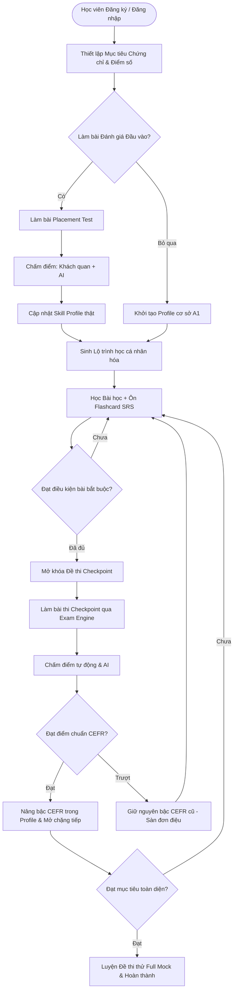

# APTISPREP — TÀI LIỆU NGHIỆP VỤ HỆ THỐNG

> **Dự án**: AptisPrep — Nền tảng Học, Luyện thi và Đánh giá năng lực tiếng Anh theo chuẩn Aptis (CEFR)  
> **Khung công nghệ**: Java 21, Spring Boot 3, Thymeleaf MVC, SQL Server, Google Gemini AI, Session Security & CSRF  
> **Phiên bản tài liệu**: 2.0 (Cập nhật tháng 11/2026 — Đồng bộ với cấu trúc nhánh `develop`)

---

## MỤC LỤC
1. [TỔNG QUAN HỆ THỐNG VÀ CÁC VAI TRÒ](#1-tổng-quan-hệ-thống-và-các-vai-trò)
2. [PHÂN CÔNG TRÁCH NHIỆM 3 THÀNH VIÊN (RACI MATRIX)](#2-phân-công-trách-nhiệm-3-thành-viên-raci-matrix)
3. [7 LUỒNG NGHIỆP VỤ CHI TIẾT ĐẦU-CUỐI](#3-7-luồng-nghiệp-vụ-chi-tiết-đầu-cuối)
   - [Luồng 1: Xác thực, Hồ sơ, Bảo mật & Mục tiêu học tập](#luồng-1-xác-thực-hồ-sơ-bảo-mật--mục-tiêu-học-tập)
   - [Luồng 2: Đánh giá đầu vào (Placement) & Khởi tạo lộ trình](#luồng-2-đánh-giá-đầu-vào-placement--khởi-tạo-lộ-trình)
   - [Luồng 3: Quá trình Học tập, Thực hành & Ôn tập từ vựng](#luồng-3-quá-trình-học-tập-thực-hành--ôn-tập-từ-vựng)
   - [Luồng 4: Thi kiểm tra chặng (Checkpoint) & Thăng cấp năng lực](#luồng-4-thi-kiểm-tra-chặng-checkpoint--thăng-cấp-năng-lực)
   - [Luồng 5: Ngân hàng Đề thi & Phòng thi trực tuyến (Exam Engine)](#luồng-5-ngân-hàng-đề-thi--phòng-thi-trực-tuyến-exam-engine)
   - [Luồng 6: Hệ thống Chấm điểm, AI Assessment & Quy đổi CEFR](#luồng-6-hệ-thống-chấm-điểm-ai-assessment--quy-đổi-cefr)
   - [Luồng 7: Quản trị hệ thống, Học viên & Cấu hình Đề thi/Thang điểm](#luồng-7-quản-trị-hệ-thống-học-viên--cấu-hình-đề-thithang-điểm)
4. [QUY TẮC NGHIỆP VỤ BẤT DI BẤT DỊCH (BUSINESS INVARIANTS)](#4-quy-tắc-nghiệp-vụ-bất-di-bất-dịch-business-invariants)
5. [CẤU TRÚC DỮ LIỆU VÀ CHUYỂN ĐỔI ENTITY ↔ DTO](#5-cấu-trúc-dữ-liệu-và-chuyển-đổi-entity--dto)

---

## 1. TỔNG QUAN HỆ THỐNG VÀ CÁC VAI TRÒ

### 1.1 Mục tiêu hệ thống
AptisPrep là nền tảng trực tuyến phục vụ người học ôn luyện chứng chỉ tiếng Anh Aptis (Aptis General, Aptis Advanced) theo khung tham chiếu Châu Âu (CEFR từ A1 đến C). Hệ thống cung cấp lộ trình học cá nhân hóa theo từng kỹ năng:
*   **4 Kỹ năng giao tiếp**: Listening (Nghe), Reading (Đọc), Writing (Viết), Speaking (Nói).
*   **1 Hợp phần nền tảng bắt buộc**: Grammar & Vocabulary (Ngữ pháp và Từ vựng).

Hệ thống bảo đảm **tiến độ học thật, kết quả chấm thật, bằng chứng cập nhật trình độ bền vững** và tích hợp AI đánh giá bài thi tự luận khách quan.

### 1.2 Các vai trò người dùng (Actors & Personas)

| Vai trò | Quyền hạn và Phạm vi hoạt động |
|---|---|
| **Khách (Guest / Anonymous)** | Xem trang chủ giới thiệu, xem cấu trúc bài thi Aptis, đăng ký tài khoản học viên, đăng nhập hệ thống. |
| **Học viên (Student)** | Thiết lập mục tiêu điểm số; làm bài kiểm tra đầu vào (Placement Test); học bài lý thuyết, làm bài tập tương tác; ôn thẻ từ vựng Flashcard (SRS); thi chặng (Checkpoint Test); làm đề thi thử (Practice, Full Mock); xem lịch sử kết quả, bảng phân tích năng lực CEFR và chi tiết bài thi/phản hồi AI. |
| **Quản trị viên (Admin)** | Quản lý học viên (tìm kiếm, xem chi tiết tiến độ, khóa/mở khóa tài khoản); quản trị bài học và bộ flashcard; quản trị ngân hàng câu hỏi, media (audio/image) và đề thi; cấu hình danh mục chứng chỉ, bộ chấm điểm (Scoring Scheme), dải quy đổi CEFR (Score Bands) và quy tắc Raw $\rightarrow$ Scale; xem kết quả và kích hoạt chấm lại AI khi cần. |
| **Hệ thống Chấm tự động & AI Engine** | Tự động chấm bài trắc nghiệm khách quan; điều phối job chấm tự luận qua Google Gemini API; quy đổi điểm Raw $\rightarrow$ Scale (thang 0–50) $\rightarrow$ CEFR; cập nhật hồ sơ năng lực (`user_skill_profiles`). |

---

## 2. PHÂN CÔNG TRÁCH NHIỆM 3 THÀNH VIÊN (RACI MATRIX)

Dự án được phân chia thành 3 mảng nghiệp vụ khép kín từ Controller $\rightarrow$ Service $\rightarrow$ Repository $\rightarrow$ Template Thymeleaf $\rightarrow$ Unit/Integration Test:

```text
┌────────────────────────────────────────────────────────────────────────┐
│                          APTISPREP CORE SYSTEM                         │
├─────────────────────┬──────────────────────────┬───────────────────────┤
│    NGƯỜI 1 (THÔNG)  │      NGƯỜI 2 (THẢO)      │     NGƯỜI 3 (TRÂM)    │
│  Tài khoản, Chấm điểm│     Nội dung giáo trình  │   Ngân hàng câu hỏi,  │
│   AI & Skill Profile│    Lộ trình & Checkpoint │   Media & Engine thi  │
└─────────────────────┴──────────────────────────┴───────────────────────┘
```

| Hạng mục nghiệp vụ | Người 1 (Thông) | Người 2 (Thảo) | Người 3 (Trâm) |
|---|:---:|:---:|:---:|
| Đăng ký, Đăng nhập, Session, Active Filter, Đổi mật khẩu | **Chủ trì (R/A)** | Tham gia (I) | Tham gia (I) |
| Mục tiêu học tập (Goal) & Cập nhật Hồ sơ cá nhân (Profile) | **Chủ trì (R/A)** | Nhận event (C) | Tham chiếu (I) |
| Quản lý học viên phía Admin (Khóa / Mở khóa tài khoản) | **Chủ trì (R/A)** | Tham khảo (I) | Tham khảo (I) |
| Cấu hình Chứng chỉ (Certificates) & Thang điểm (Scoring Schemes, Bands) | **Chủ trì (R/A)** | Tham chiếu (I) | Sử dụng khi tạo đề (C) |
| Chấm điểm khách quan (Objective Grading: Trắc nghiệm/Matching/Ordering) | **Chủ trì (R/A)** | Tham chiếu (I) | Cung cấp bài nộp (C) |
| Chấm tự luận bằng AI (Gemini Writing & Speaking Audio Transcription) | **Chủ trì (R/A)** | Tham chiếu (I) | Cung cấp bài nộp (C) |
| Quy đổi điểm Raw $\rightarrow$ Scale (0–50) $\rightarrow$ CEFR Band & Tổng hợp điểm | **Chủ trì (R/A)** | Tham chiếu (I) | Hiển thị kết quả (I) |
| Quản lý & Cập nhật Hồ sơ Năng lực học viên (`user_skill_profiles`) | **Chủ trì (R/A)** | Nhận kết quả chặng (C)| Nhận kết quả đầu vào (C)|
| Quản trị Bài học (Lessons: Lý thuyết, Audio/Video, Knowledge Check) | Tham chiếu (I) | **Chủ trì (R/A)** | Tham chiếu (I) |
| Quản trị & Ôn tập Thẻ từ vựng (Flashcard SRS cá nhân & gắn bài học) | Tham chiếu (I) | **Chủ trì (R/A)** | Tham chiếu (I) |
| Thuật toán sinh Lộ trình học (Learning Path) & Theo dõi Tiến độ (C/N) | Tham chiếu (I) | **Chủ trì (R/A)** | Tham chiếu (I) |
| Điều kiện mở bài thi Chặng (Checkpoint Gating) & Mở chặng tiếp theo | Tham chiếu (I) | **Chủ trì (R/A)** | Gọi engine thi (C) |
| Quản trị Ngân hàng Câu hỏi (Questions, Items, Options) | Tham chiếu (I) | Tham chiếu (I) | **Chủ trì (R/A)** |
| Quản lý Media bài thi an toàn (Audio Streaming, Token, Chống tua) | Tham chiếu (I) | Dùng helper (C) | **Chủ trì (R/A)** |
| Quản trị Đề thi 4 loại (Placement, Practice, Checkpoint, Full Mock) | Nhận scheme (C) | Chọn đề chặng (C) | **Chủ trì (R/A)** |
| Engine Phòng thi trực tuyến (Timer, Autosave, Next Section, Nộp bài) | Nhận attempt (C)| Tham chiếu (I) | **Chủ trì (R/A)** |
| Luồng thi Đánh giá đầu vào khép kín (Placement Test End-to-End) | Cập nhật Profile| Kích hoạt Path | **Chủ trì điều phối** |

*(Ghi chú: **R** = Responsible/Thực hiện chính; **A** = Accountable/Chịu trách nhiệm cuối; **C** = Consulted/Phối hợp gọi hàm; **I** = Informed/Nhận thông tin/Hiển thị)*

---

## 3. 7 LUỒNG NGHIỆP VỤ CHI TIẾT ĐẦU-CUỐI



---

### Luồng 1: Xác thực, Hồ sơ, Bảo mật & Mục tiêu học tập
*   **Người phụ trách chính**: Thông (Người 1)
*   **Màn hình liên quan**:
    *   `/login`, `/register`, `/student/password`
    *   `/student/profile` (Hồ sơ học viên)
    *   `/student/goals` (Mục tiêu học tập)
    *   `/admin/students`, `/admin/students/{id}` (Quản lý học viên Admin)

#### Các bước xử lý chi tiết:
1.  **Đăng ký & Đăng nhập**:
    *   Học viên đăng ký tài khoản với Họ tên, Email, Mật khẩu. Hệ thống kiểm tra trùng email không phân biệt hoa thường (`DuplicateEmailException`). Mật khẩu được mã hóa an toàn bằng BCrypt.
    *   Đăng nhập kiểm tra trạng thái tài khoản: Nếu `ACTIVE` $\rightarrow$ tạo `LoginSession`; nếu `LOCKED` $\rightarrow$ chặn và thông báo lý do khóa do Admin nhập; nếu không hợp lệ $\rightarrow$ báo lỗi.
2.  **Bảo vệ phiên đăng nhập (`ActiveAccountFilter`)**:
    *   Mỗi request gửi lên máy chủ đều được `ActiveAccountFilter` kiểm tra trạng thái thời gian thực trong cơ sở dữ liệu.
    *   Nếu Admin vừa bấm Khóa tài khoản, ngay ở request tiếp theo của học viên, session lập tức bị hủy bỏ và điều hướng về trang thông báo khóa, không chờ session hết hạn.
3.  **Thiết lập Mục tiêu học tập (Goals)**:
    *   Học viên chọn Chứng chỉ mục tiêu (ví dụ: Aptis General) và Ngày dự thi dự kiến.
    *   Học viên chọn mức CEFR mục tiêu riêng cho từng kỹ năng: Nghe, Nói, Đọc, Viết, Ngữ pháp/Từ vựng (cho phép mục tiêu từ A1 đến C1).
    *   Sau khi lưu mục tiêu thành công, hệ thống phát sự kiện `GoalChangedEvent` qua Spring ApplicationEventPublisher để kích hoạt Người 2 cập nhật lại Lộ trình học (Learning Path).
4.  **Bảng Đối chiếu Năng lực tại Hồ sơ (`/student/profile`)**:
    *   Hiển thị trực quan song song hai cột: **Trình độ thực tế hiện tại** (lấy từ `user_skill_profiles`) đối chiếu với **Trình độ mục tiêu** (lấy từ `user_goals`).
    *   Trường hợp học viên mới chưa thi Placement, hệ thống hiển thị Empty State hướng dẫn làm bài kiểm tra đầu vào.

---

### Luồng 2: Đánh giá đầu vào (Placement) & Khởi tạo lộ trình
*   **Người phối hợp**: Trâm (Engine thi) $\rightarrow$ Thông (Chấm điểm & Ghi Profile) $\rightarrow$ Thảo (Sinh Lộ trình)
*   **Màn hình liên quan**:
    *   `/student/placement` (Màn hình giới thiệu & chọn đề đầu vào)
    *   `/student/placement/result` (Kết quả thi đầu vào)

#### Các bước xử lý chi tiết:
1.  **Lựa chọn làm hoặc bỏ qua**:
    *   Học viên có thể chọn làm bài thi đầu vào để xác định trình độ chuẩn xác, hoặc chọn **Bỏ qua** để bắt đầu lộ trình định hướng xuất phát từ trình độ cơ bản (A1).
2.  **Khởi tạo đề thi đầu vào**:
    *   Học viên chọn kỹ năng cần kiểm tra. Hệ thống chọn một đề `PLACEMENT` hợp lệ và đã công bố (`PUBLISHED`).
    *   Kiểm tra chính sách thi lại (`PLACEMENT_RETAKE_POLICY`): Mỗi kỹ năng chỉ được có tối đa 1 lượt thi đang làm dở (`IN_PROGRESS`); nếu đang có bài nộp chờ chấm thì phải đợi chấm xong mới được làm lượt mới.
3.  **Làm bài qua Exam Engine**:
    *   Thực hiện làm bài thi qua engine chung (giới hạn thời gian, lưu đáp án, nộp bài).
4.  **Chấm điểm & Cập nhật Hồ sơ Năng lực**:
    *   Sau khi nộp, hệ thống chấm điểm khách quan và gọi AI chấm tự luận.
    *   Khi có điểm tổng hợp, `AccountProfileService` ghi nhận kết quả vào bảng `user_skill_profiles` và đánh dấu `user_profile_applications` (đảm bảo mỗi lượt thi chỉ cập nhật năng lực đúng 1 lần, chống tính trùng).
5.  **Kích hoạt Lộ trình học**:
    *   Hệ thống gọi `LearningPathService` để tự động tạo các chặng học (Stage) tương ứng với khoảng cách từ CEFR đầu vào đến CEFR mục tiêu.

---

### Luồng 3: Quá trình Học tập, Thực hành & Ôn tập từ vựng
*   **Người phụ trách chính**: Thảo (Người 2)
*   **Màn hình liên quan**:
    *   `/student/lessons` (Thư viện bài học)
    *   `/student/lessons/{id}` (Chi tiết học bài & làm bài tập kiểm tra)
    *   `/student/flashcards` (Danh sách bộ Flashcard)
    *   `/student/flashcards/{id}` (Màn hình ôn tập thẻ từ vựng)

#### Các bước xử lý chi tiết:
1.  **Học lý thuyết và bảo vệ Media**:
    *   Bài học được tổ chức theo kỹ năng và cấp độ CEFR (A1, A2, B1, B2, C1).
    *   Tài nguyên Audio/Video được truyền phát (stream) qua URL bảo mật (`/student/lessons/{id}/audio`), kiểm tra quyền học viên, chống tải lậu hoặc truy cập trực tiếp file vật lý.
    *   Trình nghe nhạc kiểm soát heartbeat nghe; học viên phải nghe đủ thời lượng quy định mới mở khóa phần câu hỏi thực hành.
2.  **Làm bài tập kiểm tra (Knowledge Check & Practice)**:
    *   Học viên trả lời các câu hỏi kiểm tra sau bài học (trắc nghiệm, điền từ, bài viết ngắn).
    *   Hệ thống lưu lịch sử bài nộp (`lesson_work_submissions`), tự động chấm và lưu kết quả (`lesson_progress`).
3.  **Ôn tập từ vựng thông minh (Spaced Repetition System - SRS)**:
    *   Học viên có thể ôn bộ thẻ gắn liền với bài học hoặc tự tạo bộ Flashcard cá nhân.
    *   Trong màn hình ôn thẻ (`flashcards/study.html`), khi lật thẻ, học viên đánh dấu: *Chưa thuộc (Again)*, *Khó (Hard)*, *Tốt (Good)*, hoặc *Dễ (Easy)*.
    *   Thuật toán SRS tính toán thời điểm ôn tập tiếp theo (`next_review_at`). Thao tác refresh trang không làm tăng số lần ôn trùng lặp.
4.  **Tính toán Tiến độ Thực tế (Real Progress Contract)**:
    *   Tiến độ học tập của một chặng được tính theo công thức tỷ lệ chuẩn: $\text{Progress} = \frac{C}{N} \times 100\%$
        *   $C$: Số bài học bắt buộc đã hoàn thành thực tế.
        *   $N$: Tổng số bài học bắt buộc được quy định trong chặng.
    *   Nếu chặng chưa có bài học ($N = 0$), hệ thống trả về `NULL` thay vì chia cho 0.

---

### Luồng 4: Thi kiểm tra chặng (Checkpoint) & Thăng cấp năng lực
*   **Người phối hợp**: Thảo (Kiểm tra điều kiện) $\rightarrow$ Trâm (Phòng thi) $\rightarrow$ Thông (Chấm & Thăng hạng Profile)
*   **Màn hình liên quan**:
    *   `/student/learning-path` (Lộ trình học)
    *   `/student/learning-path/{pathId}/checkpoint/start` (Bắt đầu thi chặng)
    *   `/student/attempts/{id}/result` (Kết quả thi chặng)

#### Các bước xử lý chi tiết:
1.  **Kiểm tra điều kiện mở Checkpoint (Gating Condition)**:
    *   Học viên không thể bấm thi Checkpoint tùy tiện.
    *   Khi bấm bắt đầu chặng, hệ thống kiểm tra: Toàn bộ bài học bắt buộc (`required = true`) trong chặng hiện tại đã có trạng thái `COMPLETED` trong `lesson_progress` hay chưa.
    *   Nếu chưa đủ điều kiện $\rightarrow$ chặn và thông báo danh sách bài học cần hoàn thành.
2.  **Khởi tạo đề Checkpoint**:
    *   Hệ thống tìm đề thi loại `CHECKPOINT` gắn đúng với Kỹ năng, Chứng chỉ và Cấp độ CEFR của chặng hiện tại.
    *   Chuyển học viên vào Engine phòng thi.
3.  **Chấm điểm & Quy đổi chuẩn CEFR**:
    *   Bài thi được chấm khách quan và tự luận AI.
    *   Điểm tổng hợp được đối chiếu với dải điểm CEFR quy định trong bộ chấm điểm (`ScoringScheme`).
4.  **Quy tắc cập nhật Năng lực (Sàn đơn điệu - Monotonic Floor)**:
    *   **Trường hợp ĐẠT (Passed)**: Điểm số $\ge$ ngưỡng yêu cầu của chặng $\rightarrow$ Trình độ kỹ năng trong `user_skill_profiles` được nâng lên cấp độ mới $\rightarrow$ Chặng hiện tại đóng lại (`COMPLETED`) và Chặng tiếp theo được mở khóa (`IN_PROGRESS`).
    *   **Trường hợp TRƯỢT (Failed)**: Điểm số $<$ ngưỡng yêu cầu $\rightarrow$ **Giữ nguyên trình độ hiện tại**, tuyệt đối không bị tụt hạng CEFR $\rightarrow$ Chặng vẫn mở để học viên ôn tập lại và thi lại lần sau.
    *   *Lưu ý*: Việc học xong tất cả bài học trong chặng không tự động tăng CEFR nếu chưa thi đạt bài Checkpoint.

---

### Luồng 5: Ngân hàng Đề thi & Phòng thi trực tuyến (Exam Engine)
*   **Người phụ trách chính**: Trâm (Người 3)
*   **Màn hình liên quan**:
    *   `/student/exams` (Thư viện đề thi)
    *   `/student/exams/{id}` (Chi tiết đề & thang điểm)
    *   `/student/attempts/{id}` (Giao diện phòng thi trực tuyến)
    *   `/student/attempts/{id}/review` (Xem lại bài làm và đáp án)

#### Các bước xử lý chi tiết:
1.  **Cấu trúc 4 loại đề thi**:
    *   `PLACEMENT`: Đề kiểm tra đầu vào (thường là đề rút gọn để xác định trình độ ban đầu).
    *   `PRACTICE`: Đề luyện tập theo từng kỹ năng đơn lẻ.
    *   `CHECKPOINT`: Đề thi kết thúc chặng học tập.
    *   `FULL_MOCK`: Đề thi thử hoàn chỉnh chuẩn Aptis (bao gồm đủ các phần thi Ngữ pháp/Từ vựng, Đọc, Nghe, Viết, Nói diễn ra liên tục).
2.  **Khởi tạo lượt thi & Đóng băng nội dung (Exam Snapshot)**:
    *   Khi học viên bấm bắt đầu thi, hệ thống tạo bản ghi `exam_attempts` và sao chép toàn bộ nội dung câu hỏi, thứ tự, đáp án vào các bảng snapshot (`exam_question_snapshots`, `exam_item_snapshots`, `exam_option_snapshots`).
    *   *Mục đích*: Nếu sau này Quản trị viên có chỉnh sửa nội dung câu hỏi gốc trong ngân hàng đề, toàn bộ lịch sử và điểm số của lượt thi này vẫn được giữ nguyên vẹn 100%.
3.  **Bộ đếm thời gian (Timer & Deadline Enforcement)**:
    *   Thời gian làm bài được tính toán trên máy chủ: `deadline = startedAt + durationSeconds`.
    *   Giao diện đếm ngược theo giây. Khi hết giờ, hệ thống tự động khóa bài thi và kích hoạt nộp bài tự động (`force submit`).
4.  **Cơ chế Tự động lưu đáp án (Autosave)**:
    *   Mỗi khi học viên chọn phương án trắc nghiệm hoặc nhập văn bản Viết, script `exam-runner.js` gửi request ngầm (`POST /answers/autosave`) kèm CSRF token để lưu câu trả lời vào database.
    *   Nếu mất mạng hoặc trình duyệt bị tắt đột ngột, khi vào lại, học viên được tiếp tục làm bài thi (Resume) với đầy đủ đáp án đã chọn trước đó.
5.  **Bảo vệ phần thi Nghe (Listening Protection)**:
    *   File audio được bảo vệ qua endpoint kiểm soát lượt nghe.
    *   Mỗi câu hỏi Nghe quy định tối đa **2 lượt nghe** (`max_play_count = 2`).
    *   Trình nghe nhạc không cho phép tua (seekable = false). Trình duyệt lưu token lượt nghe; refresh trang không giúp học viên được nghe lại quá 2 lần quy định.
6.  **Phần thi Nói (Speaking Recording)**:
    *   Học viên cấp quyền microphone và thực hiện ghi âm trực tiếp trên trình duyệt.
    *   File ghi âm được tải lên máy chủ qua endpoint an toàn (`AudioUploadService`), kiểm tra định dạng âm thanh (audio/webm, audio/wav, audio/mpeg) và dung lượng tối đa 24MB.
7.  **Nộp bài & Khóa lượt thi (Submit & Lock)**:
    *   Học viên xác nhận nộp bài. Trạng thái lượt thi chuyển từ `IN_PROGRESS` sang `SUBMITTED`.
    *   Khóa toàn bộ quyền chỉnh sửa đáp án và phát sự kiện `AttemptSubmittedEvent` để chuyển sang quy trình chấm điểm.

---

### Luồng 6: Hệ thống Chấm điểm, AI Assessment & Quy đổi CEFR
*   **Người phụ trách chính**: Thông (Người 1)
*   **Màn hình liên quan**:
    *   `/student/results` (Danh sách kết quả học tập)
    *   `/student/attempts/{id}/result` (Bảng điểm chi tiết một bài thi)
    *   `/student/assessments/{key}` (Chi tiết tác vụ chấm AI)
    *   `/admin/result/list`, `/admin/result/detail` (Kết quả phía Admin)

#### Các bước xử lý chi tiết:



```mermaid
flowchart LR
    Submit[Bài thi đã nộp & Khóa] --> Split{Phân loại kỹ năng}
    
    Split --> Objective[Reading / Listening / Grammar]
    Split --> Subjective[Writing / Speaking]
    
    Objective --> ObjGrading[ObjectiveGradingService]
    ObjGrading --> RawScore[Tính Raw Score]
    
    Subjective --> AiJob[AiAssessmentService: Tạo Job]
    AiJob --> GeminiAPI[Gọi Google Gemini AI]
    GeminiAPI --> AiResult[Sinh Điểm & Feedback chi tiết]
    
    RawScore --> ScalePolicy[ScoringPolicyService: Raw -> Scale 0-50]
    AiResult --> ScalePolicy
    
    ScalePolicy --> BandPolicy[Đối chiếu ScoreBand: Gán CEFR A1-C]
    BandPolicy --> Finalize[AttemptFinalizationService]
    Finalize --> SaveResults[Lưu EXAM_SKILL_RESULTS & Tính Overall]
    SaveResults --> ProfileUpdate[Cập nhật Skill Profile nếu là Placement/Checkpoint]
```

1.  **Chấm điểm khách quan (`ObjectiveGradingService`)**:
    *   Tự động so khớp câu trả lời của học viên với đáp án đúng đã lưu trong snapshot:
        *   *Single Choice*: Đúng được điểm trọn vẹn của item.
        *   *Matching*: Ghép cặp chính xác từng vế tương ứng.
        *   *Ordering*: Sắp xếp đúng thứ tự logic của các câu/đoạn văn.
    *   Tính tổng điểm thô (`Raw Score`) của từng kỹ năng.
2.  **Chấm điểm tự luận bằng Google Gemini AI (`GeminiGradingService`)**:
    *   **Phần thi Viết (Writing)**:
        *   Payload gửi sang Gemini gồm: Đề bài, Tiêu chí chấm (Rubric v1), Độ dài yêu cầu, Bài làm của học viên.
        *   Gemini trả về JSON có cấu trúc chặt chẽ (JSON Schema) gồm: Điểm thành phần (Task Fulfillment, Cohesion, Grammar, Vocabulary), Tổng điểm và Nhận xét chi tiết (Feedback).
    *   **Phần thi Nói (Speaking)**:
        *   File âm thanh của học viên được trích xuất và chuyển hóa thành văn bản (Transcription) thông qua pipeline nhận dạng giọng nói.
        *   Đoạn transcript sau đó được gửi sang Gemini để đánh giá theo rubric phát âm, ngữ pháp và độ lưu loát.
    *   **Quản lý Job và Retry**:
        *   Tác vụ chấm AI được lưu trong bảng `ai_assessment_jobs` và `ai_assessments` với khóa `assessment_key` duy nhất để đảm bảo tính Idempotency (không bao giờ chấm trùng lặp).
        *   Nếu API gặp sự cố timeout hoặc mạng chập chờn, điểm số tạm thời để `NULL`, trạng thái là `ERROR` hoặc `PENDING`.
        *   Cung cấp nút **Thử lại (Retry AI)** cho cả Học viên và Admin với CSRF token, chỉ thử lại đúng phần bị lỗi, không chấm lại toàn bộ bài thi.
3.  **Quy đổi Điểm chuẩn Aptis (Raw $\rightarrow$ Scale $\rightarrow$ CEFR)**:
    *   Điểm thô (Raw Score) được quy đổi sang Thang điểm chuẩn Aptis từ **0 đến 50** cho từng kỹ năng thông qua bảng quy tắc `scoring_scale_rules`.
    *   Sau đó, điểm thang (Scale Score 0–50) được đối chiếu với bảng dải điểm `score_bands` của bộ chấm tương ứng để xác định cấp độ **CEFR (A1, A2, B1, B2, C)**.
    *   Riêng kỹ năng Ngữ pháp & Từ vựng (Grammar & Vocabulary) không cấp band CEFR độc lập, mà đóng vai trò điều kiện chuẩn hỗ trợ phân bậc cho các kỹ năng còn lại.
4.  **Tổng hợp Kết quả & Áp dụng Profile**:
    *   Điểm toàn bài và điểm từng kỹ năng được ghi nhận vĩnh viễn vào bảng `exam_skill_results`.
    *   Nếu bài thi là `PLACEMENT` hoặc `CHECKPOINT`, hệ thống chuyển kết quả sang `AccountProfileService` để cập nhật hồ sơ năng lực học viên. Nếu bài thi là `PRACTICE` hoặc `FULL_MOCK`, kết quả chỉ lưu vào lịch sử để học viên xem lại, không thay đổi Skill Profile.

---

### Luồng 7: Quản trị hệ thống, Học viên & Cấu hình Đề thi/Thang điểm
*   **Người phụ trách chính**: Thông (Học viên & Thang điểm), Trâm (Câu hỏi & Đề thi), Thảo (Bài học & Flashcard)
*   **Màn hình liên quan**:
    *   `/admin/dashboard` (Tổng quan quản trị)
    *   `/admin/students`, `/admin/students/{id}` (Quản lý học viên)
    *   `/admin/certificates`, `/admin/scoring-schemes` (Quản lý chứng chỉ & bộ chấm)
    *   `/admin/questions`, `/admin/exams` (Quản lý ngân hàng câu hỏi & đề thi)
    *   `/admin/lessons`, `/admin/flashcards` (Quản lý nội dung bài học)

#### Các bước xử lý chi tiết:
1.  **Quản lý Học viên (Student Management)**:
    *   Admin xem danh sách toàn bộ học viên, tìm kiếm theo tên/email, lọc theo trạng thái (`ACTIVE`, `LOCKED`, `INACTIVE`).
    *   Xem chi tiết từng học viên: Ngày tham gia, Mục tiêu điểm số, Trình độ CEFR 5 kỹ năng hiện tại, Tỷ lệ hoàn thành bài học, Lịch sử các bài thi đã làm.
    *   Thực hiện hành động **Khóa tài khoản (`/lock`)**: Admin nhập lý do khóa bắt buộc; tài khoản chuyển sang trạng thái `LOCKED`.
    *   Thực hiện hành động **Mở khóa tài khoản (`/unlock`)**: Khôi phục trạng thái hoạt động bình thường cho học viên.
    *   *Ràng buộc*: Không cho phép xóa cứng tài khoản học viên để bảo toàn dữ liệu lịch sử bài làm và điểm số.
2.  **Quản lý Chứng chỉ & Thang điểm (Scoring Admin)**:
    *   CRUD Chứng chỉ: Đặt tên, mã chứng chỉ duy nhất (Code: `APTIS_GEN`, `APTIS_ADV`), mô tả.
    *   CRUD Bộ chấm điểm (`ScoringScheme`): Gắn với chứng chỉ, phạm vi áp dụng (tất cả kỹ năng hoặc một kỹ năng), phiên bản (Version: 1, 2,...).
    *   **Nguyên tắc bảo toàn Scheme**: Bộ chấm điểm đã từng được sử dụng để chấm ít nhất 1 bài thi thì **không được phép sửa trực tiếp**, mà phải nhân bản sang một Version mới để lưu vết lịch sử.
    *   Cấu hình Dải điểm (`ScoreBand`): Thiết lập mức điểm tối thiểu, tối đa và CEFR tương ứng. Thuật toán `ScoreBandCoverage` kiểm tra nghiêm ngặt: Điểm phải từ 0 đến 50, dải điểm liên tục không bị hở, không chồng lấn biên giữa các mức.
3.  **Quản trị Câu hỏi & Đề thi (Catalog Admin)**:
    *   Soạn thảo câu hỏi theo 5 dạng chuẩn: Single Choice, Matching, Ordering, Writing Text, Speaking Audio.
    *   Upload và quản lý Media đính kèm (kiểm tra MIME type thực, dung lượng, định dạng file).
    *   Tổ chức đề thi: Gom câu hỏi vào các section, kiểm tra tính hợp lệ trước khi bấm **Công bố (`Publish`)**. Đề thi chưa đủ câu hỏi hoặc thiếu file âm thanh bắt buộc sẽ bị chặn không cho xuất bản.

---

## 4. QUY TẮC NGHIỆP VỤ BẤT DI BẤT DỊCH (BUSINESS INVARIANTS)

Nhằm đảm bảo tính chính xác và toàn vẹn của hệ thống, toàn bộ mã nguồn phải tuân thủ nghiêm ngặt các quy tắc sau:

| Mã quy tắc | Tên quy tắc nghiệp vụ | Mô tả chi tiết |
|:---:|---|---|
| **BR-01** | **Bảo toàn dữ liệu lịch sử (No Hard Delete)** | Tuyệt đối không xóa cứng (`DELETE`) Học viên, Chứng chỉ, Bộ chấm điểm, Đề thi đã thi hoặc Bài làm. Tất cả sử dụng cờ trạng thái (`INACTIVE`, `ARCHIVED`, `LOCKED`). |
| **BR-02** | **Sàn đơn điệu Checkpoint (Monotonic Floor)** | Học viên trượt bài thi Checkpoint không bao giờ bị tụt bậc CEFR hiện có. Điểm năng lực trong `user_skill_profiles` chỉ tăng hoặc giữ nguyên. |
| **BR-03** | **Ranh giới cập nhật Profile** | Chỉ có bài thi **Placement Test** và **Checkpoint Test** mới có quyền cập nhật vào `user_skill_profiles`. Bài thi `PRACTICE` và `FULL_MOCK` chỉ lưu lịch sử kết quả, không làm đổi trình độ của học viên. |
| **BR-04** | **Chống áp dụng lặp (Claim Idempotency)** | Bảng `user_profile_applications` lưu vết từng `attempt_id` và `skill`. Mỗi kết quả thi chỉ được nâng trình độ hồ sơ đúng một lần duy nhất. |
| **BR-05** | **Đóng băng Đề thi (Exam Snapshot)** | Khi bắt đầu làm bài, toàn bộ nội dung câu hỏi và đáp án được snapshot lại. Sửa câu hỏi trong ngân hàng sau thời điểm thi không làm ảnh hưởng đến bài thi đang làm hoặc đã nộp. |
| **BR-06** | **Chống gian lận lượt nghe (Listening Limit)** | Audio bài thi Nghe chỉ được nghe tối đa 2 lần. Máy chủ cấp token theo lượt thi, không cho phép tua và không gửi link file tĩnh trực tiếp xuống trình duyệt. |
| **BR-07** | **Bảo mật kịch bản nghe (No Transcript Leak)** | Trong suốt quá trình làm bài thi, nội dung transcript của bài nghe không bao giờ được gửi xuống client dưới bất kỳ hình thức nào. |
| **BR-08** | **Gọi AI ngoài Transaction DB** | Tác vụ gọi Google Gemini API phải được thực hiện ngoài Database Transaction để tránh treo Connection Pool của cơ sở dữ liệu khi mạng chậm hoặc timeout. |
| **BR-09** | **Phân quyền và CSRF toàn diện** | Toàn bộ các form thay đổi dữ liệu (`POST`, `PUT`, `DELETE`) bắt buộc phải có CSRF Token hợp lệ. Học viên chỉ được xem và thao tác trên bài thi của chính mình (`Ownership Check`). |
| **BR-10** | **Quy tắc phiên bản Scoring Scheme** | Bộ chấm điểm đã có bài thi tham chiếu sẽ bị khóa sửa. Mọi thay đổi về thang điểm bắt buộc phải tạo Version mới; bài thi cũ vẫn chấm theo đúng version tại thời điểm thi. |

---

## 5. CẤU TRÚC DỮ LIỆU VÀ CHUYỂN ĐỔI ENTITY ↔ DTO

### 5.1 Kiến trúc DTO phân tách 2 chiều
Hệ thống tuân thủ mô hình kiến trúc MVC sạch:
*   **Chiều nhận dữ liệu (Input - Command/Form DTO)**: Nằm tại package `com.aptisprep.dto.form` và các DTO `*EntityDto.java`. Toàn bộ dữ liệu người dùng gửi lên được validate bằng Bean Validation (`@Valid`, `@NotBlank`, `@Size`,...) trước khi vào tầng Service.
*   **Chiều gửi dữ liệu ra giao diện (Output - View Model/DTO)**: Nằm tại package `com.aptisprep.dto.view` hoặc các Java `record` bất biến. Không bao giờ truyền trực tiếp JPA Entity ra ngoài Thymeleaf model để tránh rò rỉ dữ liệu nhạy cảm (như mật khẩu, token, khóa nội bộ) và tránh lỗi LazyInitializationException.

### 5.2 Cơ chế chuyển đổi (Mapping Mechanism)
Dự án sử dụng cơ chế chuyển đổi tường minh bằng phương thức tĩnh (`static factory methods`) và service mappers, mang lại hiệu năng cao và dễ dàng bảo trì:
*   `LessonDTO.fromEntity(Lesson lesson)`
*   `QuestionDTO.fromEntity(QuestionEntity question)`
*   `QuestionMediaDTO.fromEntity(QuestionMediaEntity media)`
*   `ScoringViews.CertificateView.fromEntity(Certificate value)`
*   `ScoringViews.SchemeView.fromEntity(ScoringScheme value, LocalDateTime effectiveFrom)`
*   `AccountProfileServiceImpl.toGoalView(UserGoal goal)` $\rightarrow$ `AccountSnapshot`
*   `CatalogServiceImpl.toEntry(MockExamEntity exam)` $\rightarrow$ `AdminCatalogView.Entry`

---
*Tài liệu được biên soạn phục vụ công tác đối chiếu nghiệp vụ, kiểm thử phần mềm, nghiệm thu đồ án chuyên ngành và hướng dẫn vận hành hệ thống AptisPrep.*

